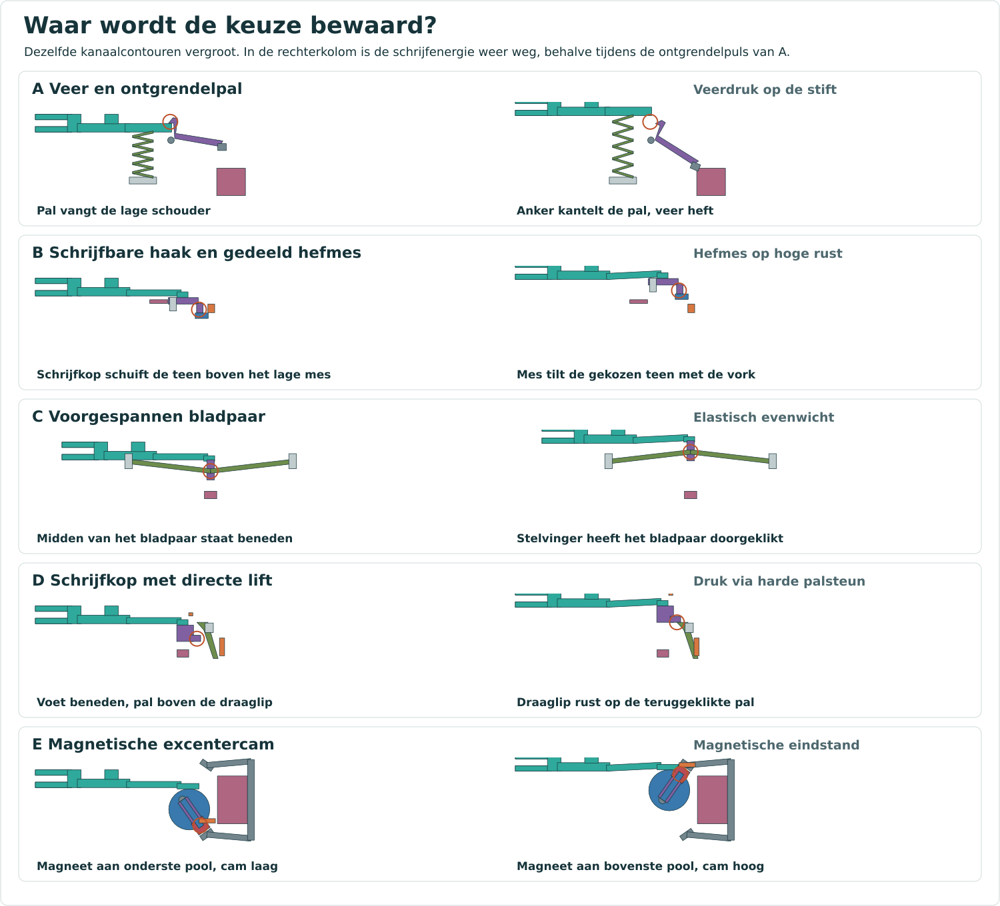
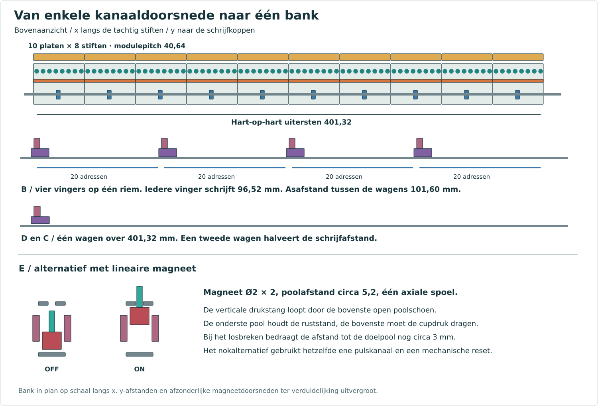
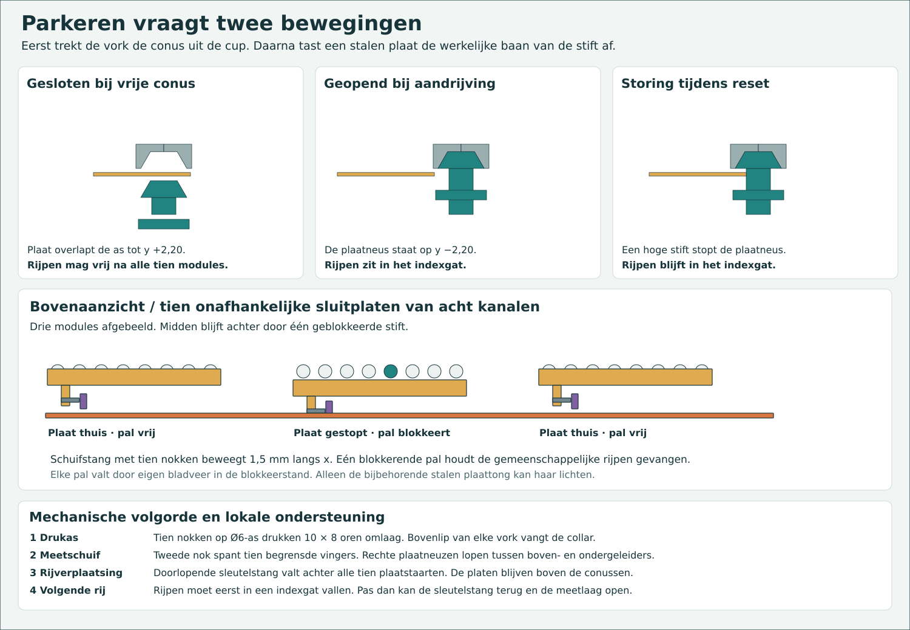
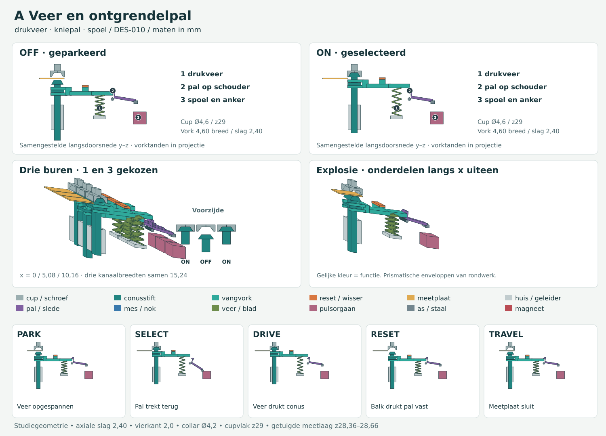
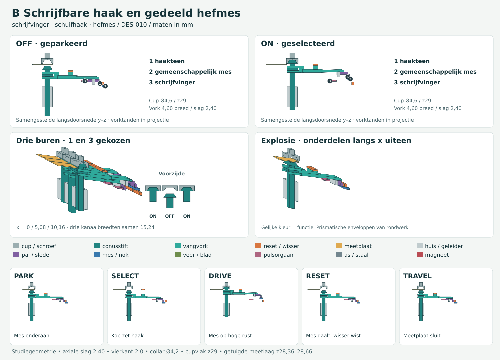
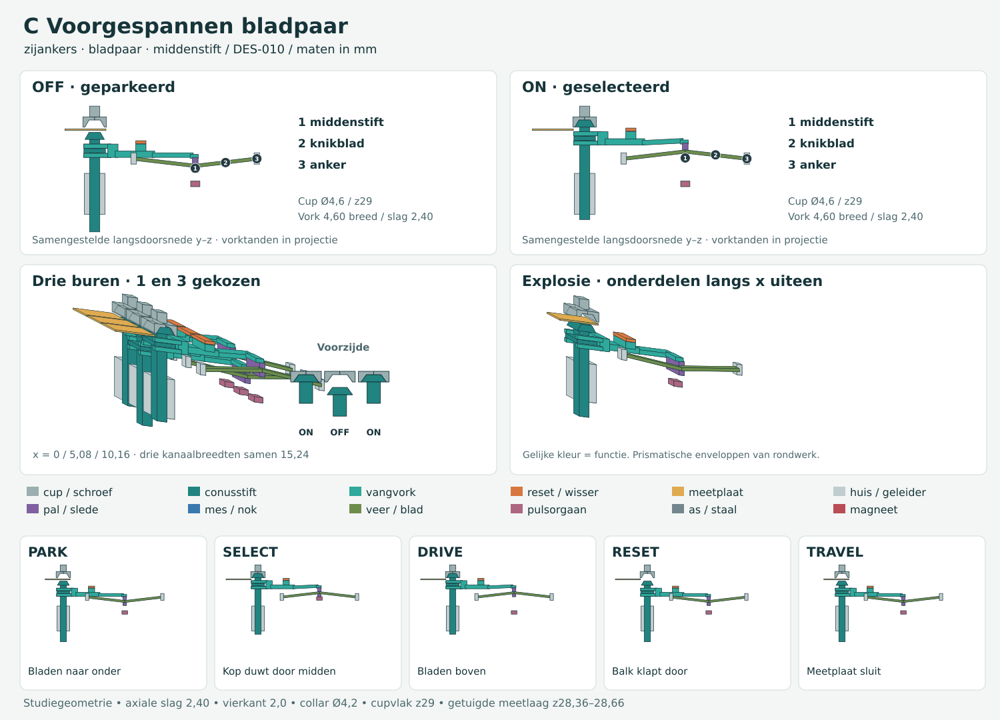
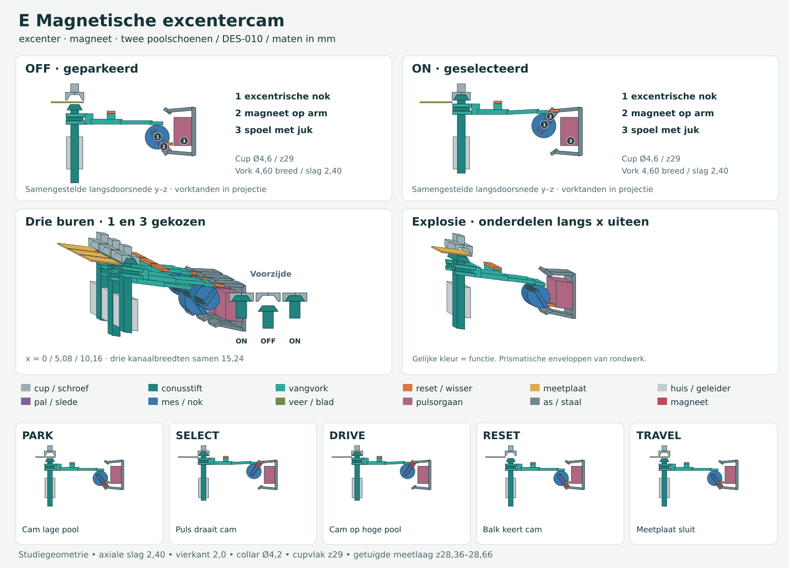

# Compacte koppelingselectie voor de verrijdbare bank

**Ontwerpstudie bij DES-010 · 24 november 2026 · keuze vóór een eerste proef**

**D is de eerste proef waard.** Eén verplaatsbare kop tilt een kanaal op. Een pal neemt de kracht over, waarna de kop verder kan. Dit schrapt 80 spoelen, 80 draadparen en elektrische houdstroom. **B is de tweede kandidaat** als een rij in enkele seconden geschreven moet worden. Daar stelt de kop alleen onbelaste haakjes in. Een gemeenschappelijk mes levert de kracht. De prijs daarvoor is een stijvere en zwaarder belaste dwarsas. **Geen van beide is over het hele ramingsbereik onder €60 aangetoond.**

| Keuze voor 80 | A · veer/pal | B · haak/mes | C · knikblad | D · liftkop/pal | E · magneetnok |
|---|---:|---:|---:|---:|---:|
| Selector incl. parkeren, materiaal per bank | €49–120 | €47–96 | €38–81 | €38–82 | €54–125 |
| Elektrische aandrijvingen incl. park, excl. bestaande aandrijfmotor | 81 | 6 | 3 | 3 | 81 |
| Losse kanaalstukken, excl. bestaande conusstift | 6¹ | 2 | 1 | 2 | 5² |
| Montage per bank, werkbankraming | 5–10 u | 1,5–3 u | 1–2 u | 1,3–2,5 u | 6–12 u |
| Volledig masker vanuit PARK, 80 aan, doelwaarden | 0,8–1,5 s | 5,5–6,5 s | 21–23 s | 21–23 s | 1–2 s indien puls slaagt |
| Elektrische energie masker incl. één reset, scenario | ~6 J | ~32 J | ~68 J | ~68 J | ~9 J indien puls slaagt |
| Belangrijkste herhaalde slijtage | Palrand, veergeleiding | Haakteen, lip, mes | Voorgespannen blad | Bovenpal en lip | Lager, magneetclip en nok |
| Ruimterisico op 5,08 mm | Spoel én anker | Haak loopt achter de stift | Geen diepte voor tweede dwarsveer nodig | Kop passeert langs achterzijde | Magnetische buren |
| Mechanische eenvoud | Kleine pal, veel afmontage | Meer gedeelde bewegingen | Eén print, moeilijke instelling | Eén schrijfkop, lokaal eenvoudig | Klein, veel materiaalovergangen |
| Parkeren | Veer blijvend tegen slot | Mes eerst omlaag | Knikdrempel overwinnen | Pal eerst vrijmaken | Magnetisch kantelpunt passeren |
| Verwachte betrouwbaarheid / grootste onzekerheid | Matig · vrijgavekracht | Kansrijk · ongelijke hoogten | Laag · houdkracht/kruip | Kansrijk · slijtage borgvlak | Laag · pulskoppel/overspraak |
| Keuze | Reserve, arbeid te hoog | **Proef 2** | Afvallen bij deze geometrie | **Proef 1** | Afvallen bij huidige last |

¹ Vork, veer, pal, anker, pool en gewikkelde bobbin. ² Vork, nok, magneet, juk en gewikkelde bobbin. Gedeelde kamstrips, elektronica en pennen staan in de materiaalstaat. Alle vijf gebruiken hetzelfde mechanische reisverbod. De energiewaarden tellen geen rijtransport, schroefmotor of rustverbruik van de controller. Tijd en prijs zijn scenario's, geen metingen.

**Bladeren:** [A · ontgrendelen](#a--veer-met-individuele-ontgrendeling) · [B · gezamenlijk heffen](#b--gedeeld-hefmes-met-schrijfbare-haak) · [C · bistabiele stift](#c--mechanisch-bistabiele-stift) · [D · bewegende kop](#d--bewegende-kop-met-lokale-borgpal) · [E · magnetische nok](#e--magnetisch-bistabiele-cam) · [kostenstaat](onderdelen.csv) · [twee kleine proeven](#twee-kleine-proeven).



## Wat het project al heeft laten zien

| Bewijsniveau | Wat er daadwerkelijk bekend is | Betekenis voor de keuze |
|---|---|---|
| Fysieke eigenaarwaarneming | E-295: enkele compacte draadparen liepen met de hand soepel. E-298: tegenoverstaande punten blokkeerden, selectoren bogen, een handaandrijving sleet. E-301: één microstepper bewoog één pin op en neer met aangepaste montage. Bij proef A verdween blokkering na verwijderen van supportresten. | Houd de bestaande draad, blijf uit de boring met support, test twee draairichtingen en een geblokkeerde buur. Er is geen gemeten selectorkracht. |
| Bestaande mechanismen | Een Jacquard-haak kan wel of niet door een mes worden meegenomen. Tetragon beschrijft één schuivende magneet die een rij mechanisch opgeslagen braillepunten schrijft. Een flipdot bewaart zijn stand na een puls. | In B lenen we de scheiding van kiezen en heffen, in D de reizende schrijver, in E de magneet met twee eindstanden. De last van een schroefkoppeling blijft afzonderlijk te bewijzen. |
| Historische berekening en CAD | E-303 geeft koppel- en kostenmodellen. E-304 geeft buig- en wrijvingsgevoeligheid van een gemeenschappelijke selector. E-305 berekent circa 30/50 mN bij 0,3/0,5 A en ca. 43,5 mN buurinteractie in één specifieke magneetgeometrie. De DES-010-camcoupon is breder dan één kanaal. | Geen van deze drie getallen is een krachtmeting aan deze bank. Het bestaande 2×2-resultatenformulier meldt geen fysieke bankproef. |
| Deze studie | Parametrische 2,5D-enveloppen, kracht- en tijdrekeningen, begrotingsintervallen. | Geen CAD-vrijgave, slicercontrole, vermoeiingsproef of veiligheidskwalificatie. |

[Projectmissie](../../../../01-project-description/shape-display-mission.md) · [prioriteiten](../../../../02-design-criteria/current-prototype-priorities.md) · [DES-010](../../DES-010-central-motor-selectable-cone-bank.md) · [waarnemingen uit E-298 en E-295](../../../../tools/curated-experiment-checks/E-304/evidence-and-selection.md) · [E-301](../../../../06-experiments/E-301-pico-w-motorcontroller.md) · [E-303](../../../../06-experiments/E-303-selectable-friction-clutch-feasibility.md) · [E-304](../../../../06-experiments/E-304-guided-full-length-row-column-clutch.md) · [E-305](../../../../06-experiments/E-305-permanent-magnet-reversible-clutch.md) · [2×2-resultaten](../../../../owner-print-tests/2026-11-15-central-cone-bank/results.md).

## Aansluiting, maatvoering en slag



x loopt langs de 80 kanalen, y langs de rijverplaatsing en z omhoog. Alle maten zijn mm. Het eerste kanaal ligt op x0, het laatste op x401,32. Tien uitneembare cassettes van acht hebben een modulepitch van 40,64 en samen een rasterbreedte van 406,40. Ze vervangen de lange handvorken en individuele M3-jacks. Aan de onderzijde van de resident schroef blijft de DES-010-cup op z29 staan. De schroef, flens, 3-mm-spoed, pinbreedte 4,50 en geleider 4,70 blijven het referentieprofiel. De vaste structuur draagt de pinlast.

De gemeenschappelijke riem draait de axiaal vaste rotor. De vierkante stift van 2,0 schuift in de nominale opening van 2,3 en neemt het koppel in beide richtingen mee. Twee zijtanden van de niet-meedraaiende U-vork omsluiten de Ø4,2 × 0,8 collar met 0,10 axiale speling per zijde. De bovenste tanden trekken hem bij reset positief uit de cup. Binnenopening 3,20 geeft de draaiende vierkante diagonaal van 2,83 ruimte. De tanden zijn 0,70 breed, de buitenbreedte 4,60. Hun nominale maximale radiale overlap met de collar is 0,50 per zijde. Controleer lokale contactdruk en uitslijten als de collar draait. Het armuiteinde steekt naar +y zodat de buurdraaias vrij blijft.

| Maat / ruimteclaim | A | B | C | D | E |
|---|---:|---:|---:|---:|---:|
| Lokale selector incl. geopende meetplaat, gereserveerde y-grenzen | −10,2…32 | −10,2…32 | −10,2…37 | −10,2…31 | −10,2…34 |
| Kanaalenvelop x, excl. gedeelde delen | 4,65 | 4,65 | 4,65 | 4,65 | 4,65 |
| Lokale bewegende stift + selectie in z, excl. vaste cup | 8,60…30,386 | idem | idem | idem | idem |
| Inbouwbudget hele reizende bank incl. eindstations, x × y × z | 446 × 110 × 76 | 460 × 126 × 76 | 460 × 126 × 76 | 460 × 126 × 76 | 446 × 110 × 76 |

De laatste regel reserveert ruimte voor de oude aandrijfmotor aan y−, een nokas naast de vorken en bij B/C/D de servohuizen achter y+34. Reken vanaf z−45 tot +31, exclusief vaste pinnen erboven. Een omkeerwiel en sledepositie tot voorbij het buitenste kanaal vallen in die eindreserve. **Dit is een inbouwbudget.** Het 80-kanaals dubbeldeks riemtraject, retour, bevestigingskoppen, kabelbocht en werkelijke servohuizen zijn nog niet als samenstel gepast. De referentie heeft slechts twee uitgangen. Vlak langs 80 collineaire trommels ontbreekt riemomwikkeling.

De conus heeft contactstralen 1,1 en 1,9, halve hoek 30° en hoogte 1,386. Vrije tipruimte onder de cup = terugtrekslag − 1,386. De meetplaat vraagt daarnaast 0,30 dikte en ruimte aan beide kanten.

| Terugtrekken | Netto lucht | Gevolg bij dezelfde cup |
|---|---:|---|
| 1,20 | −0,186 | Tip blijft in de cup. Rijverschuiving blokkeert. |
| 1,80 | 0,414 | Na 0,30 plaat blijft 0,114 voor beide spelingen samen. |
| 2,00 | 0,614 | Mogelijk met andere plaathoogte en gemeten foutbegroting. |
| 2,20 | 0,814 | Bij de getekende plaat resteert slechts 0,174 onder de plaat. |
| **2,40** | **1,014** | **0,374 onder en 0,340 boven de plaat. Eerste proefmaat.** |

Een alternatief voor korte slag is een ondiepe ringconus. Bij dezelfde 30° geeft r1,55…1,90 een hoogte van 0,606. Met 1,60 retractie blijft 0,994 lucht over. De benaderde contactoppervlakte daalt van 15,08 naar 7,59 mm² en de gemiddelde straal stijgt van 1,50 naar 1,725. De smalle contactband is gevoeliger voor laagtrappen, drukpieken en scheefstand. Ook de cup en de meetplaathoogte moeten mee veranderen. Bewaar deze variant als de gemeten schrijf- of resetarbeid de keuze verhindert. De vijf bladen gebruiken de originele 2,40.

## Eén mechanisch reisverbod voor alle vijf



1. **Rij vasthouden.** Een geveerde stalen indexpen grijpt in de vaste indexstrip. De aandrijving van de schroeven staat stil vóór reset. In SELECT en DRIVE houdt een hard nokvlak de pen gevangen.
2. **Positief neerhalen.** Tien lokaal geleide drukvoeten op één as raken de oren van acht vorken elk op y8…10. In PARK ligt de onderzijde van de voet op z25,75 tegenover het nominale oor op z25,70. De bovenlip van de vork vangt de draaiende collar. Het juiste verschil in slag voor voorspanning en vrijloop zit in de lokale krachtlip. De as eindigt op een vlakke nokrust met mechanische aanslag. De motor kan uit.
3. **De stiften zelf aftasten.** Per acht kanalen schuift een ononderbroken, vlakke staalplaat van 40,2 × 8 × 0,30 in y van neus −2,20 naar +2,20. Zij vult z28,36…28,66. Haar voorrand kruist alle acht assen. Bij een hoogstaande stift komt ze tegen conus of vierkant, ook als de vork afgebroken of de drukbalk doorgebogen is. Bij een hangende stift kan de aandrijfnok zijn slag afmaken via de eigen invoerveer. De betreffende **plaat** blijft achter.
4. **Tien lokale toestemmingen in serie.** De omgezette staart van elke plaat licht pas in de laatste 0,3 slag zijn eigen normaal blokkerende pal. Een tweede, langs x bewegende sleutelstang met tien aanslagnokken moet 1,5 kunnen verschuiven om de rijpen te kunnen lichten. Elke achtergebleven pal blokkeert één nok. Een afwezige plaat bedient haar pal evenmin. De sleutelstang valt achter de tien plaatstaarten en houdt ze vast zolang de rijpen uit het gat staat. Gedurende TRAVEL houden zowel drukvoeten als gesloten platen de kanalen beneden.
5. **Opnieuw in dezelfde of een nieuwe rij.** Alleen een volledig teruggevallen rijpen geeft de sleutelstang vrij. De platen kunnen dan openen. Voor een ander masker op dezelfde rij blijft de rijpen in zijn gat. Stop de motor, doorloop RESET tot PARK, wis lokaal geheugen en schrijf het nieuwe masker. Schrijf de hele combinatie opnieuw, ook als maar één bit verandert. Posities van de schroeven worden daarbij niet bewust aangedreven.

De rijpen en sleutelstang vormen een gevangen mechanische sleutel. Een sleufadapter op de bestaande rijbediening geeft de eerste 1,5 mm als verloren beweging aan de sleutelstang voordat de pen kan lichten. De schuine penbediening mag geen hefboom worden om een geblokkeerde sleutelstang door te drukken. Voor de eerste handproef kan dezelfde adapter met de hand worden bediend. De veiligheid veronderstelt intacte slotdelen en een mechanisch begrensde aandrijving. Een softwarebit of parkeereindschakelaar bewijst geen vrije tip.

**Rand bij een bijna geparkeerde stift.** De meetplaat laat de nominale laatste 0,374 mm vóór haar ondervlak toe. Dat is een ruimtelijke vrijgavegrens. Ook zo'n stift blijft onder een stalen plafond, minimaal 0,64 mm onder het nominale cupvlak. Precies op de onderste aanslag zitten kan deze plaat alleen niet aantonen. De drukvoeten bepalen de parkstand. Een losse afgebroken tip in de vaste cup, een afgebroken getuigenstaart die klem blijft staan of breuk van de rijpen valt buiten enkelvoudige vastloopdetectie.

**Stijfheid en foutbudget.** Plaat zonder schuine invoerneus, met steunlippen boven en onder om de 5,08 tussen de assen en aan beide moduleranden. Streef naar maximaal 0,10 verticale geleideruimte en 0,05 opbuigen bij begrensde invoerkracht, aanvankelijk 0,5 N per plaat. Bij een plaatselijke stripbreedte van 5 mm, dikte 0,30 en vrije lengte 2,2 voorspelt de eenvoudige stalen uitkraging bij 0,5 N circa 0,001 mm doorbuiging. Speling, kantelen van de hele plaat, bramen en FDM-steunvervorming domineren die uitkomst. Als foutscenario kosten 0,10 float, 0,10 montagehoogte, 0,08 balkvorm en 0,10 vuil samen 0,38 mm. Dat overschrijdt de kleinste nominale speling. **Ook 2,4 mm is dus geen aangetoonde veilige bedrijfsslag.** Meet lokaal langs de hele reisweg. Als de marge ontbreekt, eerst uitlijning of slag aanpassen.

**Uitval en vastlopen.** Als de stroom tijdens DRIVE of RESET wegvalt, kan een kanaal boven blijven. De gevangen rijpen verhindert vertrek. Bij uitval tijdens TRAVEL blijven de platen gevangen. Na terugkeer van spanning eerst rij vastzetten en volledig parkeren. Bij vastlopen aandrijving begrenzen en afschakelen, de vergrendelde rij als zodanig laten staan. Resetkracht op één scheeflopende of geklemde vork kan veel hoger worden dan de gemiddelde kanaalkracht. De eindstop of gemeten motorstroom is bruikbaar voor storingsmelding, nooit als reisvrijgave.

## Krachten en economische grens

Voor de oude 30°-conus volgt uit DES-010 bij benadering `T_nuttig = F × (3 μ_conus − 1,984 μ_keeper − k_zij)` in Nmm. Met μ_keeper 0,20 en k_zij 0,10 geeft μ_conus 0,25 ongeveer 0,253 Nmm/N. Bij μ_conus 0,30 wordt dit 0,403. Voor het historische rekenscenario 0,343 Nmm vergt dit **1,35 of 0,85 N**. Bij μ_conus 0,15 wordt de coëfficiënt negatief. Dan helpt harder drukken in dit model niet. Meet apart de lege bank, de conusslip, de schroefstart en de lostrekkracht na stilstand. De getekende veerdruk is geen motorspecificatie.

| Scenario per kanaal | Licht | Midden | Zwaar |
|---|---:|---:|---:|
| Aandruk F / losbreken U / geleidingswrijving G, N | 0,30 / 0,15 / 0,08 | 0,80 / 0,50 / 0,08 | 1,20 / 1,00 / 0,08 |
| Gemeenschappelijk neerhalen na ontlasten, 80(U+G), N | 18,4 | 46,4 | 86,4 |
| A conservatieve reset, 80(U+G+F+0,432), N | 77,0 | 145,0 | 217,0 |
| B hefmes, 80(F+G), N | 30,4 | 70,4 | 102,4 |
| D bovenpal vrijschuiven, 80(0,20F+0,04), N zijwaarts | 8,0 | 16,0 | 22,4 |

A telt losbreken en hoogste veerkracht conservatief tegelijk. B en D bereiken de algemene neerhaalkracht nadat respectievelijk het mes is gezakt of de pal is weggeschoven. Bij vier, veertig en tachtig gelijktijdig klemmende kanalen schaalt de term U met 4, 40 en 80. Een enkele harde blokkering heeft geen eindige kracht uit dit model. C en E voegen hun eigen omslagkracht toe, zie de conceptbladen.

Per acht kanalen grijpt een nok vlak bij een in het huis gelagerd steunpunt aan. Een excentriciteit van 1,4 mm en totaal rendement 0,65 geven voor 86/102/217 N een worst-case askoppel van circa 0,19/0,22/0,47 Nm. Een pers met 0,47 Nm klemkoppel moet onder beweging meer kunnen dan alleen dat catalogushoudkoppel. Voor een massieve Ø6 stalen as, G = 79 GPa, L = 406 mm en eindlast 0,22 Nm is de berekende verdraaiing circa 0,51° of 0,013 mm slag bij 1,4 mm straal. Een losse geprinte bus, passpeling en een vervormd oor kunnen groter zijn. De nok met 2,4–2,8 mm lift en vlakke hoge/lage rust maken elektrische houdstroom overbodig. De actuator moet op beide rustvlakken spanningsloos mogen worden gemaakt.

Voor B/D/E is de eerste krachtlip 8 lang × 3,6 breed × 0,90 dik. Bij een aangenomen E = 1,8 GPa geeft een ingeklemde ligger k ≈ 2,31 N/mm. Na het raken van de cup levert 0,4 extra slag ongeveer 0,92 N. Met ±0,15 hoogtefout wordt dat 0,58–1,27 N vóór speling. Bij 1,2 N is de wortelspanning ongeveer 20 MPa. De werkelijk gebogen lip en kruip moeten worden gemeten. Een dun gestanst vervangblad per acht vorken kan bij slechte duurproef een optie zijn, met extra inkoop en montage. C gebruikt een naar één kant verschoven lip van 3,0 breed om het zijanker te passeren (k circa 1,92 N/mm), in serie met haar onzekere knikveer.


## A · Veer met individuele ontgrendeling



Een stalen drukveer op y13,6 drukt de vork omhoog. Een pal vangt in OFF een schouder van de vork. De hartlijn van de contactkracht valt nagenoeg door het palasgat. Een spoel trekt het aangehangen stalen anker kort naar beneden, de palneus draait opzij, de vork stijgt langs de neus. De eigen retourlip laat de pal weer sluiten zodra de schouder voorbij is. De afgeschuinde bovenzijde wijkt bij de volgende neergaande slag. Eén rechte scharnierdraad gaat door de acht pallen van een cassette.

- **Geometrie.** Veer OD circa 3,0–3,2, draaddikte 0,25, gemiddelde diameter 2,7, tien actieve windingen. Bij G = 79 GPa geeft dit circa 0,20 N/mm. Voor de tabellen is 0,18 genomen. Zitting tot vorkbodem groeit van 6,6 naar 9,0. Bij 0,8 N ON vraagt dat een vrije lengte rond 13,4. Een geleidepen in de veer voorkomt uitbuigen. Circa 0,45 neusoverlap, een hoekslag rond 22° en 6,8–7,2 ankerarm. Bij deze grote hoek beweegt het draaduiteinde enkele millimeters. De open luchtspleet bij de start is de zwakke plek.
- **Vrijgavekracht.** Met afwijking e = 0,15 van de lastlijn, glijwrijving μ = 0,20, arm tot neus 2,6 en ankerarm 7 is `F_anker ≈ F_OFF × (e + μ × 2,6)/7 + 0,03`. Bij F_OFF = 0,73–1,63 volgt 0,10–0,19 N. Bij μ = 0,35 en e = 0,4 stijgt de zware hoek naar 0,34 N. Een hogere pal met een lastlijn buiten het draaipunt verliest dit voordeel snel. Een mechanische schrijver kan dezelfde staart drukken, maar brengt de scansnelheid van D terug.
- **Spoel en selectie.** Eén vaste, maximaal 4,2 brede spoel met stalen pool en scharnierend anker per kanaal. Beperk bijvoorbeeld tot acht gelijktijdige pulsen van 5 V × 0,28 A × 25 ms. Dat vergt maximaal 2,24 A en 0,035 J per kanaal. Voor het voorbeeld vraagt dit circa 18 Ω incl. begrenzing. Wikkelruimte, R/L-stijgtijd en beginkracht moeten samen kloppen. Honderd windingen dun draad alleen specificeren die impedantie niet. Tien groepen met 25 ms aan en 15 ms marge plus vrijzetten van park geven circa 0,8–1,5 s. Na een puls is iedere combinatie mechanisch opgeslagen.
- **Cyclus.** PARK: veer opgespannen, pal dicht. SELECT: rijpen gevangen, platen en drukvoeten terug, impuls per gekozen pal. DRIVE: veer draagt de conusdruk. RESET: de balk trekt positief omlaag, de pal klikt dicht. TRAVEL: meetplaten en rijpen wisselen de sleutel. Bij herschrijven blijft de rijpen zitten.
- **Fabricage en oordeel.** Vork zijwaarts vlak printen, pallen als vlakke stukken, klikbobbin en rail met toegankelijke soldeerkant. Bij 2–4 minuten wikkelen/termineren plus 60–120 s lokale montage per kanaal is 5–10 uur inclusief afstellen aannemelijk. Een vastgeroeste pal geeft geen selectie, een versleten neus ongewenste selectie. Een losschietende veer belast bij reizen de gesloten plaat. **Reserve:** snelle parallelselectie is aantrekkelijk, maar kracht bij maximale luchtspleet en 80 handgewikkelde spoelen maken dit onaantrekkelijk voor de eerste proef.

[Opengelegde montage A](figuren/A-montage.svg)

## B · Gedeeld hefmes met schrijfbare haak



Een schrijfvinger verschuift een kleine haakslede 1,45 langs y in een kooi onder de krachtlip. Twee ondiepe detentuitsparingen houden het bit stroomloos vast. Onder de slede loopt een gemeenschappelijk verticaal hefmes. Alleen als de teen boven het mes uitsteekt neemt het mes de slede omhoog. Een vlakke hoge nokrust draagt de complete belasting. Een korte lage klikneus in de kooi houdt ongekozen vorken onder tegen trillingen. Een gemeenschappelijke wiskam brengt alle haaksledes onderaan terug naar nul.

- **Passing en belasting.** De OFF-teen eindigt op y20,95. Het mes begint op 21,25. Bij het passeren van een geparkeerde teen is er 0,30 vrij. Na 1,45 verschuiven is de theoretische overlap van de volle 0,95 brede teen beschikbaar. Met 0,20 totale y-fout houdt OFF slechts 0,10 vrij. Het mes heft 2,8 vanaf z20,6. De eerste 2,4 brengen de conus omhoog, de rest veert lokaal. Het hefmes draagt tot 102 N in het zware scenario. De individuele schrijfvinger overwint alleen sledefrictie en detent, voorlopig 0,08–0,25 N over 1,45. Een vergrendelde haak mag nooit onder meslast worden herschreven.
- **Adresmechaniek.** Vier kleine servowagens zijn mechanisch op 101,60 afstand aan één riem/slanke koppelstang verbonden. Elke vinger bestrijkt twintig kanalen over 96,52 met maximaal vier gelijktijdige schrijfimpulsen. Tipbreedte 2,0, kanaalcontact circa 2,9. Programmeer op kanaalcentra met een lokale veerdetent in de scanwagen en een gedeeld referentiecontact. Zet servovoeding uit na terugnemen van de vinger. Er zijn vier schrijfservos, één scanmotor en één parkeermotor. De laatste beweegt via een aparte nokbaan ook het mes.
- **Fasering van de gemeenschappelijke as.** PARK: mes laag en meetplaten dicht. SELECT: vergrendel de rijpen, trek de platen terug, open de drukvoet terwijl het mes op zijn onderste rust blijft. Programmeer de haken. DRIVE: de as draait verder tot hoge mesrust. RESET: eerst mes neer, dan wisser door de tenen en drukvoeten neer, vervolgens de aparte meetbeweging. TRAVEL: sluitplaten gevangen. Een nieuw masker in dezelfde rij gebruikt dezelfde lage wisstand.
- **Valkuil.** De hefkooi moet de slede in beide z-richtingen vangen maar de 1,45 schrijfslag toelaten. Een opgekrulde teen of halfgeschreven bit kan langs het mes schampen. Het mechanisme moet bij een tussenstand óf volledig terugvallen óf aantoonbaar vangen. Een te stijve krachtlip concentreert de banklast op de eerste hoge cup. Bij uitval op hoge rust blijft de selectie staan, midden in een nokhelling mag het mes teruglopen terwijl de rijpen vast blijft.
- **Assemblage.** Acht sleetjes vanaf de zijkant in open U-kooien steken, dan één klikdeksel en messtrook plaatsen. De haakvlakken vlak in XY printen en de ingang van buiten toegankelijk houden. Reken 30–65 s per kanaal plus 45–90 min voor wagens, faseren en controle. **Proef 2** beantwoordt of een onbelaste schrijfslag een betrouwbare selectie bij echte hefbelasting oplevert.

[Opengelegde montage B](figuren/B-montage.svg)

## C · Mechanisch bistabiele stift



Hier vormen vangvork, middenstift, twee schuine bladen en twee inklikankers één vlak geprint stuk. De horizontale halve overspanning is 12. Door de veerankerpunten bij montage naar elkaar toe te zetten, kan de middenstift naar boven of beneden uitknikken. De ankers zitten op y7,6 en 31,6, de stift op y19,6. De geïndexeerde schrijfkop duwt alleen geselecteerde stiften door het midden. De parkeervoet werkt via het oor in omgekeerde richting. Losse veren, kanaalpal en kanaalspoel vervallen.

- **Geometrie en fysica.** Twee bladen van 12,08 vrije lengte, doorsnede 1,35 × 0,65. Eindposities ±1,40 rond de middenlijn, dus 2,80 totale slag. De benodigde horizontale verkorting is slechts 0,081 per blad. Bij 0,10 afwijking kan een blad ongecomprimeerd zijn of aanzienlijk te veel voorspanning krijgen. Een geïdealiseerd scharnierend tweestaafmodel met `l = √(12²+z²)` geeft `F(z)=2EA(1−l/l₀)z/l`. De berekende piek is 0,64 / 0,95 / 1,16 N bij E = 1,2 / 1,8 / 2,2 GPa. Geprinte wortels zijn geen ideale scharnieren.
- **Belaste ON-stand.** In de onbelaste stabiele eindpositie is de netto veerkracht nul. De cup moet het blad vóór die positie opvangen om een aandrukkracht te krijgen. Dit kost effectieve hefslag. Bij 1,2 N gevraagde klemkracht bestaat in dit eenvoudige model voor geen van de drie moduli een stabiel belast evenwicht. Rond 0,8 N is de reserve al klein. De schrijver moet ruwweg 0,6–1,2 N omslag plus tot 1,2 N contactlast kunnen leveren. Voor gelijktijdige reset is een conservatief bovenscenario 80 × (1,16 + 1,00 + 0,08) ≈ 179 N.
- **Vervorming en levensduur.** Bij het midden bedraagt de axiale verkorting circa 0,67%. Wortelbuiging komt daar bovenop. Leg de y-z-bladcontour vlak op het bed zodat doorlopende filamentpaden beide wortels bereiken. Geef de wortels een grote overgang, doelradius minstens 1,2, vermijd een naad op het knikpunt en laat de vlak geprinte vork vanaf de zijkant om de collar schuiven. Een blad van 0,65 vraagt een gecontroleerd extrusiepad. Voorspanning, vocht, temperatuur, laaghechting en langdurig boven staan veranderen de nulstand. Een symmetrischer dubbel blad kan torsie verminderen en kost breedte. Een visuele CAD-stand zegt niets over de resterende houdkracht na weken.
- **Cyclus.** PARK: blad onder, plaat dicht. SELECT: plaat vrij, kop drukt gekozen stiften over het midden. DRIVE: alleen het bovenste energie-evenwicht draagt de belasting. RESET: positieve terugtrek en neerwaartse omslag. TRAVEL: stalen dak gevangen. Bij herschrijven worden alle bladen eerst laag gezet. Een gescheurde of gekropen veer kan eerder dan bedoeld terugvallen.
- **Oordeel.** Schat 20–45 s per kanaal voor eindjes inklikken en vrijloop, daarna 35–60 min voor scanunit en afstelling. De geringe gedwongen verkorting vraagt nauwere controle dan de veronderstelde printfout. **Afvallen in deze vorm**, ondanks het laagste aantal lokale onderdelen. Een andere materiaalklasse of een apart metalen klikblad is een andere mechanische keuze.

[Opengelegde montage C](figuren/C-montage.svg)

## D · Bewegende kop met lokale borgpal


Eén geïndexeerde wagen rijdt achter de bank langs x. Een kort servohendeltje tilt een verticale vinger onder de hefvoet op y19. De voet duwt tegen de krachtlip. Op weg omhoog wijkt een palvinger zijdelings over een afschuining. Boven schiet hij onder de **vlakke draaglip** en rust zelf tegen een harde steun van het huis. De elastische palwortel hoeft alleen het terugklikken te leveren. De schrijver trekt zich terug en kan naar het volgende kanaal. Zo blijven ook niet-aangrenzende kanalen tegelijk actief.

- **Slag en maat.** Geleide hefvoet 3,6 breed, bovenlip tot y22,05, vlakke palneus vanaf y21,50. Nominale overlap 0,55, na een totale y-fout van 0,20 resteert 0,35. De gemeenschappelijke wiskam drukt de neuzen 1,35 naar achteren, ruim voorbij die overlap. De schrijfvinger heeft 2,0 breedte en heft circa 2,8 plus instelbare voorbijloop van 0,1–0,2 om de pal te laten inspringen. De positieve terughaalvoet raakt ook de hiel van de hefvoet tijdens reset. Daardoor kan de vork loskomen als de lichte schrijver al weg is. Een lage klikneus in de geleider voorkomt dat een OFF-voet door trillingen omhoog kruipt.
- **Krachten.** Koplast ≈ F + G + 0,15…0,35 N voor de afschuining, ongeveer 0,53–1,63 N. Een vingerarm van 6 vraagt tot ca. 9,8 Nmm vóór verliezen. Bij 50% mechanisch rendement is dit ca. 20 Nmm aan de servo. Voldoende ruimte voorzien voor een rollend tipprofiel of een scharnierend duwstangetje. Corpus en servomotor bevinden zich achter de korte vinger, buiten de 5,08-kanaalbreedte. In DRIVE loopt de kracht van voet → draaglip → pal → harde steun, ook als de servovoeding volledig los is.
- **Cyclus.** PARK: alles laag en afgedekt. SELECT: rijpen vast, meetplaten open, gekozen voeten één voor één boven de pal drukken. DRIVE: schrijfkop terug en spanningsloos, alle geschreven koppelingen blijven boven. RESET: schroefmotor stil, dwarskam trekt alle pallen vrij, daarna positieve druk op vork én voet. TRAVEL: meetplaten gevangen. Voor opnieuw schrijven op dezelfde rij eerst wissen en de rijpen inhouden. Bij uitval halverwege schrijven is het masker onbekend maar de rijpen blijft vast.
- **Montage en slijtage.** Eén palstrip met acht afzonderlijk verende vingers klikt in elke module. Acht voeten vallen in open sleuven, de kap sluit over alle acht. Print de vork in zijaanzicht, de palstrip vlak in de veerrichting. De afschuining neemt de botsing bij schrijven, het vlakke draagvlak draagt de belasting. Braamvorming en pollen op dit land vergroten wislast of verhinderen inspringen. Een vervangbare strip beperkt reparatie tot acht kanalen. Reken 25–60 s per kanaal plus 45–70 min voor wagen, rail, riem en nulstand. **Proef 1** heeft de gunstigste verhouding tussen wat gebouwd moet worden en wat de uitslag beslist.

| Variant D | Geïndexeerde posities | Vol masker vanuit PARK¹ | Extra t.o.v. één kop | Mechanisch gevolg |
|---|---:|---:|---:|---|
| 1 × 80 | 80, reis 401,32 | ~21,6 s | basis | Minste delen, langste kabelbeweging |
| 2 × 40 | 40, reis 198,12 | ~11,2 s | €4–8 | Twee koppen op 203,20 afstand, één scanmotor |
| 4 × 20 | 20, reis 96,52 | ~6,0 s | €12–24 | Vier slagen parallel, hogere piekstroom en afstelling |

¹ 0,10 s indexeren + 0,16 s drukken/terugnemen per positie, plus 0,8 s gedeelde beweging. Bij een willekeurig masker kunnen lege adressen worden overgeslagen. In één monotone doorgang bepaalt vooral de verste gekozen positie de rijtijd en per stop of één of meer groepsbits gezet worden. Afwisselend, alleen de laatste en alles aan zijn drie verschillende belastinggevallen. Heen en terug schrijven voorkomt een lege retour per rij. Herijken/verplaatsen vanuit een willekeurige stilstand kan een extra traverse kosten. Het volle scherm met 80 verschillende rijen vraagt zelfs bij 6 s/rij ongeveer acht minuten voor schrijven alleen. Het oude projectrichtgetal van circa 30 s betreft een typische spelonderbreking. De werkelijke verdeling van veranderde rijen bepaalt of een eenkopsbank bruikbaar is.

[Opengelegde montage D](figuren/D-montage.svg)

## E · Magnetisch bistabiele cam



De voorkeursgeometrie voor deze vergelijking is een Ø6-excenter achter de vork, met de rotatieas langs x en een Ø2 × 2 schijfmagneet in een gesloten klikzak op een arm van 4,6. De magneet is axiaal gemagnetiseerd en wordt met de **magnetisatie langs de arm in het y-z-vlak** ingestoken. Bij ±55° trekt hij naar één van twee uiteinden van een zachtstalen juk. Eén spoel stuurt tijdelijk flux door beide poollippen zodat het losbreken van de lage pool en aantrekken naar de hoge pool elkaar helpen. De as loopt door acht cams. Scheidingsribben en twee eindclips houden ze axiaal op hun plaats.

- **Direct lineair alternatief.** Schuif op y20 met Ø2 × 2 magneet tussen twee stalen eindplaten, één z-gerichte spoel (maximale huisbreedte 4,3), niet-roterende koppeling met de krachtlip. Magneetcentrum beweegt 2,8, poolafstand circa 5,2 incl. 2 mm magneet en tweemaal 0,2 eindspeling. Een puls moet eerst de lage pool losbreken terwijl de hoge nog 3,0 weg staat. Voor 0,8 N klemkracht en 0,08 geleiding is alleen de eindlast al 0,88 N en de opgaande kracht moet op iedere z voldoende zijn. Het oudere 50-mN-rekenvoorbeeld bij 0,5 A betrof een andere Ø3 × 2 op slechts 0,6 slag. Het levert geen grond om een factor 18 hogere kracht aan te nemen.
- **Roterend alternatief.** Excentriciteit 1,709 en 110° hoekslag geven `2e sin55° = 2,80`. De raaklijn van het nokoppervlak blijft over het hele traject op de verbrede drukschoen. Rond het midden vraagt 0,8 N externe belasting tot 1,37 Nmm, in de hoge eindstand circa 0,78 Nmm plus wrijving. De last start pas na contact. De magneet en stop moeten de hoge cam bij reactie tegen terugdraaien houden. Vlakke dwell toevoegen verlicht de houdlast, maar vraagt een ander nokprofiel met een steilere aanloop. Een geïntegreerde retourarm op de buitenzijde wordt bij RESET door een aparte nokvinger over het midden gedrukt. De positieve vorkextractie blijft daarnaast bestaan.
- **Magnetische grens.** Als illustratie geeft een Ø2 × 2 magneet bij aangenomen Br = 1,2 T een dipoolmoment circa 0,006 A·m². Zelfs een transversaal veld van 20 mT geeft hoogstens 0,12 Nmm vrij magnetisch koppel. Een kortgesloten magnetisch circuit bij de pool kan sterk afwijken. Juist het koppel **weg van de lage pool** en vervolgens bij cupcontact zijn onbekend. Voor het zware resetgeval geldt op armlengte 4,6 minimaal `F_retour = M_los/(4,6 cos55°)`. Bij 0,2/1/3 Nmm is dat 0,08/0,38/1,14 N per kanaal boven de algemene extractiekracht. Een hoge catalogustrekkracht aan vlak staal zegt hierover weinig.
- **Cyclus en falen.** PARK: lage pool en meetlaag dicht. SELECT: plaat open, één puls per gekozen cam. DRIVE: hoge pool en nok dragen stroomloos. RESET: retourvinger dwingt lage stand, vork trekt de collar neer. TRAVEL: de meetlaag blokkeert de stift. De tweede elektrische schakelrichting, tweede spoel en H-brug per kanaal vervallen. Halve omslag, verkeerde magneetpolariteit, naburige staalpaden, vuil op poolvlakken en een uitgelopen magneetclip blijven reële faalwijzen. Eén spoel per kanaal geeft nog steeds 160 aansluitingen.
- **Kosten en keuze.** Kies als pulsrekenvoorbeeld 5 V, 0,5 A, 30 ms, acht gelijktijdig. Dat vraagt maximaal 4 A en 0,075 J per poging. Mechanische werking bij die puls is onbekend. Reken 3–6 min voor wikkelen/afwerken en 1–2 min voor richten/klikken per kanaal, plus strookmontage. **Beide magnetische varianten afwijzen voor de eerste proef.** De roterende cam maakt meer mechanische overbrenging mogelijk, maar de koppelreserve en buurimmuniteit zijn bij deze pitch onzeker en de montage blijft duur.

[Opengelegde montage E](figuren/E-montage.svg)


## Kosten, tijd en energie op dezelfde basis

De [volledige onderdelenstaat](onderdelen.csv) bevat aantallen, bewerkingen en eurobereik voor 80. Tel voor één concept alle regels met **alle** en alle regels waarin de conceptletter staat. De kosten gelden voor de toegevoegde selectie op één bestaande motorbank, inclusief begrensde parkeeraandrijving, interlock, stuurelektronica, voedingsaandeel, kabels, klikdelen en een vervangende vork per kanaal. Het zijn verbruikte materialen bij serie-inkoop of kleine EU-detailhandel, geen bestellijst met gegarandeerde prijzen. Portokosten, gereedschap, afschrijving en arbeidsloon zijn apart. Voor een nieuwe volledige bank reserveert DES-010 historisch nog €70–160 voor aandrijving/rail/voeding/communicatie en €40–120 voor transmissie/frame. Die posten overlappen deels het hier toegewezen voedingsaandeel. Als €60 voor een **hele nieuwe bank** geldt, kwalificeert geen concept.

| Materiaal voor 80, € | A | B | C | D | E |
|---|---:|---:|---:|---:|---:|
| Gemeenschappelijk incl. 80 vorken | 21,62–47,18 | 21,62–47,18 | 21,62–47,18 | 21,62–47,18 | 21,62–47,18 |
| Extra selectie en aandrijving | 27–73 | 25,50–48,50 | 16–33,50 | 16,20–35 | 31,90–78 |
| **Totaal** | **48,62–120,18** | **47,12–95,68** | **37,62–80,68** | **37,82–82,18** | **53,52–125,18** |
| Rekenmidden, geen verwachte marktprijs | 84,40 | 71,40 | 59,15 | 60,00 | 89,35 |

Het gemeenschappelijke pakket laat aan de lage kant €28,38 over voor een doelprijs van €50. Aan de hoge kant blijft slechts €12,82 over tot de harde grens. D kan bij een middenprijs voor zijn specifieke delen (€25,60) onder €50 blijven als de gemeenschappelijke delen maximaal €24,40 kosten. Voor B is dat met zijn specifieke middenprijs (€37) slechts €13, onder de lage gedeelde raming. Met één schrijver kan B drie servo's en hun montage uitsparen, grofweg €9,60–15. B gaat dan richting de schrijftijd van D. Het economisch beslispunt is dus de combinatie van prijs **én** gevraagde herschrijftijd.

Prijsankers voor de begroting zijn de GT2-riem van circa €2/m en SG90-servo's rond €2,75–3 bij 5–10 stuks. Een scanwagen vereist ook twee poelies, geleiding, motor en driver. De goedkope 28BYJ-48 + driver rond €4 is uitsluitend een prijsreferentie. De berekende indexsnelheid met een 16T-GT2-poelie vraagt voor een driehoekig snelheidsprofiel over 5,08 in 100 ms circa 190 rpm piek en 2,03 m/s². Daarvoor is een direct aangedreven kleine bipolaire stappenmotor of aantoonbaar geschikte DC-indexering voorzien. 39-rpm-microgearmotoren zijn een kostenanker voor de **nokas**. Hun statische houdkoppel is geen continu bruikbaar bedrijfskoppel. De lagere begrotingsgrenzen veronderstellen groepsinkoop, eenvoudige bandstaalbewerking met een mal en één gedeelde printstrook per acht. Handmatig lasersnijwerk op bestelling, industriële kant-en-klare actuatoren of één volledige voeding nieuw per bank kunnen de bovengrens overschrijden.

Bij 20 €/uur montagekosten telt D €26–50 en B €30–60 aan arbeid boven hun materiaalstaat. De A- en E-ramingen veronderstellen bovendien een eenvoudige wikkelmal. Printmateriaal is begroot rond €20–30/kg, op geschatte massa, vóór een slicerweging. Acht kanaalstukken direct achter elkaar monteren en met één kap sluiten voorkomt tachtig losse schroeven. Drukvoeten krijgen wel gezamenlijke eindbevestigingen. Op 406 mm lengte zijn tien vervangbare huizen realistischer dan één lange FDM-print. Open sleuven, vlakke afdekstrips en zijdelings ingezette vorken maken support uit de nauwe werkvlakken vermijdbaar. De bestaande hoge schroefpin zelf is al gevoelig gebleken voor supportresten.

**Energiebasis.** Een reset als rekenlast van 6 V × 0,7 A × 0,8 s kost 3,36 J. B voegt circa 3 J voor de hefslag toe. Voor B/C/D veronderstellen we gemiddeld 2,5 W voor de actieve scanmotor/driver en per geschreven bit 5 V × 0,20 A × 0,16 s = 0,16 J servo-energie. Dat geeft bijvoorbeeld D: 20,8 × 2,5 + 80 × 0,16 + 3,36 ≈ 68 J. B: 5,2 × 2,5 + 80 × 0,16 + 3,36 + 3 ≈ 32 J. Voor A/E is 80 × pulsenergie plus dezelfde reset circa 6/9 J. Het zijn vergelijkbare orders van grootte. Een stroeve nokmotor kan veel meer trekken en een geblokkeerde puls levert geen nuttige arbeid. Bij D is de minimale nuttige hefenergie bij 0,8 N over 2,4 mm zelfs als die kracht over de hele slag zou werken circa 1,9 mJ per kanaal. Het verplaatsen van de kop domineert het elektrische voorbeeld. In DRIVE kunnen scanmotor, servovoeding, pulsspoelen en parkmotor uit. De centrale schroefmotor verbruikt apart zolang hij werkelijk aandrijft.

## Wat digitaal gecontroleerd is

De doorsneden, explosies, buren en vijf fasen gebruiken dezelfde parametrische onderdeelcontouren. Rondwerk is in de perspectieven door prismatische omhullingen weergegeven. De langsdoorsnede combineert de middenstift en de naastliggende vorkvlakken, zodat zowel de collar als de positieve terugtrek zichtbaar blijven. De componentenkaart toont stukken apart en de gemeenschappelijke opbouw van drie van de tien modules. Elektronica en externe motorhuizen staan als montagegroepen in de onderdelenstaat.

- Voor A–E, vijf fasen en gekozen/ongekozen kanalen zijn de x-enveloppen tegen de halfpitch en de conustip tegen de gesloten meetlaag gecontroleerd. De kleinste nominale symmetrische envelopruimte is 0,43 op 5,08. Met twee assen elk 0,10 naar binnen en twee maatfouten van 0,08 blijft 0,07. Voor de **bestaande** Ø4,9 rotorlippen is de nominale ruimte slechts 0,18. Dezelfde fouten zouden daar interferentie geven. Dat transmissierisico staat los van de kanaalselector.
- De stift is op de hartlijn over 241 standen met 0,01 stap vergeleken met het vlak van de meetplaat. Vanaf +0,38 boven PARK wordt iedere hogere intacte stift geraakt. Bijkomend zijn E's nokraakpunt over 111 hoekstanden en C's geïdealiseerde krachtpiek nagerekend. De stiftberekening toetst een geblokkeerd kanaal onafhankelijk van de balkpositie.
- Er is geen integrale 3D-botsingsanalyse van de 80-kanaals bank, tussenstanden van alle geleiders of elektrisch-magnetische simulatie. Onderlinge pasvorm van nokwisser, kabel en bestaand dubbeldeks riempad, de geleiding in de 0,34 verticale ruimte en de effectieve schuifspeling bij scheefstand zijn beslisrisico's. Een vaste cilinder of veercontour in de tekening is geen gevalideerde lagering of veerkarakteristiek.

Reproduceer vanuit deze map met Python 3 en alleen de standaardbibliotheek.

```sh
python3 model.py
python3 montage.py
python3 parkering.py
python3 bankoverzicht.py
python3 selectiedetail.py
python3 raming.py
python3 controle.py
```

## Twee kleine proeven

**Eerst D, met één herbruikbare drietands parkeer- en meetmodule.** Neem drie echte conusstiften en collars op x0, 5,08 en 10,16, één bestaande cup/schroef per kanaal en een **handmatig geïndexeerde schrijfvinger**. Drie mechanische stops vervangen de lange riem. Eén actief middenkanaal en twee flanken volstaan om schrijfkracht, retentie en bureninvloed te meten. Meet bij stilstaande motor met een krachtmeter de kracht-slagcurve tot zitten, koppel bij eerste beweging in beide richtingen, slip en losbreekkracht na 1 en 10 minuten. Doorloop 000, 010, 101 en 111 en herschrijf 101 → 010 in dezelfde rij. Noteer of de pal inspringt, de kop kan vertrekken en welke andere pin aantoonbaar beweegt.

Zet voor de blokkeerproef een **echte stift** mechanisch vast, niet alleen de vork. Probeer afzonderlijk midden en buitenste kanaal op +0,2, +0,5, +1,2 en +2,4 boven nominale PARK. Laat de drukas zijn eindrust bereiken via een meegaande aandrijving. Bij +0,5 en hoger moet de betreffende plaat stoppen en de rijpen mechanisch gevangen blijven. Bij +0,2 mag de plaat alleen sluiten als de tip onder het gemeten reisplafond blijft. Test hetzelfde met de drukvoet los van de collar en met weggenomen plaat. Druk licht op één stift tijdens TRAVEL, trek de voeding los in elk van de vijf fasen en probeer opnieuw vrij te geven. **Afkeur bij één vals vrije rijpen, opwippen boven de plaat of schade die de test onbeslist maakt.** Pas daarna handmatig maximaal 100 wissels en 10 min belaste ON. Dit selecteert een principe, geen levensduur.

**B alleen als tweede vergelijking.** Gebruik dezelfde drie stiften, drukvoeten en meetplaat. Vervang alleen de voet/pal door drie haaksledes en één kort handbediend hefmes. Programmeer 010 en 101 met een losse pen, leg een uitneembare shim van 0,15 onder één cup en meet het verschil in lipdruk en piekhefkracht. Schrijf ook op 0,2 naast het doel en probeer half ingestoken haken. Na 100 wissels moeten volledige bits nog onafhankelijk schrijven, de ongekozen teen vrij passeren, en de geparkeerde bank dezelfde vastloopproef doorstaan. Meet vervolgens of een goedkope schrijfservo bij de gebleken slag/kracht de begrote 0,16 s aankan. Als B geen robuuste onbelaste selectiemarge oplevert of D bij twee koppen snel genoeg is, valt de meerprijs van B weg als argument.

**Keuze na deze proeven.** Meet eerst of hetzelfde conuspaar bij een bruikbare druk zowel vooruit als achteruit werkt en positief loskomt. Kies D als de schrijfvinger ≤1,6 N nodig heeft en de draaglip onder de gemeten last standhoudt. Kies B boven D als de lichtere schrijver betrouwbaar ≤0,25 N vraagt, de lokale lip de hoogtevariatie opvangt én de gewenste rijtijd de extra hardware waard is. Beschouw die krachten als ontwerpdrempels. Bij hogere gemeten krachten moet de kosten-/sterktereferentie opnieuw worden doorgerekend. Een vals vrijgegeven verplaatsing diskwalificeert beide varianten tot de interlock is herzien.

## Bronnen buiten het project

- Tetragon beschrijft de magnetisch verschoven stalen kogel, één schrijver per rij en de prototypestatus. [ecoBraille-productbeschrijving](https://tetragon.at/products) en [technische illustratie](https://tetragon.at/download/folder_ecobraille.pdf).
- De historische mechanische beschrijving van griffe, messen en haken onderbouwt de functieverdeling bij B. [Jacquard machine, §86](https://www2.cs.arizona.edu/patterns/weaving/monographs/mso_ken.pdf).
- AlfaZeta beschrijft een schijf met permanente magneet en een gepulste kern met remanentie. Het voorgestelde juk met twee rustpolen wijkt magnetisch daarvan af. [Flip-disc technology](https://flipdots.com/en/electromagnetic-flip-disc-technology-how-it-works/).
- Geprinte polymeren vertonen afhankelijkheid van rasterrichting en belasting bij vermoeiing. Er is geen levensduuroverdracht naar de getekende knikveer. [Literatuuroverzicht vermoeiing bij FDM](https://doi.org/10.1016/J.IJFATIGUE.2020.106007).
- Prijs- en componentankers, geraadpleegd op 24 november 2026. [GT2-riem](https://www.tinytronics.nl/en/mechanics-and-actuators/parts/timing-belts/gt2-timing-belt-6mm-1m) · [SG90](https://www.tinytronics.nl/en/mechanics-and-actuators/motors/servomotors/sg90-mini-servo) · [kleine parkgearmotor](https://www.tinytronics.nl/en/mechanics-and-actuators/motors/dc-motors/aslong-jga12-n20-380-dc-transmission-motor-6v-39rpm) · [28BYJ-prijsreferentie](https://eckstein-shop.de/Motion-Schrittmotoren) · [historische componentprijzen E-303](../../../../tools/curated-experiment-checks/E-303/components-and-costs.md).


**Repositorycontrole.** De gerichte berekeningen en de lokale links/afbeeldingen zijn gecontroleerd. De algemene projectcontrole meldt dezelfde zes historische maatmeldingen als op de uitgangsversie (E-266, E-283, E-286, E-288, E-293 en AGENTS.md). Basis voor deze studie: b403d801ad346805fb8e5bcb14ca7ff7d7742922.
