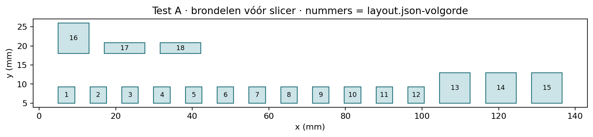

# Test A — scherpe puntkoppeling: zelfstandig uitlijnen

**Status:** DEFERRED\
**Prioriteit:** geen — printaanbod geparkeerd voor de gerichte [micro-motorproef](../2026-10-17-microstepper-screw-pin/test.md); geen nieuw resultaat of CAD-wijziging\
**Laatst beoordeeld:** 2026-10-17\
**Technische bron:** [E-298](../../06-experiments/E-298-self-aligning-point-clutch.md). E-297 en alle oudere proeven blijven ongewijzigd.

## 1. Vraag en beslissing

Kan een paar identieke helften, elk met twee scherpe punten en twee holtes, door uitsluitend axiaal samenbrengen zelfstandig naar volledige aangrijping draaien? Vergelijk drie puntvormen en twee identieke paren per vorm. De bovenste as mag vrij draaien; vooraf fase instellen of tijdens drukken met de hand verdraaien telt niet als zelfuitlijning.

De test bepaalt of de korte helling A voldoende kansrijk is voor de voorbereide 2×2. Als alleen een andere variant werkt, is het geleverde matrixproject met A daarmee niet gekwalificeerd. Noteer het verschil; print B dan niet op basis van dat resultaat. Geen automatische vervolgserie.

**Stop:** afbrokkelen, scheuren, hard vastlopen, zichtbaar buigen, ontbreken van volledige zetting of uit elkaar klimmen tijdens rustig bidirectioneel draaien. Meer kracht is geen oplossing voor een vastgelopen puntcontact.

## 2. Printproject en onderdelen

[**point-fit.3mf**](point-fit.3mf) — één X1 Carbon-project, met opgeslagen instellingen; open als project. De plaat bevat **18 delen**: twaalf rotorhelften, vier gedeelde handassen en twee gedeelde meenemers. De laatste zes delen worden tussen de varianten hergebruikt.

| Variant | Rotoren / paren | Punthoogte boven rechte voet | Apexverschuiving | Doel |
|---|---|---:|---:|---|
| A — point48 | vier: A1-paar en identiek A2-paar | 0,48 mm | 0° | Meer rechte flank; kandidaat voor B |
| B — point60 | vier: B1-paar en identiek B2-paar | 0,60 mm | 0° | Steilere geleiding, minder rechte flank |
| C — point60skew | vier: C1-paar en identiek C2-paar | 0,60 mm | 12° | Asymmetrische geleiding; verplaatst dode fase |

Iedere punt loopt zowel radiaal als in omtreksrichting sterk toe. De uiteindelijke kleine kroon en werkelijk geslicede puntlagen staan in [printbaarheid](../../tools/curated-experiment-checks/E-298/printability.md). De twee holtes zijn open sectorruimtes tussen de brede puntvoeten, zodat de tegenoverliggende punten kunnen zakken zonder een afgesloten supportgevulde pocket.

[Onderdelen en plaatindeling](layout.json) · [CAD-montage](../../tools/curated-experiment-checks/E-298/cad/cad-guide.md). De objectnamen identificeren de delen; houd A/B/C en herhalingen apart in zes bakjes. De eerste vier rotoren zijn A, de volgende vier B, de laatste vier C, overeenkomstig de kaart/objectnamen. Een geïsoleerde rotor heeft geen geprinte letter.

De rotoren staan op hun vlakke vangflens, punten omhoog. De blinde DD-boring is open aan de bedzijde en krijgt geen support. Meenemers staan op hun rug met beide bladen verticaal; handassen op hun brede voet. Verwijder alleen losse draadjes en eventuele expliciet aangegeven bedhechting, geen nabewerking aan de puntflanken.

**Slicerraming:** 57 min 52 s totaal / 1,62 g PLA; modelprinttijd 44 min 34 s, rest opstartvoorbereiding.

**Opgeslagen profiel, tijd en materiaal:** zie [gecontroleerde Bambu-instellingen](bambu-settings.md). Dit zijn slicerwaarden, geen fysieke waarnemingen. Open het 3MF rechtstreeks; CAD of Python uitvoeren is niet nodig.

**Benodigd:** handen, pen, zes bakjes; liefst een aanwezige schuifmaat/liniaal en telefoon voor bovenaanzicht/video. Een reeds aanwezige keukenweegschaal is optioneel voor een grove krachtschatting. Geen aankoop nodig. Houd kleine scherpe delen van ogen weg en druk niet op de punten zelf.

## 3. Montage, kracht en zelfuitlijning

1. Inspecteer de twee punten van iedere rotor vóór de eerste aanraking. Noteer ontbrekende toppen, draadjes, vervorming of ongelijke hoogte. Test eerst of de DD-handas vrij in de rotor schuift en in beide draairichtingen meeneemt. Een stroef schuifprofiel is een afzonderlijke uitkomst.
2. Schuif de twee meenemers zijwaarts om de rotorflenzen: de smalle opening zit aan de aszijde, de brede opening aan de halszijde. Ze moeten iedere rotor actief duwen én terugtrekken en vrije rotatie toelaten.
3. Zet een rotor met handas onderaan en houd zijn voet tegen rotatie. Keer de tweede rotor om, punten naar beneden; steek de tweede handas van boven in zijn DD-boring. Laat die bovenste as vrij roteren. Gebruik de bovenste meenemer voor zuiver axiale druk, niet de bovenste handas als draaiknop. Lijn de assen zo coaxiaal mogelijk uit; noteer scheefstand als mogelijke proefverstoring.
4. Maak eerst bij passende fase een **referentie voor volledige zetting** zonder kracht. De E-297-eindstand is **15,76 mm tussen de buitenvlakken van beide rotorflenzen**, gemeten langs de rand; de tandwortelvlakken staan dan 3,36 mm uiteen. Een los paar kan verder insteken dan de matrix. Beoordeel daarom aangrijping bij deze maat, niet alleen bij volledig dichtdrukken tot de tandbodem. A heeft daar nominaal 0,48 mm rechte overlap, B/C 0,24 mm. Werkelijke printfouten zijn onbekend.
5. Markeer de brede asvoeten en noteer de beginfase, gezien langs de gezamenlijke as. Trek uiteen, stel de **beginhoek** in en breng uitsluitend axiaal samen. Probeer per paar 0°, ±5°, ±10°, 30°, 60°, 90°, 120° en 150°; onderzoek bij C ook 24° en 24°±5°/±10°. Nul betekent tegenoverliggende tandvoeten, 90° betekent voet tegenover holte. De asymmetrische punten liggen bij C bij ongeveer 24° precies tegenover elkaar. Observeer elke gewenste rotatie zonder haar met de vingers te helpen.
6. Noteer: roteert de bovenste as vanzelf, hoeveel graden en welke richting; bereikt het paar de referentiemaat; blijft een punt staan; is een zetje nodig? Een zetje mag alleen als **afzonderlijke diagnose** na een mislukte poging en wordt als hulp geregistreerd. Herhaal A1 en A2 bij dezelfde fases, zodat printspreiding zichtbaar wordt. Geef ieder paar vijf rustige koppel-/ontkoppelcycli en inspecteer daarna opnieuw.
7. Beoordeel kracht eerst als licht/duidelijk/zwaar/blokkade. Eventueel: plaats de onderste asvoet op een getarreerde weegschaal en noteer de extra aflezing vlak vóór en tijdens invangen. `F≈0,00981 × extra gram` N. Vermeld resolutie en opstelling. Bij wegen mag de bovenste as nog steeds vrij roteren; zijdelingse steun of vingers op de ondervoet kunnen de meting beïnvloeden. Dit is geen gekalibreerde krachtmeting. Bij blokkeren stoppen, geen doelkracht opbouwen.
8. Houd het paar op de referentiediepte, draai rustig in beide richtingen met lichte tegenhouding en kijk of de flanken blijven dragen. Alleen schuin topcontact, uitlopen of verder dichtduwen dan de matrixmaat geldt niet als bewijs voor B. Ontlast torsie en trek achtereenvolgens eerst de ene, vervolgens in een nieuwe cyclus de andere meenemer terug. Beide routes moeten loskomen zonder beschadiging.

**Let op hoekspeling:** ook een vastgehouden handas houdt zijn rotor niet exact in fase vast. De nominale DD-passing heeft circa 26,14° totale omkeerspeling. Markeer en observeer beide rotoren én asvoeten. Noteer apart of de onderrotor binnen zijn speling draait en of een bovenste asmarkering achterloopt op de rotor. Zelfstandig opnemen van speling is mechanisch gedrag; het is geen bewijs dat uitsluitend de bovenhelft indexeerde.

**Kansrijk voor B:** beide A-paren invangen vanuit de onderzochte niet-dode fases zonder fasezoekactie, de referentiediepte bereiken, beide richtingen dragen en weer lossen zonder schade. Exacte dode fases worden apart gerapporteerd: als die blokkeren is algemene zelfuitlijning vanuit willekeurige fases niet bewezen, ook wanneer de overige proeven goed gaan.

## 4. Resultaten — nog niet uitgevoerd

Datum: ______  Bestand / profielwijzigingen: ______  Filament/nozzle: ______  Printtijd/massa: ______  Nabewerking: ______

| Paar | Punten intact vóór/na? | DD/rotatie in meenemer vrij? | Volledig bij 15,76 mm? | Draagt links/rechts? | Beide terugtrekroutes? |
|---|---|---|---|---|---|
| A1 | | | | | |
| A2, identiek | | | | | |
| B1 | | | | | |
| B2, identiek | | | | | |
| C1 | | | | | |
| C2, identiek | | | | | |

Herhaal deze meetregel voor de relevante fases; leeg betekent onbekend:

| Paar / beginhoek | Zelf gedraaid, graden / richting | Volledige zetting zonder hulp? | Krachtgevoel / schaalaflezing + resolutie | Zet/hulp nodig? | Schade / observatie |
|---|---|---|---|---|---|
| | | | | | |
| | | | | | |
| | | | | | |
| | | | | | |
| | | | | | |
| | | | | | |

## 5. Interpretatie na fysieke feedback

Werkelijk waargenomen: ______  Nog onbekend: ______  A geschikt voor beperkte integratieproef? ______

Geen ingevulde fysieke uitslagen: **nog niet getest**. De CAD/slicercontrole vult deze velden niet in. Geen deadline of automatische vervolgactie.
