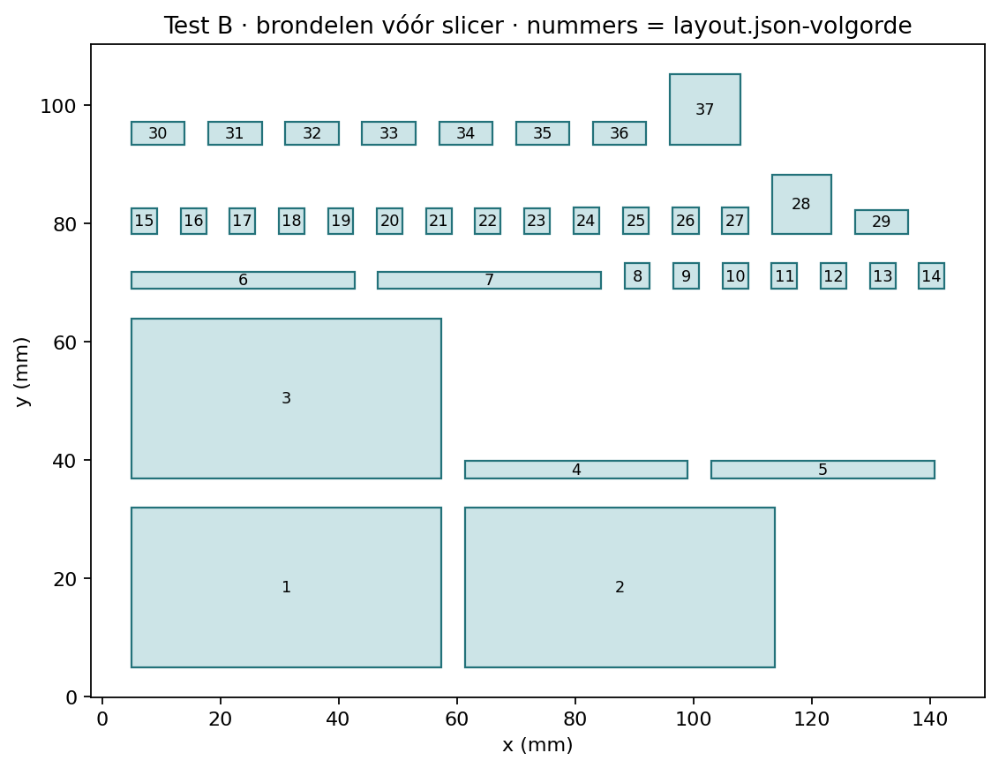

# Test B — 2×2 met gelijktijdige zelfuitlijning

**Status:** DEFERRED — gedeeltelijk fysiek beproefd; volledige 2×2-test niet uitgevoerd  
**Prioriteit:** geen; geen vervolgprint ingepland  
**Laatst beoordeeld:** 2026-10-17 (eigenaarsrapport ontvangen; exacte printdatum niet opgegeven)  
**Reden:** eigenaar printte slechts een deel van de onderdelen, monteerde een beperkte opstelling en testte één koppeling en één pin. Dit vervangt de eerdere vermelding dat er nog geen fysieke resultaten waren. E-297 blijft ongewijzigd.  
**Technische bron:** [E-298](../../06-experiments/E-298-self-aligning-point-clutch.md).

## 1. Vraag en stopconditie

Kunnen twee of vier koppelingen met verschillende outputfases door één gedeelde selectieslag volledig aangrijpen, terwijl alle inputassen stilstaan? De schroeven mogen daarbij draaien en de pinhoogtes mogen veranderen. Eén verkeerd gefaseerde koppeling die de hele selector tegenhoudt is een negatieve uitkomst, geen reden om harder te drukken of verborgen fasehulp te geven.

Deze proef behoudt de twee axiaal bewegende helften, rij omhoog / kolom omlaag, 5,08-mm raster en succesvolle E-295-draad met 0,175-mm relief. Er zijn geen veren of extra selectoren. De inputreactieplaat is uitsluitend een verwijderbare proefhulp onder het frame.

**Stop** bij hard blokkeren, openende framevoeg, buigende rail, puntbeschadiging, pin-/buurcontact, onvoldoende draadinschakeling of uit elkaar klimmen onder koppel. Geen tang of boormachine. Een blokkade niet oplossen met een verdraaiing en vervolgens als zelfuitlijning noteren.

## 2. Printklaar project

[**point-matrix.3mf**](point-matrix.3mf) — één geconfigureerd X1 Carbon-project. **37 delen:** drie framedelen, vier gedeelde selectors, acht A/point48-rotoren, vier inputassen, vier integrale schroeven, vier pinnen, één handgreep, acht stopstukjes en één vierpuntsreactieplaat. Alle functionele draad zit werkelijk in de meshes. Het STEP-aanbod bevat de puntrotoren en andere CAD-onderdelen; de schroef/pin-STL's behouden de originele functionele draad.

[Onderdelenkaart/manifest](layout.json) · [maatvoering en montage](../../tools/curated-experiment-checks/E-298/cad/cad-guide.md) · [gecontroleerde Bambu-instellingen, tijd en materiaal](bambu-settings.md).

**Slicerraming:** 6 uur 41 min 51 s totaal / 18,28 g PLA; modelprinttijd 6 uur 28 min 34 s.

Open als project en behoud instellingen en oriëntatie. Buitenframes liggen op de buitenwand, middenframe op het deelvlak; selectors op hun rug; rotoren met punten omhoog. Pinnen staan met gesloten top op het bed, schroeven op hun DD-staart. De buitenbrim ondersteunt bedhechting en moet weg van de functionele oppervlakken worden verwijderd. Supports blijven uit; geen support in draad of socket. Let bij de slanke schroeven op loskomen/wiebelen tijdens printen; slicerpaden kwalificeren bedhechting niet fysiek.

**Wat de paden nog niet bewijzen:** de dunne binnendraad heeft lokale onderbrekingen in de geplande wanddoorsnede (35–37 van 76 gecontroleerde draadlagen; grootste gemeten middellijnonderbreking circa 0,199 mm). De volle pinbuis en rotorhalzen blijven in de gecontroleerde paden gesloten. Inspecteer de draad dus op scheuren, lekke wand en schade; echte passing en sterkte zijn onbekend. Dit is geen nieuwe positieve of negatieve fysieke draadtest.

**Verder nodig:** enkele stukjes gewone tape voor de externe framevoegen, pen/liniaal, eventueel aanwezige schuifmaat en camera. Geen aanvullende hardware of aankopen.

## 3. Montage

1. Laat de plaat afkoelen. Verwijder buitenbrim en losse stringing; geen functionele delen schuren of uitboren. Controleer de punten, acht rotorhalzen, DD-boringen, draad en framewebben. Bewaar de reactieplaat apart tot het frame gemonteerd is.
2. Begin met het **middenframe**, beide aslijnen aan de open zijvlakken bereikbaar. Monteer eerst de achterste rij inputs en onderste rotoren, vanaf hun open zijkanten in de halve zittingen. Breng haar rijselector via een open zijkant vóór de flenzen en schuif vervolgens met de U-monden eerst om beide flenzen. Smalle opening naar de as, brede naar de hals. Herhaal voor de voorste rij. Sluit nog geen buitenframe.
3. Schroef buiten het frame iedere pin op zijn schroef; de eerste middenstand ligt met de pinonderkant circa 5,25 mm boven het begin van de buitendraad. Zet de bovenrotoren op de neergaande DD-staarten, punten omlaag. Vang per kolom beide flenzen in één kolomselector en leg die complete kolom vanaf haar eigen open zijkant in het middenframe. Lijn kragen, conische schroefsteun, rotorlichamen en vierkante pinnen met hun geleidingen uit.
4. Controleer alle selectortabs in hun vensters. Schuif de buitenframes zijwaarts over de registratiepennen en sluit de externe voegen met kleine stukjes tape op voet en bovenrand. Geen kraag wordt door een kleinere gesloten boring geperst. Een openende voeg is een stopreden.
5. **Rij UIT:** beneden, zonder stopstukjes. **Rij AAN:** omhoog, één stopstuk onder iedere eindtab. **Kolom UIT:** omhoog, één stopstuk onder iedere eindtab. **Kolom AAN:** beneden, stopstukjes weg. Beweeg beide uiteinden samen; de gevangen flenzen verzorgen actief terugtrekken.
6. Controleer iedere rotorhelft op de volledige slag van 2,40 mm, bij nog gescheiden punten. Een selector mag de axiaal gesteunde schroef niet als geheel meesleuren. Noteer klemmen in DD/geleiding afzonderlijk van puntcontact. Breng de pinnen rond **4 mm boven het hoogste framevlak**. De eerste proef blijft in de band circa **2,5–5,5 mm**; houd ook rekening met hoogteverandering tijdens selecteren. Niet tegen een eindstop nulstellen.
7. Plaats de reactieplaat van onderen, alle selectors UIT. De vier DD-pennen steken via de openingen in de vier inputsockets. Stel de **inputassen alleen tijdens deze voorbereiding** met de hand gelijk zodat de hulp past; forceer niet. De bovenkant van haar brede voet hoort circa 0,20 mm onder de framebodem te blijven. Ondersteun de plaat tijdens de proef en houd frame en plaat tegen meedraaien. Zij mag geen selectorkracht of output ondersteunen. Geen tape bij roterende delen. Na deze voorbereiding blijven alle inputs tijdens iedere zelfuitlijnpoging onaangeraakt.

**De reactieplaat is geen spelingsvrije fixatie.** De nominale DD-passing laat per verbinding circa 26,14° totale omkeerspeling toe. Via reactieplaat → input → onderrotor zijn dat twee verbindingen: samen maximaal circa 52,28° volledige spelingbreedte (±26,14° rond het midden), vóór printfouten. Markeer daarom ook de onderrotor en waar zichtbaar de input; film hun beweging naast de bovenrotor/schroef. Niet handmatig verdraaien blijft verplicht. Passief opnemen van DD-speling is een afzonderlijke mechanische uitkomst, geen bewijs dat de onderhelft exact stil bleef. De bovenrotor kan eveneens eerst zijn DD-speling opnemen voordat de schroef draait.

De nominale volledig geselecteerde flensbuitenvlakken staan 15,76 mm uiteen; tandwortelvlakken 3,36 mm. A heeft daar slechts 0,48 mm rechte overlap. Het oude E-297-tolerantiebudget garandeert dat nieuwe contact niet. Observeer daarom werkelijk volledige slag aan beide uiteinden en meet waar mogelijk de rotorflensafstand. Een extra afstand van 0,24 mm verbruikt al de helft van de nominale rechte overlap; onbekende maatvoering blijft een onzekerheid.

## 4. Proef met verschillende fases

1. Label van boven gezien A=R1/C1, B=R1/C2, C=R2/C1, D=R2/C2. Markeer zichtbare schroef-/rotorstand en een framereferentie. Noteer de resolutie van hoogte en draaihoek. Controleer met alles UIT op zelfstandig teruglopen; dat is een afzonderlijke observatie.
2. Stel bij gescheiden helften de **outputs** bewust op verschillende beginfases. Dit mag door een zichtbare schroefkraag/rotor voorzichtig te draaien terwijl de inputs vaststaan. Houd de pin in zijn geleiding en middenbereik. Noteer de werkelijk ingestelde fases en beginhoogtes; de DD-speling maakt “ongeveer 30°” geen exacte meting. Doe dit vóór de poging, nooit tijdens het sluiten. Nulfase betekent tandvoet tegenover tandvoet, 90° betekent tandvoet tegenover holte.
3. Begin met één rij/twee kolommen: bijvoorbeeld A circa 30°, B circa 60°. Zet beide kolommen omlaag, til de gedeelde rij rustig en gelijkmatig omhoog en observeer of beide outputs **zelf** draaien en alle helften volledig zetten. Geen input verdraaien, output aanraken of rail buigen. Onderbreek meteen als één cel blokkeert. Noteer ook een reeds deels gezette buur. Probeer dezelfde toestand daarna met omgekeerde inschakelvolgorde: rij eerst omhoog, kolommen daarna omlaag.
4. Herhaal voor één kolom/twee rijen met verschillende fases. Probeer daarna alle vier, bijvoorbeeld 30°/60°/120°/150°. Sluit de echte gedeelde staven zonder per pin te helpen. “Gelijktijdig geselecteerd” betekent dat meerdere verschillende fases tijdens dezelfde gemeenschappelijke slag moeten invangen; het achteraf afzonderlijk helpen telt niet.
5. Voer bewust één ongunstige cel in: A circa 0° of ±5° en de overige circa 30°/60°/120°. Noteer of A de hele rij/kolom stopt, of andere outputs al bewogen, en of de selector zijn eindstand haalt. De berekende eindige kroon heeft rond punt-op-punt een dode zone. Een gevonden blokkade is waardevol bewijs; niet forceren. Een aparte poging na terugtrekken en een kleine hoekcorrectie wordt als **geholpen herstart** geregistreerd, niet als geslaagde oorspronkelijke poging.
6. Meet per pin de hoogte en schroefhoek direct vóór en na selecteren, vóór enige aandrijfbeweging. Met 3-mm spoed is 30° rotatie theoretisch 0,25 mm hoogteverandering. Registreer teken en werkelijk gemeten waarde; speling en teruglopen kunnen verschillen veroorzaken. Observeer niet-geselecteerde buren afzonderlijk. Toegestane indexeerbeweging van een geselecteerde pin is geen ongewenste selectie van een buur.
7. Alleen na volledige zetting: leg de bijbehorende stopstukjes onder de hoge selectoren, ontlast de reactieplaat en trek haar recht omlaag weg. Draai met de bestaande losse handgreep iedere input om beurten een kleine slag beide kanten op. Houd de pinhoogtes in de genoemde band. Dit test koppeloverdracht en isolatie, geen gedeelde motor/transmissie.
8. Controleer de vier celtoestanden 00/10/01/11 en de 16 maskers hieronder. In iedere stand worden alle vier inputs met de hand gedraaid; alleen de geselecteerde schroeven mogen worden meegenomen. Bij adreswisselen: input stoppen/ontlasten, rijen terug, gewenste kolommen instellen, zelfuitlijnen met stilstaande inputs, volledige zetting controleren. Als een fase blokkeert, noteer de onuitgevoerde aandrijfproef in plaats van fasehulp te verzwijgen.
9. Test na beide draairichtingen de twee ontkoppelroutes: eerst alleen rij terug, in een nieuwe cyclus alleen kolom terug. Ontlast torsie vóór terugtrekken. Controleer dat draaien van die input daarna de output niet meeneemt. Eindig met inspectie van alle punten; geen duurtest of zwaardere belastingcampagne.

## 5. Eigenaarsrapport — ontvangen 17 oktober 2026

Onderstaande punten zijn een zakelijke registratie van de eigen observaties, vermoedens, voorstellen en beoordeling van de eigenaar. Er is **geen aanvullende technische interpretatie** toegevoegd. De print-/testdatum is niet apart doorgegeven.

### Printinstellingen, oriëntatie en bedbehechting

- Geprint vanuit **point-matrix.3mf** op een Bambu Lab X1 Carbon.
- Volgens de eigenaar zijn de oorspronkelijke printinstellingen gebruikt, behalve de filamentkeuze: wit, officieel Bambu Lab-filament dat in de printer zat. Het precieze filamenttype is niet opgegeven.
- De eigenaar heeft ook de **automatische oriëntatie** en **automatische plaatsing** in Bambu gebruikt; de voorgeschreven oriëntatie uit de repository is dus niet noodzakelijk behouden.
- De onderdelen waren overwegend goed geprint, maar niet alles is gelukt.
- De eerste-laag-brim / bedhechtingsrand was soms lastig van de onderdelen te verwijderen. Dit komt volgens de eigenaar ook bij andere prints geregeld voor.
- Vooral wanneer automatisch oriënteren een **schroefgat of schroefopening naar beneden** plaatste, was de brim moeilijk weg te halen.
- Eigenaar wil dat bij toekomstige 3MF-bestanden de oriëntatie vooraf zo wordt gekozen dat bedhechtingsresten zo weinig mogelijk op functionele vlakken en schroefopeningen terechtkomen.
- Bij automatisch plaatsen bleven **vier onderdelen buiten het printbed**. De eigenaar heeft daarom niet de volledige set geprint; welke vier onderdelen ontbraken is niet gespecificeerd.

### Mislukte schroeven en voorstel voor printondersteuning

- Het printen van de slanke **schroeven** is mislukt: zonder supports werd dit tijdens het printen een **spaghetti-mislukking**.
- De eigenaar had problemen met deze onondersteunde schroeven op voorhand verwacht.
- Voorstel van eigenaar: bij toekomstige schroefprints wel supports voorzien, **of** meerdere schroeven naast elkaar printen en tijdelijk met kleine, afbreekbare verbindingsstukjes aan elkaar koppelen, zodat ze elkaar stabiliseren.
- De haalbaarheid en het gemakkelijk afbreken van zulke verbindingsstukjes is **nog niet getest**.
- Eigenaar wil printondersteuning en oriëntatie al tijdens het ontwerpen en aanleveren van de printbestanden laten meewegen, in plaats van alleen op de slicer te vertrouwen.

### Montage en onderdelen

- De daadwerkelijk beschikbare/geprinte onderdelen konden gemonteerd worden; montage vergde wel werk, vooral bij het verwijderen van brims en andere printresten.
- Het **frame** paste goed. De eigenaar beschouwt het frame vooral als testgereedschap, niet als hoofdzaak.
- De kleine **assen/pinnetjes waarover de koppelingshelften schuiven** waren goed; eigenaar noemt die een eenvoudig onderdeel.
- De **rij- en kolomselectiestangen** bewogen op zichzelf soepel.
- De selectiestangen waren echter **licht verbogen**. Eigenaar vermoedt printwarmte en/of de geringe dikte als mogelijke oorzaak, zonder die oorzaak te hebben vastgesteld.
- **Belangrijk:** door die verbuiging en de krappe beschikbare beweging konden de rij- en kolomselectoren de koppelingshelften **niet ver genoeg naar elkaar bewegen voor volledig aangrijpen**. Zelfs zo dicht mogelijk bij elkaar kwam de koppeling **maar gedeeltelijk / ongeveer half** in elkaar.
- De eigenaar vond de slag en de maatvoering op dit punt erg krap en wil dat de selectiestangen voldoende stevig zijn.
- De **stop-spacers / afstandsblokjes** zijn **niet gebruikt**, omdat de eigenaar niet wist waarvoor ze dienden.
- De eigenaar vindt de afstandsblokjes erg klein en het handmatig losmaken van zulke vele kleine onderdelen onhandig; voorkeur voor **zo weinig mogelijk losse onderdelen**.
- De montage van een complete 2×2-set is niet uitgevoerd; de beperkte montage was volgens de eigenaar ook niet bijzonder gemakkelijk.

### Draaisleutel en aandrijfas

- De **manuele draaisleutel** was lastig in de **aandrijfas** te steken.
- Het insteekpunt / de groef in de aandrijfas was **erg ondiep** en sleet **vrij snel**.
- Voorstel van eigenaar: de aansluiting dieper maken zodat de sleutel verder kan insteken en beter blijft zitten.
- Eigenaar merkt op dat deze manuele aansluiting enkel voor de test dient en geen belangrijke eis is voor het uiteindelijke ontwerp.

### Zelfuitlijning, koppeling en speling

- De eigenaar heeft **slechts één koppelingspaar** getest, niet twee of vier gelijktijdig.
- Wanneer de twee punten **recht tegenover elkaar** stonden, lijnde de koppeling zich **niet** vanzelf uit; de punten **blokkeerden tegen elkaar**.
- Eigenaar had dit vooraf al verwacht wegens de volgens hem onvoldoende scherp geprinte punten.
- **Vermoeden van eigenaar:** aanzienlijk scherpere punten zijn nodig om automatische uitlijning mogelijk te maken. Dit is geen bevestigde oorzaak of bewezen oplossing.
- Eigenaar overweegt eventueel de puntkoppeling iets breder te maken **als er ruimte is**, of anders een andere punt-/koppelingsgeometrie te proberen.
- Essentiële eis volgens eigenaar: de koppeling moet vanuit **elke willekeurige beginpositie** kunnen aangrijpen.
- Wanneer de helften wel gunstig tegenover elkaar stonden en in elkaar zaten, leek de koppeling **vrij soepel te draaien**.
- De koppeling had volgens de eigenaar **behoorlijk veel speling** en wiebelde duidelijk.
- Idee voor een later eindontwerp: een **passende geleiding rond de koppeling**, afgestemd op de werkelijke pin/staaf, om zijwaartse en voor-achterwaartse beweging te beperken.
- Die extra geleiding is **nu geen prioriteit**: de eigenaar wil de koppeling tijdens de proef zichtbaar houden.
- **Afzonderlijke observaties:** het niet volledig kunnen sluiten door de licht verbogen / onvoldoende ver bewegende selectorstangen, en het blokkeren van punt-op-puntcontact. Geen van beide is hier als enige bewezen oorzaak van het andere geregistreerd.

### Pinbeweging

- **Slechts één pin** is handmatig getest.
- Het **omhoog en omlaag bewegen** van die pin ging **heel vlot**, zonder gemeld probleem.
- Het gedrag van meerdere pinnen tegelijk, niet-geselecteerde buren en de volledige 2×2-matrix is **niet getest / niet gerapporteerd**.

### Algemene beoordeling en voorkeuren van de eigenaar

- Eigenaar is **vrij tevreden** dat er nu iets concreets te zien en te testen is.
- Eigenaar heeft **veel vertrouwen in het basisidee met gedeelde rij- en kolomselectoren** en wil daarop verder bouwen.
- Belangrijkste gewenste verbeteringen volgens eigenaar: **betere zelfuitlijnende puntkoppeling**, **stevigere/rechtere selectiestangen met voldoende sluitbeweging**, **betrouwbaardere schroefprints**, en **zorgvuldig gekozen oriëntatie en bedhechting** in de aangeleverde 3MF.
- De afbreekbare verbindingen tussen geprinte schroeven zijn een **voorstel van de eigenaar**, nog geen uitgeteste oplossing.
- Eigenaar verkiest **weinig losse, kleine extra onderdelen** voor eenvoudiger printen en monteren.
- Extra geleiding voor wiebelen is een wens voor later, **niet voor de eerstvolgende proef**.

### Aanvullende feedback: montagegemak, schaalbaarheid en onderhoud

- **Ervaring tijdens montage:** de kleine testopstelling in elkaar zetten was **prutswerk**: veel kleine onderdelen, die bovendien gemakkelijk verschuiven bij het plaatsen.
- **Zorg van eigenaar bij opschaling:** dit lijkt een uitdaging wanneer zeer veel pinnen/koppelingen moeten worden gemonteerd; de beperkte fysieke montage was al omslachtig.
- **Mogelijke richting 1 — minder en gemakkelijker te plaatsen onderdelen:**
  - Ontwerp zo eenvoudig mogelijk houden, met **zo weinig mogelijk losse onderdelen** die afzonderlijk geplaatst moeten worden.
  - Onderdelen bij de montage zo veel mogelijk **vanzelf in de juiste positie laten vallen**.
  - Een goed vormgegeven frame zou onderdelen bij het plaatsen meteen kunnen **opvangen, positioneren en op hun plaats houden**.
- **Mogelijke richting 2 — vaste centrale staaf als montage- en structuurhulp:**
  - Een **statische centrale staaf** voorzien, met de koppelingsonderdelen **rond die staaf** in plaats van los gepositioneerd.
  - De koppeling zou in het midden een **doorgaand gat** hebben en over de centrale staaf geschoven kunnen worden, terwijl ze **om de stilstaande staaf kan blijven draaien** en verder hetzelfde koppelingsprincipe behoudt.
  - De centrale staaf dient alleen voor **structuur/positionering**, niet als bewegende aandrijving.
  - **Twijfel van eigenaar:** er is hiervoor mogelijk te weinig beschikbare ruimte binnen de compacte geometrie. Haalbaarheid niet onderzocht of getest.
- **Mogelijke richting 3 — uitneembare modules:**
  - Een **enkele pin**, of groepen van bijvoorbeeld **vier of zestien pinnen**, zouden als afzonderlijke modules opgebouwd kunnen worden.
  - Zulke modules kunnen vooraf geassembleerd worden en vervolgens **in het Shape Display geschoven** worden.
  - Gewenst onderhoudsvoordeel: bij vervanging van één pin hoeft **niet het hele display gedemonteerd** te worden.
  - Dat moet vermijden dat bij reparatie onbedoeld veel andere pinnen verschuiven of dat er fouten in de montage ontstaan.
  - **Twijfel van eigenaar:** modules kunnen extra breedte/ruimte vergen en nieuwe **tolerantieproblemen** meebrengen. Haalbaarheid niet onderzocht of getest.
- Deze richtingen zijn **ideeën van de eigenaar voor latere evaluatie**; geen keuze voor een nieuwe constructie of opdracht om ze nu te ontwikkelen.

### Aanvullende fysieke feedback — stopblokjes en selectiestangen (17 oktober 2026)

**Latere aanvulling op dezelfde gedeeltelijke E-298-printtest; uitsluitend eigenaarsobservaties, opmerkingen en voorstellen.** De eerder als ongebruikt beschreven stop-spacers zijn **nadien alsnog herkend en gebruikt**. De overige oorspronkelijke observaties blijven behouden.

- **Functie van de kleine `stop-spacer`-blokjes:** eigenaar heeft inmiddels zelf ontdekt dat ze de rij- en kolomselectiestangen **tijdelijk in een gekozen positie vasthouden**, zodat de handen vrij zijn om met de manuele aandrijving te testen.
- **Fysiek getest met die blokjes:** de eigenaar heeft de stangen ermee vastgezet en kon daarna **één pin effectief omhoog en omlaag draaien**.
- **Gevoel bij draaien:** dit verliep **vrij vlot, niet stroef en aangenaam**; de eigenaar is tevreden over die beweging.
- **Rij- en kolomselectiestangen:** de eigenaar **ziet ze nu al doorbuigen bij deze kleine testopstelling** en vreest dat langere stangen in een groter display daardoor problemen zullen geven.
- **Specifiek kwetsbaar punt:** aan één zijde hebben de selectiestangen **uitsparingen / inhammen** om rond de koppelingshelften te grijpen en ze axiaal op en neer te bewegen. De eigenaar begrijpt waarom deze uitsparingen er zijn, maar merkt dat de stangen **juist ter hoogte van deze uitgesneden plaatsen heel gemakkelijk buigen**.
- **Voorstel van eigenaar:** onderzoek of de uitsparingen of het profiel **steviger of anders gevormd** kunnen worden om doorbuiging te verminderen.
- **Mogelijke richting van eigenaar:** waar mogelijk **meer materiaal in de hoogte** van de selectiestang gebruiken voor extra stevigheid. **Breder** maken lijkt de eigenaar moeilijk wegens het risico tegen de naastgelegen rij-/kolomonderdelen te botsen. Dit zijn ideeën, geen geteste verbeteringen.
- **Bewijsgrens:** de nieuwe handmatige op-/neerbeweging toont geen volledige automatische zelfuitlijning, gegarandeerd volledig aangrijpen, gelijktijdige bediening van meerdere pinnen of geschiktheid van lange selectiestangen aan. De eerder gemelde moeilijkheid om de koppelingshelften volledig naar elkaar te bewegen blijft als afzonderlijke eerdere observatie staan.

### Niet vastgesteld in deze gedeeltelijke uitvoering

- Geen volledige montage / gelijktijdige zelfuitlijning van twee of vier verschillende koppelingen.
- Geen volledige 16-maskerproef, onafhankelijke selectie van alle vier pinnen of systematische controle op ongewenste buurbeweging.
- Geen hoek-, hoogte-, kracht-, maat- of duurmetingen opgegeven.
- Geen volledige, betrouwbare eindsluiting van de geteste koppeling aangetoond; de eigenaar kon de selectiestangen niet ver genoeg samenbrengen.
- Niet opgegeven: exacte uitvoeringsdatum van de print, filamentproducttype, werkelijke printtijd/filamentmassa, volledige lijst van wel/niet geprinte onderdelen, of resultaat van de voorafgaande Test A.

## 6. Oorspronkelijk testformulier — niet volledig doorlopen

Datum / 3MF / eventuele profielwijzigingen: ______  A1/A2 vooraf geslaagd?: ______  Filament: ______  Tijd/massa: ______  Nabewerking/schade: ______  Hoogte-/hoekresolutie: ______

| Poging | Beginfases A/B/C/D | Selectie + inschakelvolgorde | Input/onderrotor: draaiing of speling? | Alle helften volledig gezet zonder hulp? | Geblokkeerde cel / rail / hulp / krachtgevoel |
|---|---|---|---|---|---|
| Rij, twee fases | | | | | |
| Kolom, twee fases | | | | | |
| Alle vier, vier fases | | | | | |
| Eén dode fase | | | | | |
| Omgekeerde volgorde | | | | | |

| Poging / pin | Hoogte vóór (mm) | Hoogte na selecteren (mm) | Δh (mm) | Zelf gedraaide hoek / richting | Niet-geselecteerde buur bewoog? |
|---|---|---|---|---|---|
| / A | | | | | |
| / B | | | | | |
| / C | | | | | |
| / D | | | | | |

`10` betekent eerste rij/kolom, `01` tweede. Vul alleen uitgevoerde proeven in.

| R1R2 | C1C2 | Verwacht gekoppeld | Werkelijk / volledige zetting / blokkade / buren |
|---|---|---|---|
| 00 | 00 | geen | |
| 00 | 10 | geen | |
| 00 | 01 | geen | |
| 00 | 11 | geen | |
| 10 | 00 | geen | |
| 10 | 10 | A | |
| 10 | 01 | B | |
| 10 | 11 | A, B | |
| 01 | 00 | geen | |
| 01 | 10 | C | |
| 01 | 01 | D | |
| 01 | 11 | C, D | |
| 11 | 00 | geen | |
| 11 | 10 | A, C | |
| 11 | 01 | B, D | |
| 11 | 11 | A, B, C, D | |

Bidirectioneel gedragen?: ______  Rij trekt los?: ______  Kolom trekt los?: ______  Punten vóór/na intact?: ______  Teruglopen bij loslaten?: ______

## 7. Registratienoot

- De oorspronkelijke proefinstructies en het lege resultaatformulier zijn behouden om niet-uitgevoerde onderdelen niet als fysieke testresultaten voor te stellen.
- Bovenstaand eigenaarsrapport bevat geen door de assistent toegevoegde diagnose, mechanische oplossing of GO/NO-GO-beslissing.
