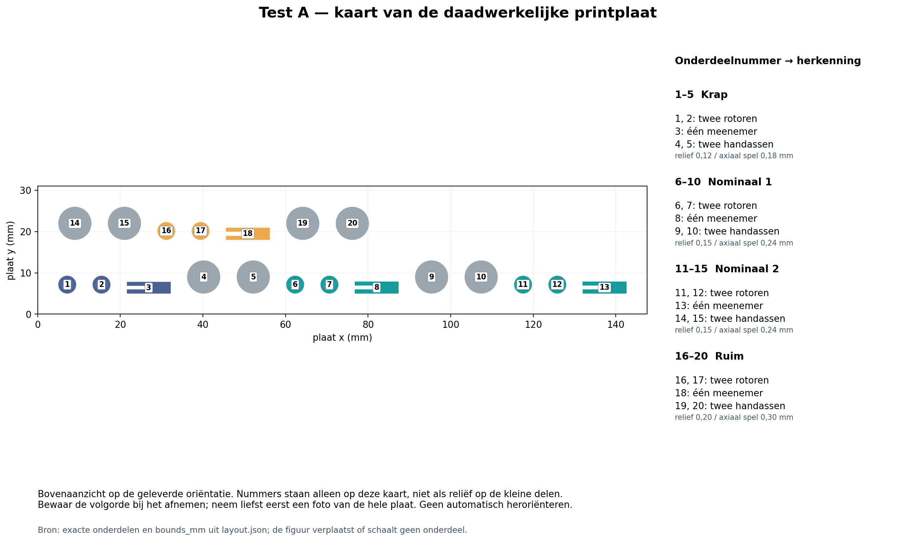
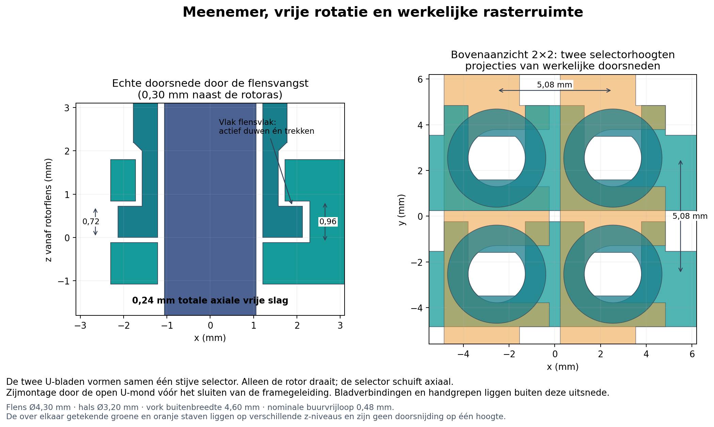

# Test A — twee koppelingshelften, schuifpassing en meenemer

**Status:** DEFERRED\
**Prioriteit:** geen — printaanbod geparkeerd voor de gerichte [micro-motorproef](../2026-10-17-microstepper-screw-pin/test.md); geen nieuw resultaat of CAD-wijziging\
**Laatst beoordeeld:** 2026-10-17\
**Reden:** complete X1C-3MF opgeslagen, opnieuw geopend en gesliced; kritische paden gecontroleerd. Fysieke passing is nog onbekend.  
**Technische bron:** [E-297](../../06-experiments/E-297-two-half-row-column-clutch-print-tests.md).

## 1. Waarom deze test?

Deze kleine plaat toetst twee afzonderlijke vragen: passen de axiaal schuivende, vormgesloten aandrijfprofielen; en kunnen twee brede frontklauwen aangrijpen, in beide richtingen draaien en weer loskomen terwijl de niet-roterende meenemer de rotor axiaal vasthoudt? De varianten vergelijken de kritische schuifpassing; identieke nominale exemplaren tonen natuurlijke printspreiding.

Een soepele E-295-schroefdraad bewijst deze nieuwe passing niet. Gebruik geen tang, boormachine of schuurwerk om een slechte variant passend te maken. Stop bij afbrokkelen, klemmen, scheuren of een vormprofiel dat vrij ronddraait zonder mee te nemen.

## 2. Printklaar

[**Printproject: clutch-fit.3mf**](clutch-fit.3mf) — één kleine plaat, **20 delen**, ongeveer **44 min 08 s / 1,94 g PLA** volgens Bambu Studio 02.08.02.61. Werkelijke printtijd en massa zijn onbekend. Plaat: 137,60 × 21,00 × 8,60 mm. Open als **project**, behoud de oriëntatie en opgeslagen instellingen; geen CAD of Python compileren.

| Set / kaartnummers | Twee rotoren | Meenemer | Twee handassen | Radiale DD-/vorkrelief | Totale axiale flensspeling |
|---|---|---|---|---:|---:|
| Krap | 1–2 | 3 | 4–5 | 0,12 | 0,18 |
| Nominaal 1 | 6–7 | 8 | 9–10 | 0,15 | 0,24 |
| Nominaal 2, identiek | 11–12 | 13 | 14–15 | 0,15 | 0,24 |
| Ruim | 16–17 | 18 | 19–20 | 0,20 | 0,30 |

De nummers staan in de onderdeelkaart en objectnamen; haal de sets één voor één van het bed en label zakjes/bakjes. De miniatuurrotoren zelf hebben geen slecht leesbare opgedrukte cijfers. Iedere set heeft twee identieke rotorhelften; keer voor montage één helft om. De twee nominale sets zijn werkelijk dezelfde geometrie. De passingsklassen veranderen zowel de DD-/vorkspeling als de axiale vangruimte; beoordeel die functies afzonderlijk volgens de stappen hieronder.

**Opgeslagen profiel:** X1 Carbon, 0,4-mm nozzle, Generic PLA, Textured PEI 55 °C / nozzle 220 °C; laag en eerste laag 0,12 mm; Arachne, 2 nominale wanden, 0,45-mm nominale lijnbreedte, 100% vulling. Wanden 30 mm/s, eerste laag/bruggen 20 mm/s, versnelling 1000 mm/s² (eerste-laagextrusie 500); partfan 100% na eerste laag, auxfan uit. Supports, brim, raft en skirt **uit**; print per laag; XY-, gat- en elephant-footcompensatie 0. [Volledige opgeslagen waarden en bewijs](bambu-settings.md).

**Oriëntatie:** rotoren op vlakke vangflens, tanden omhoog; DD-boring open op het bed, blind dak als korte brug. Meenemers op de achterrand, beide bladen verticaal en U-monden omhoog; hun handlip raakt het bed. Handassen op de brede voet. Geen binnenste supports of af te knippen CAD-pinvoetjes.

**Werkelijke padcontrole:** alle 20 delen en beide tanden van iedere rotor zijn aanwezig, geen supportpaden en geen nieuwe zwevende laagcomponenten. De nominale rotornek is doorlopend in de gecontroleerde paden. De **krappe** variant heeft in de opgeslagen slice twee kleine lokale onderbrekingen langs de berekende nekwandmiddellijn; na heropenen en opnieuw slicen zijn het er drie, circa 0,36 mm groot. Eerdere lagen ondersteunen die zones. Inspecteer die variant extra op gaatjes/scheuren en noteer het resultaat; dit is geen aangetoonde sterke wand. Zie [kritische paden](critical-toolpaths.png). De grootste berekende vrije brug-/overhangmiddellijn is 1,493 mm. Printsamenhang, doorhang en fysieke passing blijven onbekend.

**Extra:** handen, pen en vier kleine bakjes/zakjes; een liniaal of aanwezige schuifmaat is optioneel. Niet forceren of functionele profielen nabewerken.

## 3. Montage en test

1. Laat de plaat afkoelen. Houd de toleranties en de twee identieke nominale sets bij elkaar. Verwijder alleen loshangende draadjes; dit project heeft geen brim. Noteer alle nabewerking. Inspecteer de dunne wanden rond het schuifprofiel, klauwpunten en beide axiale contactvlakken van de meenemer.
2. Controleer eerst één rotor op zijn aandrijfas. Schuif heen en terug zonder de rotor te verdraaien. Controleer vervolgens dat de as de rotor in beide draairichtingen positief meeneemt; wat vrije hoek bij omkeren is verwacht, volledig doordraaien niet.
3. Monteer de niet-roterende meenemer zijwaarts om de rotorkraag volgens de montagetekening. De smalle U-opening zit aan de aszijde, de brede aan de halszijde; de flens ligt ertussen. De ene meegeleverde meenemer wordt achtereenvolgens op beide rotoren getest. Trek én duw aan de meenemer: de rotor moet volgen. Houd de meenemer stil en draai de as rustig tien omwentelingen linksom en tien rechtsom. Noteer wrijving, schrapen, klemmen en axiale speling apart.
4. Plaats de twee rotoren tegenover elkaar. Breng ze met lichte vingerdruk naar elkaar toe en zoek de fase door een input langzaam te verdraaien. Observeer de **volledige zetting**; alleen meedraaien door tandtipwrijving is geen geslaagde aangrijping. Stop als de tanden bovenop elkaar blijven staan.
5. Herhaal bij zes verschillende relatieve startfasen over een halve omwenteling (ongeveer 0°, 30°, 60°, 90°, 120°, 150°). Kijk ook bewust naar een tand-op-tand start. Noteer of verdraaien, terugtrekken of opnieuw proberen nodig was. Druk niet door een tandblokkade heen.
6. Draai volledig gezet met lichte tegenhouding in beide richtingen. Ontlast het koppel, trek eerst de onderste helft terug en daarna bij een nieuwe cyclus de bovenste helft terug. Beide moeten zelfstandig loskomen. Doe vijf aangrijp-/ontkoppelcycli per nominale set; vergelijk daarna de krappe en ruime variant.

**Succes:** beide nominale sets blijven intact, schuiven zonder forceren, de meenemer beweegt de rotor actief in beide axiale richtingen en laat rotatie toe, volledig gezette klauwen nemen beide draairichtingen mee, beide terugtrekroutes werken. Dit is een handpassingsproef, geen draagkracht- of levensduurkwalificatie.

## 4. Mijn resultaten — Sander

**Testdatum:**  
**Werkelijk gebruikt 3MF-bestand / gewijzigde instellingen:**  
**Printer / nozzle / filament / laaghoogte:**  
**Werkelijke printtijd / massa indien bekend:**  
**Print gelukt?** [ ] ja [ ] deels [ ] nee [x] nog niet geprint

| Set | As schuift? | Meenemer duwt én trekt? | Vrije rotatie in meenemer? | Beide koppeldraairichtingen? | Ontkoppelt via beide helften? | Schade / nabewerking |
|---|---|---|---|---|---|---|
| Nominaal 1 | | | | | | |
| Nominaal 2 | | | | | | |
| Krap | | | | | | |
| Ruim | | | | | | |

| Startfase | Nominaal 1: volledig gezet / hulp nodig | Nominaal 2: volledig gezet / hulp nodig |
|---|---|---|
| circa 0° | | |
| circa 30° | | |
| circa 60° | | |
| circa 90° | | |
| circa 120° | | |
| circa 150° | | |

**Koppelingshelften draaiden mee zonder volledig te zetten?:**  
**Voelbare hoekspeling / axiale speling / verschil tussen identieke sets:**  
**Vijf cycli uitgevoerd?:**  
**Foto/video of overige opmerkingen (optioneel):**

## 5. Interpretatie na feedback

Nog geen fysieke observaties. Een lege regel is onbekend. Selecteer een passing voor de functionele proef pas op daadwerkelijk schuiven én positief meenemen, niet alleen op zo weinig mogelijk wrijving. Bij mislukte nominale passing geldt Test B niet als bewezen printbare montage; geen forceren of automatische vervolgserie.
