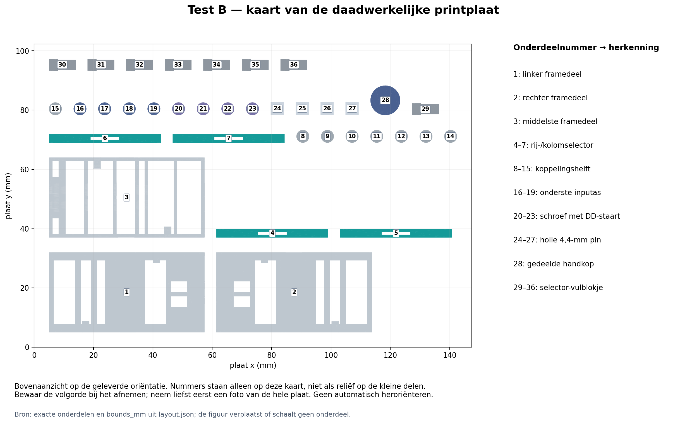
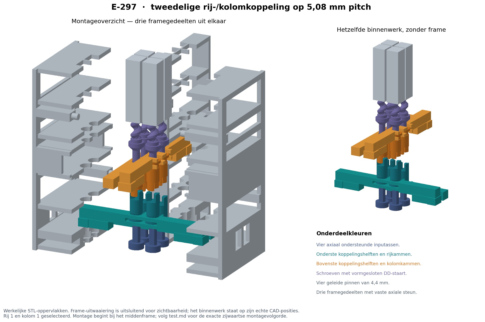

# Test B — werkelijke rij-/kolomselectie in een 2×2-raster

**Status:** READY  
**Prioriteit:** P2 — na geslaagde nominale passing in Test A  
**Laatst beoordeeld:** 2026-10-16  
**Reden:** definitieve CAD en montagepaden gecontroleerd; X1C-project opgeslagen, heropend en opnieuw gesliced. Fysieke werking is nog onbekend.  
**Technische bron:** [E-297](../../06-experiments/E-297-two-half-row-column-clutch-print-tests.md), [Test A](../2026-10-16-two-half-clutch-fit/test.md).

## 1. Waarom deze test?

Vier pinnen van 4,4 mm staan werkelijk op 5,08 mm pitch. Twee rijstaven bewegen de onderste koppelingshelften omhoog/omlaag; twee kolomstaven bewegen de bovenste omlaag/omhoog. Eén rij en één kolom laten precies één tweedelige koppeling aangrijpen. De proef onderzoekt gezamenlijke selectorbeweging, vrij draaien in de meenemers, positief ontkoppelen en onafhankelijke pinbeweging in beide richtingen.

De handgreep draait beurtelings de vier **inputassen onder de koppelingen**. Zij wordt niet rechtstreeks op de schroeven gezet. Voor bewijs van selectie moet je ook de niet-geselecteerde inputassen draaien: hun schroeven horen daarbij stil te blijven. Dit artikel kwalificeert geen gedeelde rotatiebus of motor.

**Stop:** harde weerstand, tand-op-tand blokkering die niet zacht verdwijnt, onvolledige zetting, buuraanraking, scheuren, openende frameverbinding of beschadigde draad. Eerst onbelast testen. Gebruik lichte vingerkracht, geen tang, boormachine of aangedreven eindstop.

## 2. Printklaar

[**Printproject: clutch-matrix.3mf**](clutch-matrix.3mf) — één plaat met **36 delen**, 137,46 × 92,30 mm in het vlak. Bambu Studio raamt **4 uur 29 min 43 s en 17,85 g PLA**; dit zijn geen gemeten printwaarden. Gebruik de **nominale passing uit Test A**. Als die niet soepel schuift én positief meeneemt, print of monteer deze nominale matrix dan niet op goed geluk. De concrete slicerraming, exact opgeslagen instellingen en padcontrole staan in [bambu-settings.md](bambu-settings.md).

| Kaartnummers | Onderdelen |
|---|---|
| 1–3 | Linker, rechter en middelste framegedeelte |
| 4–7 | Vier identieke dubbele selectors; twee worden 90° gedraaid en gespiegeld voor de kolommen |
| 8–15 | Acht identieke rotorhelften; bovenste vier bij montage omkeren |
| 16–19 | Vier inputassen met opgesloten voetkraag en handgreepsocket |
| 20–23 | Vier integrale schroeven met DD-staart en steunconus |
| 24–27 | Vier 4,4-mm pinnen met E-295-binnendraad en gesloten top |
| 28 | Eén afneembare handgreep voor alle inputs |
| 29–36 | Acht stopstukjes van 2,40 mm, twee per selector |

**Profiel en oriëntatie behouden:** X1C/0,4/PLA, 0,12-mm eerste en overige lagen, Arachne, twee nominale wanden, nominale lijnbreedte 0,45 mm en 100% infill. Nozzle 220 °C, Textured PEI 55 °C; gewone modelpaden 30 mm/s, eerste laag/bruggen 20 mm/s, versnelling 1000 mm/s² (eerste-laagextrusie 500); partfan 100% na de eerste laag, auxfan 0%. Supports/raft/skirt uit; print per laag; XY-, gat- en elephant-footcompensatie 0. Het project bewaart de buitenbrim; de exacte breedte en afstand staan in de profielcontrole. Geen support in draad, DD-boringen of klauwen.

De buitenframes liggen op hun brede buitenwand, met registratiepennen omhoog. Het middenframe ligt op zijn vlakke deelvlak. Meenemers staan op hun achterrand; rotoren op hun vlakke flens. De pinnen staan **met gesloten top op het bed en draad bovenaan**. De integrale schroeven zijn 26,32 mm hoog op een DD-staart van 2,20 × 1,60 mm. Hun 3-mm buitenbrim raakt de voet werkelijk (afstand 0), maar hechting en slanke printstabiliteit zijn nog niet fysiek bewezen. Let vooral tijdens de eerste 4–8 mm op loskomen of wiebelen; stop die print bij instabiliteit. Verwijder de enkele 0,12-mm brimlaag voorzichtig aan de buitenzijde; beschadig of verdik het schuifprofiel niet. De E-295-succesprint had een bredere voet en kwalificeert deze nieuwe staartoriëntatie niet.

**Extra nodig:** enkele kleine stukjes gewone tape om alleen de buitenste framevoegen te sluiten, pen en liniaal. Een reeds aanwezig pincet kan helpen bij montage; niets met een tang vastpersen. Geen lagers, veren, boutjes, motoren of aankopen per pin.

### Montage, vóór de functionele proef

1. Laat afkoelen; verwijder alleen buitenbrim en losse stringing. Inspecteer de acht dunne halzen, tanden, open boringen, framewebben en DD-staarten. Geen functionele profielen schuren of uitboren. Noteer iedere beschadiging; gebruik geen kromme schroef.
2. Begin met het **middenframe**, met beide aslijnen aan de open linker- en rechterdeelvlakken bereikbaar. Bepaal de voorzijde van waaruit de open U-vorken over de flenzen zullen schuiven. Monteer eerst de **achterste rij**, dus de rij die het verst van deze invoerzijde ligt. Leg haar twee inputassen met kragen en losse onderste rotoren elk vanaf hun eigen open zijkant in de halve zittingen. Houd de onderdelen licht op hun plaats; er is nog geen buitenframe gesloten.
3. Breng de eerste rijselector **via een open zijkant** in de vrije ruimte vóór de rotoren, tussen de inputretainer en de vaste rotorgeleiding. Schuif daarna van voren naar achteren, met de U-monden eerst, om beide flenzen. Ga niet door een gesloten voorwand heen. De smalle vorkopening ligt aan de aszijde, de brede aan de rotorhalszijde. Plaats vervolgens de twee input/rotoronderdelen van de **voorste rij** en haar tweede rijselector op dezelfde manier. De achterste vork moet eerst zitten; anders blokkeert de voorste rij zijn invoerweg.
4. Schroef buiten het frame de vier pinnen op de schroeven. Voor een eerste middenstand ligt de pinonderkant ongeveer **5,25 mm boven het begin van de buitendraad**. Plaats twee bovenrotoren op twee neergaande DD-staarten, tanden omlaag. Schuif één kolomselector zijwaarts om hun flenzen. Deze voorgemonteerde kolom met twee schroeven en pinnen wordt vanaf haar **eigen open linker- of rechterzijde** in de halve zittingen van het middenframe gelegd. Lijn schroefconussen, rotorlichamen en vierkante pinnen met hun vaste geleidingen uit. Herhaal met de andere kolom. De tanden blijven vrij; druk niets in elkaar.
5. Controleer dat alle staaftabs in hun vensters liggen. Sluit nu pas het **linker en rechter buitenframe** zijwaarts, over de integrale paspennen. De deelvlakken lopen door de aslijnen en sluiten de grotere kragen in hun zittingen op. Een kraag wordt nergens door een kleinere gesloten boring geforceerd.
6. Sluit de twee externe framevoegen met kleine stukjes tape aan voet en bovenrand, buiten de bewegende delen. De paspennen richten uit; tape houdt de voegen dicht. Zet het frame rechtop. Een voelbaar openende voeg is een stopreden. De montagebanen zijn in CAD gecontroleerd; hoe gemakkelijk de kleine onderdelen met de hand blijven liggen, is nog een fysieke testvraag.

7. **Rij UIT:** beneden, geen stopstukjes. **Rij AAN:** omhoog, een stopstuk onder elke eindtab. **Kolom UIT:** omhoog, een stopstuk onder elke eindtab. **Kolom AAN:** beneden, stopstukjes verwijderd. Houd de rail met de hand tijdens wisselen en beweeg beide uiteinden gelijkmatig. De staven trekken de rotor ook actief terug; tikken of zwaartekracht is geen vervanging.
8. De schroeven zijn onafhankelijk axiaal gesteund; een selector hoort alleen zijn rotorhelft te verschuiven. Zet bij stilstaande inputs alles uit. Controleer dat alle helften zichtbaar gescheiden zijn. Verstel daarna elke pin afzonderlijk via de echte selectie en de handgreep tot de toppen **ongeveer 4 mm boven het hoogste framevlak** staan. Dit ligt dicht bij de CAD-middenstand van 3,81 mm. Gebruik geen harde eindstop om te nulstellen.

Voor de eerste fysieke proef blijft de top **tussen ongeveer 2,5 en 5,5 mm boven het frame**: circa ±1,5 mm rond de middenstand. De CAD is over ±3 mm gecontroleerd, maar de extra ruimte blijft hier reserve voor hoogte-instelfout, axiale klik en fasezoeken. Controleer de bewegingsrichting met een kleine draai; vanaf onderen gezien rechtsom laat de pin dalen en linksom stijgen. Het opgenomen koppel kan bij omkeren eerst de vrije hoek moeten doorlopen.

[Exacte maatvoering en volledige CAD-montagebeschrijving](../../tools/curated-experiment-checks/E-297/cad/cad-guide.md).

## 3. Bediening en functionele proef

Na de montage hierboven:

1. Label de vier posities van boven gezien A = R1/C1, B = R1/C2, C = R2/C1, D = R2/C2. Zet een kleine inktmarkering op iedere schroef/zichtbare rotor en een referentie op het frame. Noteer je waarneemresolutie voor hoogte en rotatie; “geen zichtbare beweging” betekent niet exact nul.
2. Controleer met stilstaande inputs de vier standen: alles uit, alleen rij, alleen kolom, beide aan. Alleen beide aan mag volledig aangrijpen. De mechanische slag is direct: rij AAN omhoog, kolom AAN omlaag. De meegeleverde stopstukjes houden de hoge stand vast; schuif de staven bij terugkeer actief tot hun andere stop.
3. **Iedere wissel:** stop input en ontlast torsie → rij(en) terug → kolomstand instellen → gewenste rij omhoog → rustig de benodigde input(s) verdraaien om fase te zoeken → volledige selectorzetting controleren → stopstuk plaatsen → pas dan bewegen. Niet door een tandblokkade heen drukken. De overgang naar uit heeft tijdelijk nog flankoverlap; blijf dus ook tijdens ontkoppelen niet draaien.
4. Voer de onderstaande 16 standen eenmaal uit. Draai in **elke stand alle vier inputs** rustig maximaal een halve omwenteling heen en terug. Noteer welke schroeven/pinnen werkelijk reageren. In 00/10/01 hoort de betreffende schroef niet te worden meegenomen, ook als zijn input wel draait. De vrije hoek kan ruim een kwartslag bedragen, inclusief de losse handgreep. Kijk naar de inputmarkering en selectorzetting; verwar dode hoek niet met een defect. Breng zo nodig de gekozen pin terug naar circa 4 mm boven het frame en blijf binnen de hoogteband 2,5–5,5 mm.
5. Kies vervolgens A alleen. Beweeg de pin vanuit een zichtbare middenstand een kleine slag omhoog, omlaag en terug. Doe vijf cycli en observeer B/C/D. Herhaal voor B, C en D. De veilige hoogteband staat bij de montagegegevens; gebruik nooit klemmen aan het slageinde om te nulstellen.
6. Laat een geselecteerde koppeling na linksom én na rechtsom draaien afzonderlijk via de rij en via de kolom los. Draai daarna opnieuw die input: de output moet vrij blijven. Noteer losbreekkracht, axiale tik, klemmen en verandering van de drie buurhoogtes apart.
7. Probeer één hele rij, één hele kolom en alle vier tegelijk. Zet bewust één input ongeveer 90° anders in fase dan de andere. Zoek alle inputfases voorzichtig; één geblokkeerde cel kan de gedeelde staaf tegenhouden. Noteer of alle rotoren werkelijk volledig zetten. Het is geen succes als alleen tandtipwrijving de schroef laat meedraaien.
8. Stel daarna A en D na elkaar verschillend in, met B/C onveranderd. Dat zijn twee selectiepasses. Met beide rijen én beide kolommen tegelijk zou je alle vier kiezen.
9. Laat de onbelaste pinnen laag, midden en hoog telkens circa 30 seconden los. Noteer teruglopen afzonderlijk van aangedreven buurbeweging. Eventueel na een geslaagde onbelaste proef één lichte bestaande miniatuur plaatsen en haar massa/positie noteren; geen kracht- of breuktest. Draagvermogen is vooraf niet vastgesteld.

**Succes:** vier onafhankelijk gekozen pinnen bewegen beide richtingen; geen niet-geselecteerde input drijft zijn schroef aan; beide terugtrekroutes werken; geen buuraanraking of schade; alleen volledig gezette koppelingen worden belast. Als verschillende fasen een meervoudige selectie blokkeren, noteer dat als concrete beperking van de stijve gedeelde selectors.

## 4. Mijn resultaten — Sander

**Testdatum / gekozen 3MF / Test A-resultaat:**  
**Werkelijk gebruikte printer, nozzle, PLA en gewijzigde instellingen:**  
**Werkelijke printtijd / massa indien bekend:**  
**Print gelukt?** [ ] ja [ ] deels [ ] nee [x] nog niet geprint  
**Nabewerking, ontbrekende/gebroken delen:**  
**Waarneemresolutie hoogte / rotatie:**

`10` = alleen de eerste rij/kolom, `01` = alleen de tweede. Draai telkens alle vier inputs.

| R1R2 | C1C2 | Verwacht gekoppeld | Werkelijk reagerend | Volledig gezet? Onbedoelde beweging / blokkade |
|---|---|---|---|---|
| 00 | 00 | geen | | |
| 00 | 10 | geen | | |
| 00 | 01 | geen | | |
| 00 | 11 | geen | | |
| 10 | 00 | geen | | |
| 10 | 10 | A | | |
| 10 | 01 | B | | |
| 10 | 11 | A, B | | |
| 01 | 00 | geen | | |
| 01 | 10 | C | | |
| 01 | 01 | D | | |
| 01 | 11 | C, D | | |
| 11 | 00 | geen | | |
| 11 | 10 | A, C | | |
| 11 | 01 | B, D | | |
| 11 | 11 | A, B, C, D | | |

| Gekozen pin | Vijf op/neer-cycli? | Drie buren stil? | Rij trekt los? | Kolom trekt los? | Hoekspeling / axiale tik / schade |
|---|---|---|---|---|---|
| A | | | | | |
| B | | | | | |
| C | | | | | |
| D | | | | | |

**Rij-/kolom-eerst inschakelen geprobeerd; verschil?:**  
**Verschillende startfasen: volledige zetting / handhulp / blokkade:**  
**Meedraaien zonder volledige zetting?:**  
**A en D na elkaar; B/C bleven staan?:**  
**Teruglopen na loslaten (positie / tijd / eventuele massa):**  
**Montageproblemen / foto of video (optioneel):**

## 5. Interpretatie na feedback

Nog geen fysieke resultaten. De proef bewijst geen 40-mm slag, arraylevensduur, snelheid, productieopbrengst of gedeelde motortransmissie. Bij onbruikbare FDM-schuifpassing of ontbrekende dunne wanden blijft de koppeling fysiek onbewezen; Test A lokaliseert dan welke contactfunctie een andere tolerantie of fabricagewijze nodig heeft.
