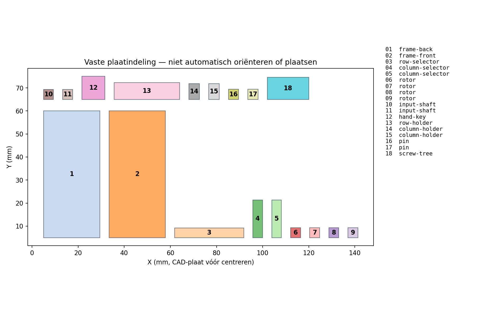
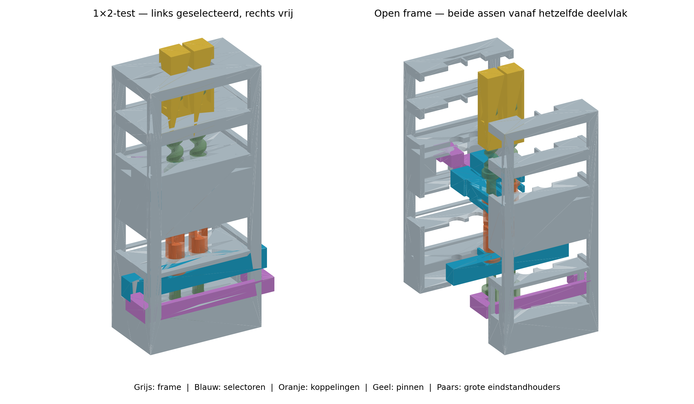

# Twee pinnen — stevige selectie, ondersteunde schroeven en fasezoeken

**Status:** READY — CAD en opgeslagen X1C-project gecontroleerd; fysieke werking nog onbekend  
**Prioriteit:** P1 binnen deze eigenaarsopdracht; geen automatische printopdracht  
**Datum:** 17 oktober 2026  
**Technische bron:** [E-299 ontwerpkeuzes](../../tools/curated-experiment-checks/E-299/design-report.md), voortbouwend op de volledige fysieke E-298-feedback. Bestaande proeven en resultaten zijn ongewijzigd.

## 1. Wat deze ene proef beslist

Kan een stijvere gedeelde rijselector twee koppelingen volledig sluiten, met twee afzonderlijke kolomselectors, waarna de gekozen pin omhoog en omlaag beweegt terwijl de andere stil blijft? En zijn de gestabiliseerde schroeven printbaar en bruikbaar na het verwijderen van hun steunframe?

**Bewuste wijziging:** brede, afgeschuinde koppeltanden met **langzaam fasezoeken aan de input tijdens het sluiten**. Dit vervangt de aanname dat een scherpere punt iedere stilstaande beginfase vanzelf oplost. De test registreert passief sluiten en fasezoeken apart. Ook een geslaagde fasezoekproef bewijst geen passieve zelfuitlijning.

**Stop bij:** hard blokkeren, verbuigende selector, openende framevoeg, breuk, beschadigde schroefdraad, pincontact met de buur, onvoldoende schroefdraadinschakeling of uit elkaar drukken van een gekoppeld paar. Niet harder drukken of met gereedschap aandrijven. Niet met geweld naar een eindstop nulstellen.

## 2. Eén vaste printplaat

Open **[two-cell-selector.3mf](two-cell-selector.3mf) als project**. Bambu Lab X1 Carbon, 0,4-mm-nozzle, PLA. **Slicerraming: 3 uur 33 min 55 s totaal, 9,37 g PLA** (3 uur 18 min 16 s model; geen gemeten printtijd). De exacte opgeslagen waarden en heropencontrole staan in [bambu-settings.md](bambu-settings.md).

**Behoud de plaatindeling en alle oriëntaties. Gebruik geen automatische oriëntatie of automatische plaatsing.** Alle delen passen samen op één plaat. Kies bij het versturen een aanwezige **PLA**-rol; een witte kleur of Bambu-merk alleen zegt niet welk materiaal het is. Het project is niet voor willekeurig ABS/PETG bedoeld. Geen nieuwe hardware nodig.

**18 printobjecten, na het losmaken 19 mechanische onderdelen:** twee framehelften, één rijselector, twee kolomselectors, vier identieke rotoren, twee inputassen, één draaisleutel, één grote U-rijhouder, twee grote kolomhouders, twee pinnen en één printframe met twee schroeven. Het printframe wordt afval; de houders blijven nodig bij het testen.

Leg identieke rotoren en gelijke kolomdelen per soort bij elkaar. De nummers op de kaart komen overeen met de objectnamen in Bambu Studio; de miniatuurrotoren zelf hebben geen opgedrukte cijfers.

Oriëntatie: framehelften op hun vlakke deelvlak, de rijselector op haar brede rug en de kolomselectors op hun brede zijvlak, rotoren met tanden omhoog, pinnen met gesloten top op het bed. De twee schroeven staan op brede gezamenlijke voeten en worden op meerdere hoogtes aan staanders gesteund. Geen slicersupports in de draadboringen. Geen brim op functionele openingen; de bedvoeten van de schroeven zijn bewust mee ontworpen.

**Inspectiepunten:** het frame bevat circa 22-mm-bruggen. Stop bij sterk doorzakkende bruggen die een geleiding of bewegingsruimte vervormen. De dunne binnendraad heeft in de nominale slicer-footprints lokale wandonderbrekingen tot circa 0,208 mm; het ongeschroefde buisgedeelte blijft gesloten. Controleer draad op gaten, scheuren en afbrokkelen. De slicerwaarschuwing over zwevende pinregio’s bleef zichtbaar, maar de controle van alle 150 lagen per pin vond geen los, niet-ondersteund laagcomponent boven de onderzochte grens. Dit is geen fysieke goedkeuring van draadsterkte.

## 3. Losmaken en eerst buiten het frame passen

1. Laat het bed afkoelen. Controleer of beide schroeven én hun steunstaanders tot bovenaan zijn geprint. Bewaar het steunframe nog als bewijs bij een mislukking. Stringing weghalen mag; schroefdraad of DD-vlakken schuren/uitboren niet.
2. De twee schroeven beginnen **1,00 mm boven de onderzijde van hun voetplaat**. Gebruik een reeds aanwezig fijn kniptangetje: maak eerst de dunne zijverbindingen aan de staanderkant los en werk van boven naar beneden. Trek niet zijwaarts aan de schroef; ondersteun haar vlak naast de verbinding. Forceer geen heel steunframe tegelijk los. Zonder geschikt bestaand gereedschap niet improviseren met een mes op de draad: noteer steunverwijdering als blokkade. Er is geen aankoopopdracht.
3. Knip de brede voet vlak onder de DD-staart bij de 1,00-mm-overgang los. Kort de eigenlijke staart hoogstens 0,10 mm in; de geringe insteeklengte is nodig. Verwijder uitsluitend los steunmateriaal. Stop als een verbinding een stuk van de draad meetrekt of de schroef buigt. Een achtergebleven steunbult op de draad is geen goede passing; noteer dit als print-/steunverwijderingsprobleem. Een noodzakelijke structurele reparatie telt niet als geslaagde print.
4. Schroef iedere pin met de hand enkele slagen op haar schroef en weer terug. De echte E-295-draadgeometrie is behouden. Test beide paren; een beschadigd paar niet in het frame gebruiken.
5. Schuif iedere rotor op de bijbehorende DD-as. De rotor moet over de nodige **3,00 mm** slag soepel bewegen en positief met de as meedraaien. Houd de vier rotoren gelijk; boven wordt dezelfde rotor omgekeerd gebruikt.
6. Plaats een selector zijwaarts om de rotorflens: het smalle U-gat aan de aszijde, het brede aan de halszijde. De flens zit tussen de twee bladen. Controleer duwen én terugtrekken, zonder de bladen te spreiden. DD-klemmen en flenswrijving apart noteren.

## 4. Montage — inleggen, dan sluiten

**A = links, B = rechts**, gezien vanaf de framezijde met de twee afzonderlijke kolombedientabs. Houd die kant bij de hele test als voorkant.

1. Leg de **achterste framehelft** op de tafel met het deelvlak naar boven. De voorste helft herken je aan de twee afzonderlijke kolomvensters. Houd de dunne framedekken vrij van tape en resten.
2. Leg beide inputassen in hun halve zittingen onderin: verdikte bus beneden, DD-staart omhoog, diepe sleutelsocket bereikbaar vanaf de onderkant. De bus zit tussen de onderste borgplaat en de assteun. Monteer op iedere DD-as een onderste rotor, tanden naar boven. Plaats de gedeelde rijselector om beide flenzen; haar stevige rug en beide eindtabs wijzen naar de achter-/zijkant van het frame.
3. Schroef buiten het frame iedere pin op haar schroef. De pinonderkant begint ongeveer **5,25 mm boven het begin van de buitendraad**. Schuif een omgekeerde bovenrotor op iedere neergaande DD-staart, tanden omlaag; de DD-vlakken moeten overeenkomen. Vang haar flens in één kolomselector, met de lange bedientab naar de voorkant.
4. Leg beide volledige schroef/pin/rotor/kolomcombinaties in de open framehelft. De conische schroefkraag hoort tussen de conische steun en de bovenste borgplaat; de pin zit in beide vierkante geleidingen. Geen kraag door een kleinere gesloten boring persen.
5. Leg de voorste framehelft erop. Controleer dat alle tabs in hun vensters liggen. Sluit de buitenvoegen met kleine stukjes gewone tape op de buitenranden, zonder bewegende delen of kijkopeningen te bedekken. Het frame heeft geen ingeperste minipennen; lijn de vlakke buitenranden zorgvuldig uit. Een voelbaar openende voeg is afkeur.
6. Controleer eerst gescheiden koppelingen: rij beneden, kolommen boven. Beide selectors moeten de volle 3,00 mm bewegen; duw beide uiteinden van de rij samen en rustig. De schroeven moeten axiaal gesteund blijven. Zet de pinbovenkanten rond **4,0 mm boven het hoogste framevlak**. De veilige eerste testband is **2,5–5,5 mm**; controleer die ook na fasezoeken. Buiten die band eerst stoppen, ontkoppelen en rustig terugstellen, nooit door een eindstop duwen.

### De grote houders zijn eindstandborging

Er zijn **geen acht losse microblokjes**. De grote U-houder borgt beide uiteinden van de rij; één brede houder per kolom borgt die kolom. Steek alleen bij een bereikte eindstand een houder in de vrije ruimte van het venster. Een houder mag geen selector naar zijn eindstand wrikken.

| Selector | UIT | AAN |
|---|---|---|
| Gedeelde rij | beneden; U-houder **boven** de twee tabs | omhoog; U-houder **onder** beide tabs |
| Elke kolom | omhoog; kolomhouder **onder** haar tab | beneden; kolomhouder **boven** haar tab |

De grote greep van een kolomhouder blijft buiten de voorwand. De U-houder loopt buiten de achterwand en bereikt beide zijvensters. Tijdens bewegen haal je alleen de bijbehorende houder weg. **Tijdens aandrijven moeten alle gekozen eindstanden geborgd zijn**, zodat tandcontact een selector niet terug kan drukken. Bij twijfel eerst stoppen en de tabel opnieuw volgen.

## 5. Korte fysieke test

Verder nodig: gewone tape, een reeds aanwezig fijn kniptangetje voor het printframe en een pen/liniaal. Gebruik een pen voor referentiestreepjes op inputs, onderste rotoren en schroefkragen; een liniaal en eventueel aanwezige schuifmaat/camera helpen. Laat de onderkant toegankelijk voor de draaisleutel: houd het frame aan de vaste buitenranden of plaats het bij een tafelrand, zonder valrisico. De sleutel steekt circa 3 mm in de verdikte inputbus; hij gaat niet in de schroef of rotor.

1. **Slag en sluiten zonder faseproblemen.** Borg beide kolommen beneden. Richt bij gescheiden helften beide paren gunstig uit: bovenste tanden tussen de onderste. Beweeg de gedeelde rij omhoog. Volledige slag moet zonder railbuiging bereikbaar zijn. Borg de rij onder de tabs. Nominale flensbuitenvlakafstand per gekoppeld paar: **15,36 mm**. Noteer of beide kanten hun eindstand bereiken; een halve koppeling telt niet. Niet aandrijven als de houder niet vrij past.
2. **Passief versus fasezoeken.** Ontkoppel en stel de bovenste koppeling vooraf bewust op punt-/tand-op-tand, ongeveer 45° en bijna de gunstige 90°; doe dit afzonderlijk voor A en B. Houd de input met de sleutel stil en probeer eerst zonder draaien met lichte selectiedruk. Noteer succes of blokkering. Bij blokkering: ontlast, begin opnieuw met dezelfde fase en draai nu alleen de input langzaam onder lichte selectiedruk. Laat de zichtbare onderste rotor door de fase lopen; max. één inputomwenteling. Stop direct zodra de selector volledig zet en draai niet verder. Noem dit **fasezoeken**, nooit passieve zelfuitlijning. Bereikt de onderste rotor door DD-speling geen 180° binnen die limiet, noteer de proef als onduidelijk. Geen tang of boormachine.
3. **Twee verschillende fases op één rij.** Stel A vooraf ongunstig en B anders in. Borg beide kolommen beneden. Til de gedeelde rij met lichte druk, zoek met input A en daarna B; stop de zoekdraaiing van A zodra haar tanden zichtbaar tussen de tegenoverliggende tanden staan, ook als B de rij nog tegenhoudt. Help dan pas B. Borg pas wanneer de hele rij zijn eindstand bereikt. Registreer of een al gezette A het sluiten van B hindert. Draai niet aan de outputs tijdens de poging. Noteer pinhoogtes vóór/na selecteren en eventuele onderrotorspeling. Dit is een gedeelde sluitproef met individuele fasezoekbediening, geen gemeenschappelijke motortest.
4. **Selectie en buur.** Controleer de acht standen hieronder. Stop de input vóór iedere adreswissel, ontlast torsie, trek de rij terug, stel de kolommen in, fasezoek en borg. Draai beide inputs afzonderlijk maximaal 1/4 omwenteling in beide richtingen, binnen de veilige hoogteband. In AAN moet de gekozen pin op en neer gaan; in UIT blijft de output stil. Herhaal alleen-A en alleen-B elk vijf korte cycli. Een kwart schroefomwenteling is theoretisch 0,75 mm; meet of schat de echte beweging en noteer zichtbare beweging van de buur.
5. **Beide ontkoppelroutes.** Na ontlasten: ontkoppel eerst via alleen de rij. Koppel opnieuw en ontkoppel dan via alleen de kolom. Draai die input daarna zachtjes: de output mag niet worden meegenomen. Inspecteer tanden, draad, sleutelbus en selectoren. Stop hier; geen duurtest of zwaardere belasting.

| Rij | Kolom A | Kolom B | Verwacht gekoppeld |
|---|---|---|---|
| UIT | UIT | UIT | geen |
| UIT | AAN | UIT | geen |
| UIT | UIT | AAN | geen |
| UIT | AAN | AAN | geen |
| AAN | UIT | UIT | geen |
| AAN | AAN | UIT | A |
| AAN | UIT | AAN | B |
| AAN | AAN | AAN | A en B |

**Praktisch succes:** beide schroefprints bruikbaar zonder draadreparatie; eenvoudige montage; volle selectorbeweging zonder doorbuigen; iedere geteste beginfase sluit met de beschreven fasezoekbediening; beide gekozen pinnen bewegen in twee richtingen; niet-geselecteerde buur blijft stil; beide terugtrekroutes werken. Dit blijft een kleine handproef, geen bewezen arraybetrouwbaarheid.

## 6. Eenvoudig resultatenformulier

Vul [resultaten.md](resultaten.md) in. Lege vakken betekenen onbekend. Bewaar mislukte delen en vermeld alle profielwijzigingen; CAD en slicerchecks zijn geen fysieke testresultaten.

## 7. Interpretatie

Nog niet fysiek uitgevoerd. Resultaten blijven open. Geen automatische vervolgopdracht, aankopen, nieuwe issues of geplande print.
