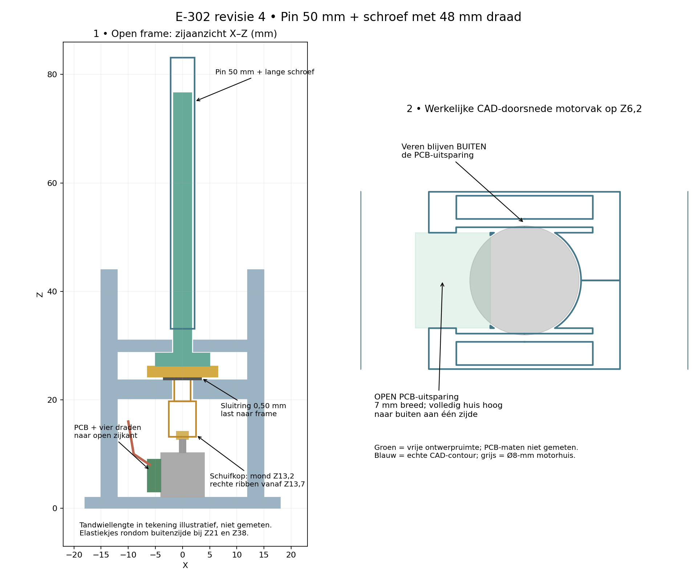
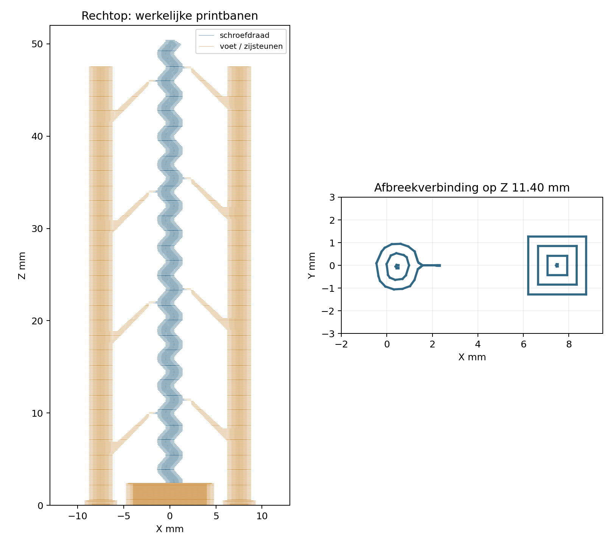

# E-302 — montage, revisie 4

Benodigd: bestaande Ø8 × 8,2-mm motor met messing tandwiel, meegeprinte of bestaande E-301
schroef en pin (10 × 10 × 2,4-mm schroefvoet), bestaande vlakke M3-ring
**ID3,2 / OD7 / dikte0,50 mm**, twee elastiekjes en verwijderbare markeerstift.
De plaat bevat een korte schroef (16 mm draad) met een standaardpin van 18 mm,
en een **lange schroef (48 mm draad, 50,4 mm totale hoogte)** met een pin van 50 mm.
Dezelfde spoed, draaddiameter, onderste 6-mm binnendraad en vierkante schroefvoet blijven behouden.
50 mm is de totale pinhoogte, **niet** de bewegingsslag.
Geen tape, lijm, slang, nieuwe elektronica of bewerking van functionele vlakken.
De ring blijft noodzakelijk: een dikkere ring kan de schroef tegen de keeper klemmen.

1. Verwijder de zijsteunen van de lange schroef volgens de instructies hieronder.
   Maak de opstelling spanningsloos. Beide actuele koppen C1/C2 hebben **drie
   inkepingen** en zijn identiek, 2 mm korter dan de geprinte revisie 3.
   De eigenaar vond A te strak en beide N-koppen gingen kapot; deze staan niet meer
   op de plaat. Laat de dunne printvoeten aan de pinnen zitten.
2. Pas C1 en C2 eerst los op het tandwiel: licht verdraaien om de drie ribben met
   tandruimtes uit te lijnen, zonder druk opschuiven en recht afnemen. De positieve
   eigenaarfeedback betrof C op de oude lengte; deze nieuwe lengte is nog ongetest.
3. Leg één framehelft met open zijde omhoog. Leg de motorbodem op de framevoet
   (Z2); richt het printplaatje naar **de open X-zijkant**, niet naar een veerbrug.
   Het metalen huis raakt de verende bruggen; PCB, soldeerpunten en alle vier
   draden blijven vrij. De uitsparing is 7 mm breed in Y, loopt van Z2 tot Z10,5 en is aan één zijde
   open naar buiten. De twee helften zijn complementair: richt hun uitsparingen
   naar dezelfde zijde. De veren blijven buiten deze uitsparing.
   Dit is een ontwerp-envelope, geen gemeten PCB-maat. Niet passend? Rapporteer
   de botsing; snijd of schuur niets weg en trek niet aan de draden.
4. Plaats de M3-ring over de Ø3-mm lagerhals van de gekozen koppeling. Schuif
   de koppeling voorzichtig over het tandwiel en leg de hals in het lagerdek.
   De ring ligt **boven op het dek**, onder de vierkante houder. Ondersteun het
   motorhuis zodat geen hefboom of merkbare duwkracht op de as ontstaat.
5. Controleer de vrije hoogte voordat het frame sluit. De mond ligt op Z13,2,
   de volledige ribben lopen van **Z13,7 tot Z19,5**; de holte is blind bij Z19,5.
   Meet tandonder- en tandbovenkant ten opzichte van de onderzijde van het frame.
   Vereis minstens **0,6 mm werkelijke overlap van tanden met het rechte ribgebied**
   en minstens **0,5 mm ruimte onder het holtedak**, ook wanneer de schroef licht
   omhoog wordt bewogen. Houd minstens 0,5 mm vrij tussen mond en motorflens/boss.
   De maatfoto geeft alleen totale uitsteking: die bewijst deze voorwaarden niet.
6. Leg de gekozen schroefvoet in de vierkante kop. Gebruik de lange schroef bij de
   50-mm pin; de korte combinatie blijft beschikbaar als vergelijking. Plaats de complementaire tweede framehelft, met de uitsparing aan dezelfde zijde,
   en twee elastiekjes in de buitenste groeven bij Z21 en Z38. Ze lopen niet over
   PCB, draden of motorbruggen. De harde splitvlakken sluiten zonder de motor
   axiaal vast te persen. Het huis moet stil blijven bij lichte handrotatie
   van de schroef. Loszitten, kantelen, scheuren of knellen betekent afkeur.
7. Draai spanningsloos één omwenteling voorzichtig. De koppeling moet vrij
   draaien; belast de schroef licht op/neer: de ring en keeper dragen de axiale
   kracht. De motoras mag daarbij niet zichtbaar verplaatsen. Nominale vrije
   keeperhoogte is 0,3 mm en ruimte onder het lagerdek 0,49 mm; echt nameten/voelen.
8. Open opnieuw en monteer de gekozen combinatie: korte schroef/18-mm pin of
   lange schroef/50-mm pin. Schroef eerst spanningsloos door de volledige gebruikte
   draadzone; geen motor gebruiken om supportresten door de binnendraad te persen. De veilige proefslag blijft 3 mm:
   bij de **18-mm pin** is de bovenzijde **5,6–8,6 mm boven het frame**, midden 7,1 mm;
   bij de **50-mm pin** is dat **37,6–40,6 mm boven het frame**, midden 39,1 mm.
   Controleer dit eerst met de hand. Geen eindstop opzoeken met de motor.
9. Markeer motorhuis/frame en tandwiel/koppeling met een verwijderbaar lijntje.
   Gebruik uitsluitend de reeds werkende E-301-bediening, zonder firmware-,
   stroom- of snelheidswijzigingen. Doe vijf korte op/neerbewegingen binnen de
   handmatig gecontroleerde slag; stop bij vastlopen, slip of huisbeweging.
10. Spanning uit, open de elastiekjes, neem koppeling en motor uit en herhaal
    montage/demontage drie keer. Test een tweede beschikbare motor met andere
    tandwielhoogte op dezelfde manier. Verplaats de motor niet met vulstukken
    om een niet-passende hoogte kunstmatig passend te maken.

## Axiale tolerantie beoordelen

Bereken bij tandbereik `[onder, boven]` de overlap:
`max(0, min(boven,19,5) − max(onder,13,7))` mm.
Controleer daarnaast dakruimte `19,5 − boven ≥ 0,5 mm`, mond/flensruimte en de
maximale 0,3-mm beweging van de houder. De ribben zijn doorgaand over 5,8 mm,
maar **5,8 mm is geen bewezen toegestane variatie in tandwielhoogte**.
De minimale overlap van 0,6 mm is een voorlopige testgrens, geen berekende koppelgarantie.
Bij onvoldoende overlap: geen motorproef. Noteer de werkelijk gemeten hoogtes.

**Gevolg van de gevraagde inkorting:** de rechte ribben beginnen nu 2 mm hoger.
Als de werkelijke tandtop precies op de foto-afgeleide Z14,2 ligt, blijft slechts
0,5 mm maximale rechte overlap over, nog vóór axiale speling. Dat ligt onder de
voorlopige 0,6-mm testgrens. De eigenaar heeft de werkelijke tandhoogte niet opgegeven;
controleer die dus bij montage en start bij onvoldoende overlap geen motorproef.
De oude CAD-ruimte garandeerde immers ook geen passende fysieke montage.

## De overschuifverbinding en de maatfoto

De foto noemt een tandwiel van Ø2,2 mm met 9 tanden/module 0,2. De koppeling
heeft een Ø2,5-mm vrijloopboring, onderbroken door drie ronde ribben. Het is dus
geen eenvoudige ronde Ø2,5-mm klemhuls. De nominale ribuiteinden van de gekozen C liggen op straal **1,05 mm** en grijpen
0,05 mm binnen de nominale tandtopcirkel aan. De radiale passing is ongewijzigd.

De 4 mm op de foto is de **totale uitsteking boven het huis**, niet de tandlengte.
De foto geeft geen drukhoek of exact tandprofiel. Een controle met een aangenomen
standaardprofiel toont geen nominale botsing, maar bewijst de werkelijke passing niet.
Zie [maatcontrole](dimension-review.json). Alle montage moet zonder forceren kunnen.

## Zijsteunen van de lange schroef verwijderen

De lange schroef staat **rechtop**, op haar bestaande vierkante voet. Twee
meegetekende torens staan links en rechts. Elke toren raakt de draad op vier
hoogtes met een nek van 0,45 mm breed en 0,24 mm hoog. Automatische supports zijn
uit; er is geen supportmantel rond de draad en geen support in de pinboringen.
Alleen het lange-schroefobject heeft een 3-mm buitenbrim.

Laat de plaat afkoelen, maak de brim los en neem de hele constructie voorzichtig
van de plaat. Ondersteun de schroef direct naast elke verbinding en knip de
smalle nek met een kleine vlakke kniptang lokaal door. Werk van boven naar beneden,
wissel de zijden af. Trek of buig de hele toren niet van de dunne schroef weg.
Neem na het losknippen de torens en brim weg; behoud de vierkante schroefvoet.

De acht contactjes zijn **vast geprint**, zonder lossingsafstand. Ze beperken
het raakvlak maar kunnen nog steeds littekens veroorzaken. Controleer elk punt
op resten, afgebroken draadtoppen en kromming. Eerst met de hand door de pin draaien;
geen motor gebruiken om resten weg te drukken, geen draad passend schuren/snijden.
Bij klemmen of schade stoppen. Zie [supportdetails](long-screw-support.md).

Met de lange schroef ligt de punt nominaal op Z76,6; de 50-mm pin eindigt bij de
laagste proefpositie op Z81,6. Er blijft dus 5 mm ruimte boven de schroefpunt.
De framegeleiding en printvoet begrenzen nog steeds de oorspronkelijke 3-mm proefslag.
