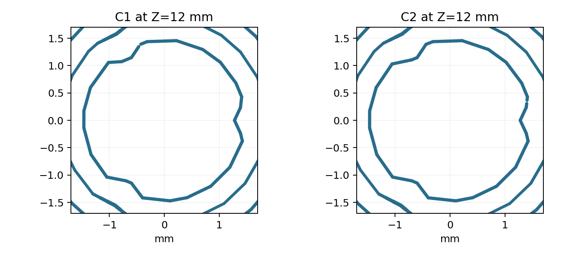
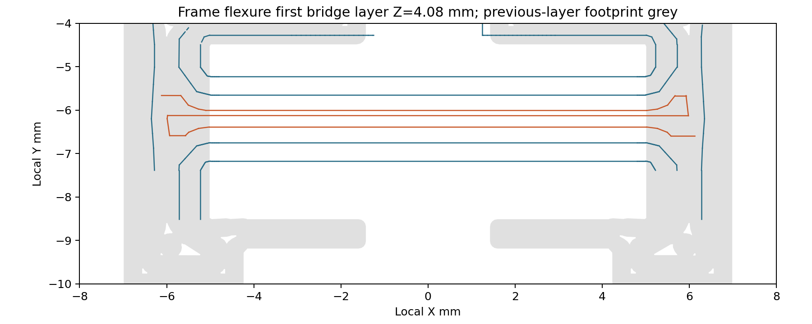

# E-302 — verificatie revisie 4, 19 oktober 2026

De eigenaar heeft **revisie 3 fysiek geprint** en gemengde resultaten gemeld:
[volledige feedback](resultaten.md). Revisie 4 verwerkt die opmerkingen.
READY betekent hier een gecontroleerd digitaal printpakket; de nieuwe lengte,
montage en rechtopstaande schroef met zijsteunen zijn nog niet fysiek bewezen.

| Controle | Resultaat / bewijs |
|---|---|
| Remote als eerste stap | `git pull --ff-only origin main`; basis `9a57fd6`, daarna op lokale `main` gewerkt |
| Kortere kop | Alleen C, twee identieke exemplaren; totale lengte 17,6 → 15,6 mm; motoruiteinde 2 mm korter, interfaces erboven behouden |
| Meshes | Acht plaatlichamen, gesloten en consistent georiënteerd; ondersteunde schroef is één verbonden mesh |
| Frame / korte delen | Framegeometrie behouden; korte schroef en 18-mm pin byte-identiek aan E-301; 50-mm pin behoudt onderste 18 mm |
| Rigid CAD | C bij 25 rotatiestanden, korte/lange schroef en 3-mm pinverplaatsing; geen nominale botsingen |
| Axiale grens | Mond Z13,2, rechte ribben Z13,7–19,5; werkelijke tandoverlap onbekend, foto-afgeleide top Z14,2 geeft slechts 0,5 mm overlap |
| Lange schroef | Functionele geometrie behouden; rechtop, twee zijtorens, acht nekken van 0,45 × 0,24 mm op vier hoogtes per zijde |
| Bambu Studio | Officiële versie 02.08.02.61; slice en zelfstandige heropening/reslice exit 0, zonder externe profielen bij heropening |
| Instellingen | X1 Carbon / nozzle 0,4 / PLA en werkelijk proces opgeslagen; geen globale verschillen, objectinstellingen identiek |
| 3MF / STL | Alle acht meshes matchen; maximale tweezijdige vertexafwijking circa 0,000011 mm; rapporthashes kloppen |
| Lobben | Beide C-koppen elk 47 rechte boringlagen gecontroleerd, alle drie ribben aanwezig, centrale radius 0,80 mm vrij |
| Lobe-uitsteking | Minimaal circa 0,146 mm in nominale baanvoetafdruk; ribtipradius circa 1,054–1,081 mm, geen fysieke maatmeting |
| Algemene laagcontrole | Alle acht onderdelen zonder nieuwe ongeankerde eilanden groter dan 0,005 mm² |
| Bruggen | Beide framehelften elk drie volledige X-brugbanen met beide einden verankerd; vrije span circa 9,98 mm; kopdak circa 10,38 mm |
| Lange-schroefbanen | 420 lagen tot Z50,40; kerncontour doorlopend, alle 16 draadgangen met draadtop; acht nekken elk twee lagen, armen tot toren gevolgd |
| Supports / boringen | Geen automatische supportbanen; beide pinboringen open; zijsteunen zijn modelgeometrie, alleen lange schroef heeft 3-mm brim |
| Pinnen | 18-mm pin 150 lagen; 50-mm pin 417 lagen tot Z50,04, alle 366 bovenlagen gesloten rondom open kern |
| Visuele controle | Montage, plaat, ribbanen, framebrug en rechtopstaande schroefbanen bekeken |
| Fysieke grens | Nieuwe overlap, slip, printstabiliteit, supportverwijdering, asbelasting en slijtage nog onbekend |

Bambu is gecontroleerd via de **officiële CLI-engine**, niet door een interactieve
GUI-sessie. De twee slices verschillen enigszins in banen, ondanks identieke
instellingen; beide zijn afzonderlijk gecontroleerd. De eerste schat **13,22 g /
4u12m01s**, de heropende **13,22 g / 4u12m07s**. Modeltijd respectievelijk
3u56m21s en 3u56m27s. Geen fysieke tijd- of materiaalmeting.

De nekcontrole volgt een schuine arm door opeenvolgende lagen terug tot de toren:
zij eist geen horizontale verbinding met de toren op één laag. Dit controleert
printbare samenhang, geen berekende of gemeten mechanische stijfheid. De smalle
contacten kunnen nog steeds de draad beschadigen bij het verwijderen.




## Reproductie

Eigenaar: open de meegeleverde 3MF. Onderstaande stappen zijn voor engineering.
Python: numpy, trimesh, manifold3d, scipy, shapely, matplotlib, networkx.
OpenSCAD en BOSL2 commit `136e6367e65d52196a3ea51d03156f8b622c60fc`.
Vanuit repositoryroot, met zelfgekozen lokale toolpaden:

```sh
python owner-print-tests/2026-10-18-microstepper-frame-v2/generate.py --bosl2 /pad/naar/BOSL2
python owner-print-tests/2026-10-18-microstepper-frame-v2/review_geometry.py
python owner-print-tests/2026-10-18-microstepper-frame-v2/review_dimensions.py
python owner-print-tests/2026-10-18-microstepper-frame-v2/drawings.py
python owner-print-tests/2026-10-18-microstepper-frame-v2/build_project.py \
  --bambu /pad/naar/bambu-studio --resources /pad/naar/resources \
  --scratch work/e302-v4/slice \
  --stl owner-print-tests/2026-10-18-microstepper-frame-v2/microstepper-frame-v2.stl \
  --out owner-print-tests/2026-10-18-microstepper-frame-v2/microstepper-frame-v2.3mf
```

Voer `review_lobes.py PROJECT OUT.json`, `review_support.py PROJECT OUT.json`,
`review_pins.py PROJECT OUT.json` en `review_long_screw.py PROJECT OUT.json` elk uit
op zowel de opgeleverde als de heropende 3MF. Ze gebruiken de bestaande
`owner-print-tests/validate-bambu-project.py` G-codelezer. Bewaar de globale
`Metadata/project_settings.config` als `saved-settings.json`; de lokale instellingen
komen uit `build_project.object_settings`. `review_archive.py` controleert tot slot
geometrie en de hashes van de slicerapporten. De `*-reopened.json`-rapporten verwijzen
naar het afzonderlijk gereslicete project in de scratchmap, waarvan de hash in de
rapporten staat; de primaire download blijft de eerste 3MF.

Officiële Bambu AppImage:
<https://github.com/bambulab/BambuStudio/releases/download/v02.08.02.61/BambuStudio_ubuntu24.04-v02.08.02.61-20260820225108.AppImage>.
SHA256 `d501b103fac5424513ec0e8d6bc145fb30719de2c7d94d7320d723740c81a7fd`
gecontroleerd. Ontbrekende runtimebibliotheken lokaal uitgepakt uit pakketten
via ondertekende Debian-APT-metadata. Tijdelijke tools/logs blijven buiten Git.

`./repo check`: alleen de bestaande groottewaarschuwingen voor E-266/E-283/E-286/
E-288/E-293 en `owner-print-tests/AGENTS.md`; geen nieuw structuurprobleem.
`git diff --check` zonder fouten. Deze wijzigingen raken geen software/elektronica.

## Herkomst en behouden negatieve evidence

De geprinte revisie 3 is terug te vinden op `9a57fd6`. A/N-koppen en de horizontale
schroef-STL blijven historische bronnen; ze staan niet op de nieuwe plaat.
De eigenaarfeedback is ongewijzigd vastgelegd naast een afzonderlijk leeg formulier
voor revisie 4. De eerdere CAD-/slicerresultaten blijven in Git-historie beschikbaar;
de rapporten in deze map gelden nu uitsluitend voor revisie 4.
