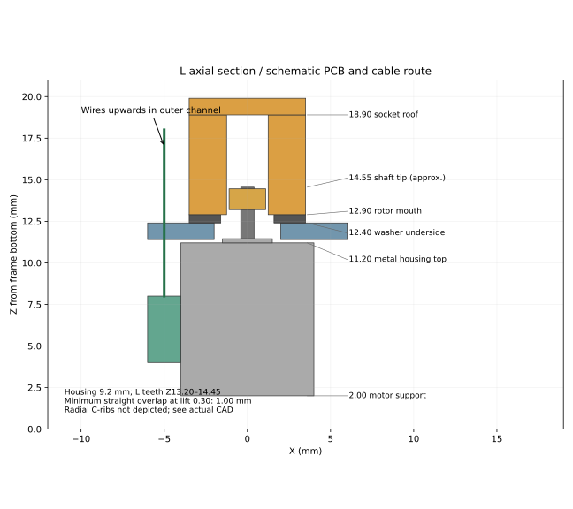

# Montageconcept — gemeten L-variant

De nieuwe3MF met tegengesteld georiënteerde helften en geleiding tot50 mm is digitaal gecontroleerd voor X1 Carbon/0,4/PLA.
Deze aanwijzingen beschrijven de gecorrigeerde CAD, geen fysiek bewezen montage.
Begin spanningsloos; verwijder de rotorbrim zonder ribben te beschadigen.
Gebruik alleen het nieuwe paar framehelften: de vorige achterkant had de verkeerde
handigheid. Draai de achterkant om, zodat pennen/gaten tegenover elkaar liggen
en beide PCB-uitsparingen aan dezelfde motorzijde zitten. Niet spiegelen in de slicer.

1. Gebruik **L: tandonderkant≈2,0 / tandbovenkant≈3,25 mm boven huis**.
   K is niet voor deze uitvoering vrijgegeven. Huis rust op Z2; bovenvlak Z11,2.
2. PCB naar de open −X-zijde. PCB ligt volgens meting tussen Z4 en8. De brede
   uitsparing loopt vanaf Z2 tot10,01: ruimte onder het printje voor lijm.
   Breedte8,5 mm tegenover gemeten6,5–7. Geen PCB/soldeer inklemmen.
3. Leid de draden vanaf de bovenzijde van het PCB naar de **buitenkant** in het
   open verticale kanaal X≤−4,2. Ze blijven daar buiten ring en rotor. Houd ze
   ook buiten de elastieken en uitlijnpennen. Niet langs de as omhoog leiden.
4. Pas eerst zonder spacer. Bestaande spacers0,60/0,72/0,84 blijven als
   pasmiddelen; kies uitsluitend een combinatie waarbij de motor vast zit en
   helften volledig sluiten. Grotere spacers kunnen bewust interfereren.
   Controleer opnieuw ascentrering; geen bewezen voorspanning of automatische keuze.
5. Ring vlak in Ø7,3-pocket, bodem Z12,4. Rotoronderkant Z12,9 rust op ring;
   huis, boss, tandwiel en as mogen niet als axiale aanslag dienen. Krachtweg:
   pin → draad/rotor → ring → circa1-mm draagdek → stijve framehelften.
6. Rechte C-ribzone conservatief Z13,15–18,9; bij maximale lift Z13,45–19,2.
   L-tanden circaZ13,2–14,45; nominale minimale rechte overlap1,0 mm.
   Asuiteinde circaZ14,55; dakruimte4,35 mm. Dit zijn berekende benaderingen.
7. Sluit met bestaande pennen en elastieken; voeg een derde elastiek toe in de
   bovenste groef bij Z67,7 om de lange geleiding gesloten te houden. Draai met de hand360° en controleer
   lift tot0,30 mm, soepele loop, vlakke ring en geen meebewegende motoras.
8. Pinonderkant Z27,9–30,9; bovenzijde Z45,9–48,9. De oorspronkelijke onderbouw blijft40,7 hoog; de centrale vierkante geleiding
   loopt nu van Z32,7 tot72,7, opening4,8 ×4,8 voor pin4,4 ×4,4.
   Voor een50-mm pin ligt de tip op Z77,9–80,9 (5,2–8,2 boven de geleiding).
   Kortere pinnen blijven binnen de lange geleiding; plaats/verwijder ze met
   geopende helften. De plaat bevat de bestaande18-mm proefpin; hergebruik
   bestaande langere pinnen met dezelfde onderzijde en draad.
   **50 mm is pinlengte, niet slag.** Slag3 mm, draadspoed3 en originele draadmesh
   behouden. Controleer eerst de volledige slag handmatig.

Stop bij druk op kabels/lijm/PCB, open splitnaad, klemmende motor, schuren,
asbeweging of onvoldoende tandoverlap. Nog geen nieuwe fysieke proef verricht. Pas na soepele handmatige controle vijf
op/neercycli binnen de3-mm slag met bestaande bediening; geen eindstop opzoeken.
