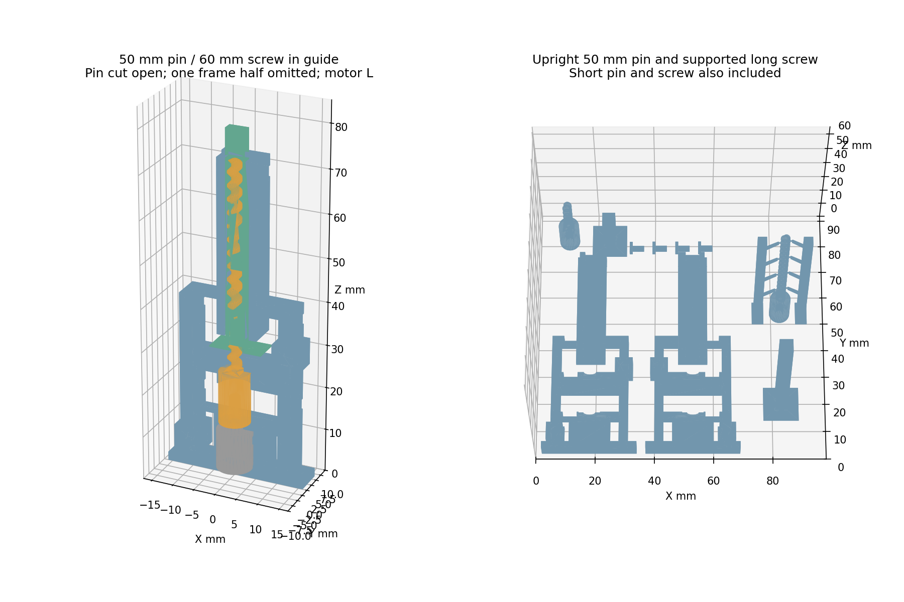
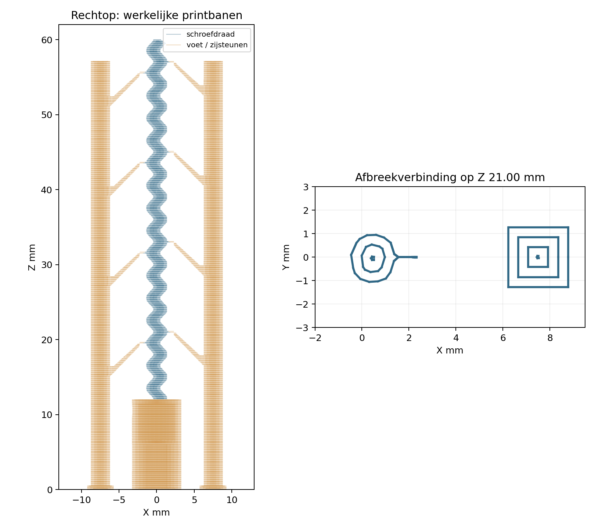

# E-302 v3 — 50-mm pin en lange schroef met verwijderbare zijsteunen

**23 oktober 2026 — huidig printaanbod RETIRED; bestanden blijven historisch bewaard.**
De eigenaar heeft een v3 fysiek getest: goede motorpassing, toenemende wrijving
bij circa15 mm stijging met lange schroef, verbetering bij losser sluiten.
Printartefacten verwijderd; na slechte tests ook rotorvoet met mes bijgewerkt.
Exacte revisie onbekend. De onderstaande algemene uitspraak “fysiek niet getest”
is achterhaald; zij bewijst niet dat deze exacte3MF geprint is.
Gebruik nu de [gerichte proef met bestaande onderdelen](../2026-10-23-low-friction-motor-frame/test.md),
niet opnieuw de volledige plaat. De onderstaande21-oktoberlevering is historie.

**Status: READY — digitaal gecontroleerd; fysieke passing nog niet getest.**
21 oktober 2026. Alleen voor **L: A≈2,0 / B≈3,25 mm boven het metalen huis**.
Gebruik de kortere K niet voor deze uitvoering. Geen printdeadline.

**Vervangt de vorige plaat:** de vorige achterkant had de verkeerde handigheid.
Beide helften opnieuw printen; nieuwe framehelften niet met oude combineren.
De nieuwe montagecontrole gebruikt uitsluitend rotaties, geen spiegeling.

Open [microstepper-frame-v3.3mf](microstepper-frame-v3.3mf) in Bambu Studio.
Printer, materiaal, proces, oriëntatie en lokale rotorbrim zijn opgeslagen;
het project is zelfstandig heropend en opnieuw gesliced.

| Onderdeel | Aantal |
|---|---:|
| Stijve framehelften, pennen/gaten | elk1 |
| Korte geïntegreerde rotor, 12-mm body + 16-mm draad | 1 |
| Lange geïntegreerde rotor, 12-mm body + 48-mm draad, met twee zijsteunen | 1 |
| Pinnen van 18 en 50 mm, beide rechtop | elk 1 |
| Spacers0,60 /0,72 /0,84 | 1 /2 /1 |

Hergebruik bestaande ring ID3,2/OD7/0,50 en motor L. Gebruik drie elastieken,
waarvan één bij de top van de verlengde geleiding. Huis9,2 mm hoog,
nieuwe zittingØ8,4. Ruimte voor PCB, variabele lijm en omhooglopende kabels.
Ring/rotor0,7 mm hoger met circa1-mm draagdek; C-inloop0,25 voor meer rechte
riboverlap. Bewezen radiale C-vorm, draadspoed3 en proefslag3 behouden.
Vierkante geleiding4,8 ×4,8 loopt van Z32,7 tot72,7 en ondersteunt bestaande
4,4-mm pinnen van18 tot50 mm lang. **Geen 50-mm slag.** De plaat bevat nu beide pinnen en beide schroeven.
Gebruik de lange schroef met de 50-mm pin; de korte schroef blijft bruikbaar met
beide pinlengtes voor de 3-mm proefslag. De lange schroef is 60 mm totaal,
inclusief de bestaande 12-mm koppelingbody.

**Bambu Studio02.08.02.61; X1 Carbon/0,4-mm nozzle; Generic PLA / Textured PEI.**
Schatting **4u59m21 /16,61g**. Geen fysieke printmeting.
Laag/eerste laag0,12; Arachne,2 wanden, nominale lijn0,45;100% zigzag-infill.
Nozzle220°C, bed55°C. Buitenwand/kleine omtrek/eerste laag/brug15mm/s,
binnenwand20; acceleratie default/binnen1000, buiten/eerste500mm/s².
Automatische supports uit; de lange schroef heeft twee meegetekende zijsteunen
met acht dunne knipverbindingen. Geen supports aan/in de pinnen. Raft0, per laag.
Korte rotor buitenbrim2 mm; lange schroef plus zijsteunen buitenbrim3 mm; gap0,12.
XY/gat/elephant-footcompensatie0; fan100% na eerste laag, hulpfan0,
minimum laagtijd8s. Geen automatische heroriëntatie/herschikking.

Framehelften op vlakke buitenzijde, uitsparingen omhoog; rotor rechtop met mond
op bed; beide pinnen rechtop op hun bestaande vierkante printvoet; spacers vlak. Vier spacers op de
plaat van links naar rechts0,60 /0,72 /0,72 /0,84. Modelbereik90,5×86×60 mm, exclusief brim.
De 50-mm pin houdt de 12×12×0,24-mm voet; geen zijsteunen aan de pin. Controleer
volledige bedhechting en stop bij loskomen of wiebelen. Bovenwandbanen maximaal
15 mm/s en500 mm/s². Rechtopstabiliteit is nog niet fysiek bewezen.

Verwijder de schroefsteunen zoals beschreven in de [montagehandleiding](assembly.md):
knip elk dun nekje lokaal los; trek niet aan de hele toren. De contacten zijn
0,45 mm breed en0,24 mm hoog. Gemakkelijke verwijdering is het ontwerpdoel,
nog geen fysieke waarneming. Controleer resten en draadpassing vóór montage.

Volg de [montagehandleiding](assembly.md): eerst spanningsloos passen, kabels in
buitenste kanaal, ring vlak,360° handrotatie en volledige3-mm slag. Pas daarna
vijf korte op/neercycli met bestaande bediening. Stop bij klemmen, open naad,
PCB-/kabeldruk, asbeweging of slip. Noteer alleen waarnemingen in [resultaten](resultaten.md).

[Maattabel, maatketen en verificatie](verification.md). READY is digitale
printvrijgave voor deze kleine proef, geen bewezen mechanische betrouwbaarheid.

`cad/`: parametrische bron; `components/`: actuele STLs; `scripts/`: generatie,
CAD-/slicecontrole; `metadata/`: bronnen, instellingen en rapporten; `images/`:
montage en banen. `components/archive/2026-10-19/` bevat oude meshes en3MF;
`metadata/archive/` oudere controles. De verkeerde helften en vorige3MF staan
in components/archive/2026-10-20-before-handedness-fix; bijbehorende rapporten
in metadata/archive/before-handedness-fix. Gebruik die oude plaat niet meer. De voorgaande plaat zonder lange schroef/pin
staat in components/archive/2026-10-20-before-long-screw; bijbehorende rapporten
in metadata/archive/before-long-screw. De gecorrigeerde framevorm is behouden.

Stop na deze gerichte correctie; geen nieuw mechanisme, elektronica of motorbankonderzoek.
