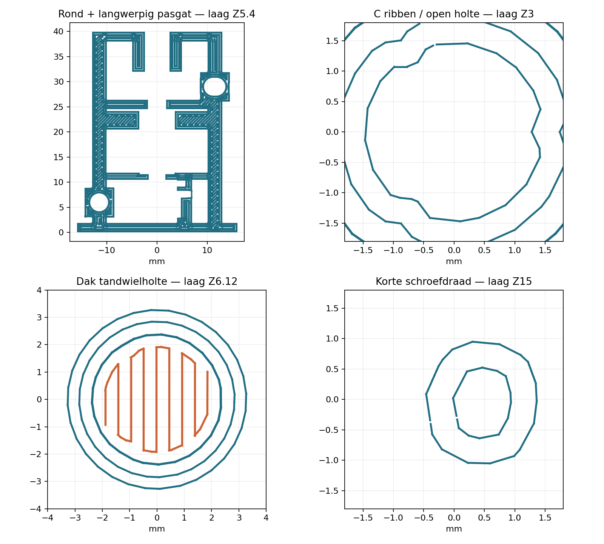

# E-302 v3 — compacte verificatie

**19 oktober 2026.** Repositorybasis `fb132bf`, na `git pull --ff-only origin main`.
Root-/printtest-/experimentinstructies, missie/prioriteiten, DES-009, E-301 fysieke
resultaten en v2 CAD/montage/resultaten/revisiegeschiedenis gelezen. Nieuwe
waarnemingen komen van de eigenaar; er is hier geen fysieke proef uitgevoerd.

## CAD

- Acht plaatobjecten, zeven unieke onderdelen; alle STL-meshes gesloten,
  consistente oriëntatie en per onderdeel één verbonden lichaam.
- Geïntegreerde rotor Ø7, totale hoogte28, mond Z12,2, dak Z18,2. Het drie-ribbenprofiel
  blijft C: basisboringØ2,5, ribafrondingR0,5, tipradius1,05, inloop0,5 mm.
- De oorspronkelijke korte schroefmesh is boven de vierkante voet afgesneden en
  met de ronde rotor verenigd. Geen opnieuw gegenereerde benadering van de draad:
  symmetrisch verschil in het functionele draadgebied circa0,0000068 mm³, numerieke
  meshprecisie. Spoed3 / draadlengte16 / nominale diameter3,2 behouden.
- 25 gekoppelde rotatie-/translatiestanden over3 mm: geen nominale rotor-frame-,
  pin-frame- of rotor-pinbotsing. Oplichting0,30 mm eveneens gecontroleerd.
  Radiale geleidingØ7,4, pinbovenkant5,2–8,2 boven het40-mm frame.
- Neerwaartse last via rotorvlak, bestaande ring en draagdek; opwaartse last via
  ronde rotorschouder en bovenste aanslag. Ring inØ7,3-pocket, zonder CAD-overlap.
  Werkelijke boss/tandhoogte en asbelasting zijn hiermee niet fysiek bewezen.
- Stijve motorboringØ8,2; geen veerbruggen. PCB-envelope aan −X vrij. Twee Ø3-pennen
  met2,8-mm uitsteek, Ø3,5 rond gat en4,2×3,5 sleuf, gatdiepte3,2.
- Spacers raken geen framevlakken in CAD; 0,60/0,72/0,84 geven nominale tangentiële
  beschikbare huisbreedte8,20/8,08/7,96. Bij0,84 bestaat opØ8 bewust geringe
  klem-interferentie; nooit forceren of helften met een open naad gebruiken.
  De motor kan bij de andere maten iets zijwaarts opschuiven. Geen gemeten voorspanning.

Rapporten: [CAD](metadata/cad-review.json), [meshes en hashes](metadata/geometry.json).

## Bambu Studio en werkelijke banen

Officiële **Bambu Studio02.08.02.61 CLI-engine**, geen interactieve GUI-sessie.
Geconfigureerd X1 Carbon/0,4/PLA-project opgeslagen, daarna zelfstandig heropend
**zonder externe profielen** en opnieuw gesliced. Beide exit0; alle globale en
objectinstellingen behouden. De bestanden verschillen in archiefhash en enkele
G-codegegevens, maar de gecontroleerde functionele uitkomsten zijn gelijk.

**Slicer-estimatie opgeleverd: 3u04m48s totaal, 2u49m09s modeltijd; heropend:
3u04m47s / 2u49m08s. Beide 10,70 g PLA / 3,588 m filament.** Geen gemeten printtijd of verbruik.
De G-code noemt8630,62 bij zijn volumeveld met labelcm³; dit is inconsistent met
gewicht/lengte en wordt hier niet als8630 cm³ overgenomen (circa8,63 cm³ uit lengte).

| Controle | Uitkomst |
|---|---|
| 3MF versus geleverde STL | Acht meshes; maximale tweezijdige vertexafwijking0,0000109 mm |
| Laagsamenhang | Geen nieuwe ongeankerde eilanden >0,005 mm² in alle acht objecten |
| Bruggen | Beide framehelften max2,38 mm, holtedak max2,452 mm; uiteinden op vorige laag verankerd |
| C-ribben | Alle drie aanwezig op45 gecontroleerde rechte boringlagen; min contrast0,151 mm; ribtipradius1,054–1,076 |
| Tandwielboring | Centrale radius0,80 vrij in rechte ribzone; dak zonder supports geprint |
| Schroefdraad | 128 lagen van de volle draadzone elk één verbonden doorsnede; vijf volledige gangen met draadtop tot circaR1,598; topafschuining ook in algemene laagcontrole |
| Pin | 150 lagen, open centrale radius0,60; bovenbuis vanafZ6,12 gesloten; geen supports in binnendraad |
| Uitlijning | Beide penkernen doorlopend; rond/sleufgat opZ5,4 open totR1,30, baanbeeld bekeken |
| Spacers | Strookdikte5/6/6/7 lagen; tabjes verbonden en bereikbaar |
| Supports/brim | Geen supportbanen; alleen rotor heeft2-mm buitenbrim; pin behoudt12×12-printvoet |

**Interne spleetjes:** nominale baanvoetafdrukken laten bij sommige schroeflagen
kleine interne lege plekken tussen de wanden zien, ondanks100% infill. De minimum
bedekking binnenR0,50 is circa83%; dit is een lokale doorsnedecontrole, geen totale
porositeit of sterkteberekening. De contour blijft één verbonden lichaam met
laagverbinding. Een lokale wandvariant gaf geen verbetering; de definitieve levering
behoudt het oorspronkelijke profiel. Er wordt geen volledig massieve kern geclaimd.
Printhechting, stevigheid, bramen, maatafwijking en soepel draaien blijven fysiek te beoordelen.



Rapporten: [opgeleverd](metadata/slice-review.json), [heropend](metadata/slice-review-reopened.json),
[opgeslagen instellingen](metadata/saved-settings.json), [bouw en objectinstellingen](metadata/microstepper-frame-v3-build.json).
De kleine spacers zijn bewust dikke stroken met tabjes; geen kwetsbare folie of veren.
De korte draad staat rechtop boven een7-mm voet met brim: geen horizontale supports
op de draad. De printbaarheid is digitaal gecontroleerd, fysieke stabiliteit niet bewezen.

## Reproductie in de repository

Python3 met numpy, trimesh, manifold3d, scipy, shapely, matplotlib, networkx;
OpenSCAD2021.01. De CAD-generator gebruikt de bestaande v2 `screw.stl` en
`pin-18.stl` als vastgelegde functionele meshbronnen. De meshvereniging gebeurt met
Manifold: OpenSCAD/CGAL gaf bij het snijden van de historische mesh een fout;
de generator wijst zulke OpenSCAD-foutmeldingen expliciet af.

```sh
python owner-print-tests/2026-10-19-microstepper-frame-v3/scripts/generate.py
python owner-print-tests/2026-10-19-microstepper-frame-v3/scripts/review_geometry.py
python owner-print-tests/2026-10-19-microstepper-frame-v3/scripts/build_project.py \
  --bambu /pad/naar/bambu-studio --resources /pad/naar/resources \
  --scratch work/e302-v3/reproduced \
  --stl owner-print-tests/2026-10-19-microstepper-frame-v3/components/microstepper-frame-v3.stl \
  --out owner-print-tests/2026-10-19-microstepper-frame-v3/microstepper-frame-v3.3mf
python owner-print-tests/2026-10-19-microstepper-frame-v3/scripts/review_slice.py \
  owner-print-tests/2026-10-19-microstepper-frame-v3/microstepper-frame-v3.3mf \
  owner-print-tests/2026-10-19-microstepper-frame-v3/metadata/slice-review.json
python owner-print-tests/2026-10-19-microstepper-frame-v3/scripts/review_slice.py \
  work/e302-v3/reproduced/reopen/microstepper-frame-v3.3mf \
  owner-print-tests/2026-10-19-microstepper-frame-v3/metadata/slice-review-reopened.json
```

Officiële AppImage uit de v2-verificatie gebruikt, SHA256
`d501b103fac5424513ec0e8d6bc145fb30719de2c7d94d7320d723740c81a7fd` bevestigd.
Ontbrekende runtimebibliotheken lokaal uit pakketten met ondertekende Debian-APT-metadata.
De scripts gebruiken het reeds vastgelegde compact-fit PLA-profiel als basis;
alle effectieve instellingen zitten in de nieuwe3MF.

## Nog fysiek te controleren

Werkelijke tandoverlap en boss/PCB-vrijloop; volledige sluiting van de helften;
motorpassing met hoogstens één spacer; vrije rotatie en ringondersteuning zonder
asbelasting; vervolgens vijf op/neercycli binnen de handmatig gecontroleerde3 mm.
Geen duurproef, motorbankkwalificatie of mechanische betrouwbaarheid geclaimd.
Elektronica/software ongewijzigd. Oudere negatieve resultaten zijn behouden.

`./repo check`: alleen bestaande groottewaarschuwingen voor E-266/E-283/E-286/E-288/E-293 en printtest-AGENTS. `git diff --check` zonder fouten.
