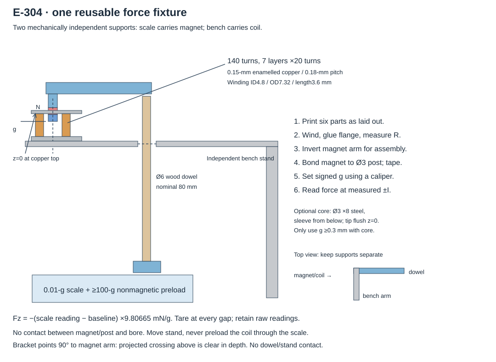

# E-305 — reversible magnetic force screen

**Status: READY for the force fixture only; no physical print or force measurement performed.**

**Priority: P3. Last reviewed: 25 October 2026.**

The current E-302 v3 offer was explicitly retired on23 October; the two earlier selector READY offers remain untouched. This is the third current READY offer. No schedule or owner deadline.

Technical source: [E-305](../../06-experiments/E-305-permanent-magnet-reversible-clutch.md). **Question:** can one inexpensive stationary winding produce repeatable positive and negative force on an axial Ø3×2-mm magnet, across a0.6-mm stroke, with tolerable heat and OFF force?

## Print and parts

Open **[reversible-magnet-force.3mf](reversible-magnet-force.3mf)** directly in Bambu Studio. It embeds all six objects, printer, filament and process settings. Do not print the separate conceptual clutch CAD. [Actual sliced paths](images/toolpaths.svg), [verification](verification.md), [assembly illustration](images/assembly.svg), [electrical schematic](images/wiring.svg).

| Printed part | Quantity | Purpose |
|---|---:|---|
| Bobbin |1|Ø4-mm bore, Ø4.8-mm barrel, Ø8.4-mm lower flange; winding length 3.6 mm |
| Top flange |1|Separate ring, glue underside at bobbin z4.4 mm |
| Coil bracket |1|Fixed to an independent wooden bench support with two cable ties |
| Scale foot |1|Holds a nominalØ6-mm wooden dowel;Ø6.4-mm blind socket |
| Magnet arm |1|Invert after printing; socket onto dowel, bond magnet to theØ3 post at the other end |
| Core sleeve |1|Optional removable steel-core comparison, not fitted for the main air test |

One68×54-mm plate, **3.63 g PLA /50 min11 s total** (36 min13 s model time), Bambu estimates. Saved and independently reopened/resliced in **Bambu Studio 02.08.02.61**; reopened estimate differs by1 second. No supports, raft or brim. Largest height 11 mm. Broad flat bases on plate; the bobbin's0.4-mm barrel wall is an actual continuous Arachne path, not assumed printable from its mesh alone. Avoid squeezing it while winding. No functional threads on this plate.

Saved settings: **X1 Carbon /0.4-mm nozzle /Generic PLA /Textured PEI /210°C nozzle /55°C bed**. Layers0.12 mm, first0.20; Arachne;3 requested walls (thin parts reduce to the width that fits); nominal line0.42, inner0.45, outer0.42, first0.50 mm.20% gyroid;5 top/bottom shells. Outer20, inner30, infill50, solid40, top/bridge20, first20 mm/s. Default acceleration1000, outer/first500 mm/s². XY and hole compensation0, elephant-foot0.05 mm. Fan100% after first layer, full from layer 2. By-layer order. Exact inherited settings are embedded and recorded in [saved-settings.json](metadata/saved-settings.json).

`components/` contains STLs; `cad/` the parametric generator; `scripts/` the build and actual-path review; `metadata/` the original/reopened verification and settings; `images/` the vector instructions. No owner CAD export is required.

### Purchased/reused components — no purchase made or authorized by this handoff

- **One S-03-02-N Ø3×2-mm axial N48 NdFeB magnet**, Ni-Cu-Ni, ±0.1 mm, [supplier](https://www.supermagnete.be/spa/imanes-disco-neodimio/disco-magnetico-3mm-2mm_S-03-02-N). Pack minimum20; list€4.80 plus delivery/minimum-order conditions. A spare is useful for polarity comparison; only one is fitted.
- **About2.8 m of 0.15-mm copper enamelled wire**, e.g.[DONAU LD15-1](https://www.reichelt.com/ie/en/shop/product/enameled_copper_wire_0_15mm_100m_black-398440).100-m retail spool~€12.20. Check insulated OD≤0.18 mm; if thicker or winding irregularity prevents20 turns×7 layers, record actual turns/geometry and do not use the nominal calculation unchanged. Leads100 mm total included; longer leads add resistance.
- **Pololu2130 DRV8833 carrier**,[manufacturer](https://www.pololu.com/product/2130/), $10.95 reference retail; EU landed cost unverified. One10Ω5-W resistor,100µF10-V electrolytic,100nF capacitor,0.75-A fuse/holder, supply switch; three10-kΩ pulldowns and a Pico or equivalent3.3-V logic controller. Optional0.43Ω1%1206≥0.25-W sense resistor for the documented higher-current stage. Standard resistor-limited stage needs no carrier modification.
- Current-limited3–5-V bench supply, multimeter, temperature probe attached to coil,0.01-g scale whose settling time is checked, caliper, nonmagnetic≥100-g preload, nonmagnetic bench stand/wood blocks and clamps. Instruments are not counted in the few-euro material cost. A cheap scale's display resolution is not its accuracy.
- One straightØ6-mm wooden dowel, nominal80 mm long; choose length so magnet/coil are at least60 mm above the scale platform and clear all scale housing. Two small cable ties for bracket; epoxy suitable for nickel/plastic and thin polyimide tape for magnet retention. Check dowel/socket fit without forcing; a loose wooden dowel may be bonded or paper-shimmed, with actual fit recorded. No printed long slender mast or mechanical bearing is needed for force measurement.
- **Optional core:** one measuredØ3×8-mm segment of uncoated, unhardened low-carbon steel, preferably identified non-leaded EN1 A/230M07 stock, cut and deburred. [An actual3-mm stock listing](https://kimetals.co.uk/materials/bright-mild-steel/bright-mild-round-bar-en1/kim42754) is UK stock; certified grade and EU landed supply are unverified. Any substitution must record actual alloy/state. Do not order a3-m bar for one insert. Omit this optional comparison if suitable scrap/stock is unavailable; no soft-iron force guarantee is used. Insert must slide in the sleeve; do not force an oversized bar. The selected air-core test needs no metal core.

Incremental small parts commonly total~€25–50 before shipping if instruments/controller are already available. This is a shopping allowance, not a quoted basket; no purchases were made.

## Assembly

1. Check the bores are open and walls intact. Dry-fit top flange. Wind20 turns per layer over3.6 mm, seven layers, keeping starts/ends at the flange and away from the bore. Count turns; glue the top flange's underside at 4.4 mm above the base. Measure winding OD and active length. Secure leads to the fixed bracket so their tension cannot load the scale. Measure cold R; nominal2.70 Ω, but lead/contact resistance matters at this scale. Stop for a short circuit or damaged insulation.
2. Glue the magnet to the arm'sØ3-mm post with **N toward the arm/upward in service**. Apply a thin tape wrap around magnet/post, leaving the pole face clear. Keep assembled magnetic tip OD<3.6 mm for the4-mm bore. Test retention gently before energizing. No heating/drilling of the magnet; keep loose magnets away from children.
3. Fit the dowel in the scale foot and inverted arm. Place foot and≥100-g nonmagnetic ballast on the scale. Clamp the coil bracket to a completely independent wood stand. Coil axis and magnet/post axis must coincide without contact. The arm, dowel and foot are supported only by the scale; the coil only by the bench. Core attraction can otherwise lift or tip an inadequately loaded fixture.
4. Set datum: top of copper winding is z=0, **not** the top flange (nominal+0.8 mm). Measure the lower magnet face relative to that datum. Negative g means magnet partly inside the bore. Record flange thickness, glue thickness and actual g uncertainty. No spacer remains between magnet and coil during readings.
5. Use the wiring diagram and current-limited supply. Verify off, +I, −I into the free coil before moving it near the magnet. Positive/negative labels are electrical conventions; record which physically pulls down. Confirm current, never infer it from PWM percentage or supply current when chopping. A series current measurement/oscilloscope is needed if using PWM; full-on resistor-limited readings are simplest.

## Finite measurement sequence

**Start with the air coil.** Initial electrical checks use≤0.2-s pulses with≥4.8-s off time. A scale may not settle that fast. First test scale response with a known small nonmagnetic weight: require a stable reading within the powered window. Never treat a filtered transient as static force. After checking temperature, force readings may use≤2 s at≤0.3 A, or≤1 s at higher measured current≤0.5 A, with≥20 s off and coil back within2°C of its starting temperature. Start below 30°C; stop at 45°C or a10°C rise. These are conservative test limits derived from copper heat capacity, **not a continuous rating**. If the scale needs longer, mark that reading unresolved and stop the higher-current stage.

1. Record ambient, cold R, turns, actual winding size and magnet size. At g=5,2,0.9,0.3, −0.4, −1.0 mm, record OFF baseline and three readings each at measured±0.1, ±0.2, ±0.3 A where attainable. Take OFF before and after each pair. Restore alignment after changing height. Retain raw grams and actual current/temperature.
2. With scale reading differenceΔm in grams, **Fz=−Δm×9.80665 mN**. An upward force reduces apparent weight. Tare per gap for the powered-force difference, but separately retain OFF readings against the coil moved far away to detect residual/fixture attraction. Null reading means below measurement resolution, not exactly zero.
3. Repeat g−0.4 and−1.0 after rotating the magnet arm/dowel assembly about the magnet's own axis only if the fixture can preserve position; otherwise rotate a separately bonded axial magnet in a reproducible holder and mark this rotational subtest pending. **Do not rotate the offset arm about the dowel**, which moves the magnet sideways. In the simple delivered fixture, the full screw-rotation test is therefore analytically covered but physically deferred; no false rotational result is required.
4. Higher-current stage is optional: install and verify the documented carrier sense limit (~0.465 A nominal with 0.43 Ω); only then remove10 Ω. Keep bench current limit0.50 A. Measure force at both stroke endpoints. Repeat10 reversal pairs at a safe measured current and compare force before/after; no continuous energizing. Record coil temperature and any persistent zero-current change. If instrumentation cannot resolve the short pulse, do not claim this stage passed.
5. Optional same-rig core comparison: power off, fit theØ3×8-mm core in the sleeve from below, with pole tip flush to winding z=0. Clamp sleeve to the independent bracket; it must not move. Repeat only g≥0.3 mm and start at g 5 mm. **Never use negative g with the core.** Record OFF, both polarities and history; both signs may attract. Reversing current without reversing force is a useful result. Keep a nonmagnetic travel stop on the independent stand to prevent magnet/core contact if the scale fixture tips; measure with clear gap.
6. Repeat one baseline with magnet/coil at least30 mm farther from the scale, preserving their mutual geometry. A changed result above the reading uncertainty implicates scale/fixture magnetism. Check force drift and axis contact before attributing a model mismatch to magnetic material.

**Continuation observation:** repeatable force reversal and approximately≥45 mN upward at both g−1.0 and−0.4 mm, at≤0.5 A, plus OFF parasitic force≤2 mN, no contact and acceptable pulse temperature, would justify the owner considering a conical contact test.45 mN gives only modest margin over the calculated40.2-mN light-load requirement at assumedμ=0.25. It does not qualify moderate torque, continuous hold or an array. At0.3 A, roughly30 mN is a credible model check but insufficient by itself for that friction-clutch torque target.

Stop before clutch manufacture if force remains below that threshold, release does not reverse, temperature exceeds limits, measurement is unresolved, or the magnet/bobbin is damaged. A failed core comparison does not invalidate the measured air-coil result. A successful isolated test does not resolve the calculated neighbor force at 5.08 mm.

## Conditional mechanical test — no additional print prepared

Only after force evidence **and an explicit owner decision**, the same winding/bracket can serve the dimensioned cone concept. This paragraph defines the decision that the rig enables; it does not launch development or claim a ready clutch.

Measure actual screw torque first. On an independently supported input/output, close at rest at 24 initial angles15° apart, three repeats, both drive directions; record closure displacement, any rotation during seating, force/current, torque and release. Test slow already-rotating capture separately at 5–30 rpm, identifying motion from the drive. Measure torque with a known radius/string load or calibrated torque instrument, not fingers. Ramp load through slip, reverse under light load, stop the shared drive then release; also record whether a loaded release fails. Measure OFF drag with the input turning and output restrained by the instrument. Test power removal with shared-drive stop,10 obstruction events with a restrained stop, and 100 low-load engagement cycles if no damage. Record wear, torque drift and all failures; no proof of thousands-of-cell reliability follows from 100 cycles. No torque test is performed by this force-only print.

## Owner results

**Date / exact printed3MF / actual printer, filament and settings changes:** …

**Print complete / cleanup / bores / thin-wall damage / winding fit:** …

**Magnet/core identity, dimensions, polarity; turns, wire OD, R20, winding dimensions:** …

**Scale calibration/settling, signed-gap uncertainty, coil temperature probe:** …

**Force results:** [blank CSV](results.csv). Missing rows mean unperformed, not zero force.

**Observed attraction/repulsion, OFF bias, heating, post-reversal drift, damage:** …

**Result:** unperformed / inconclusive / below continuation threshold / meets force-screen threshold.

**Interpretation and owner decision:** leave blank until physical observations exist.

For a Pico already running MicroPython, [bench_pulse.py](software/bench_pulse.py) is an optional finite-pulse helper run from the USB REPL/Thonny. It starts OFF and waits for a typed command;`+`/`−` means200 ms,`+1`/`−1`1 s,`+2`/`−2`2 s only at≤0.3 A. Use the ASCII minus key. It enforces20-s inter-command cooling but cannot measure temperature/current, and its USB/hardware behavior has not been tested. Stop supply power independently. GP2/3/4 follow the schematic; external pulldowns are still required. No automatic test sequence or drive motor is controlled.
