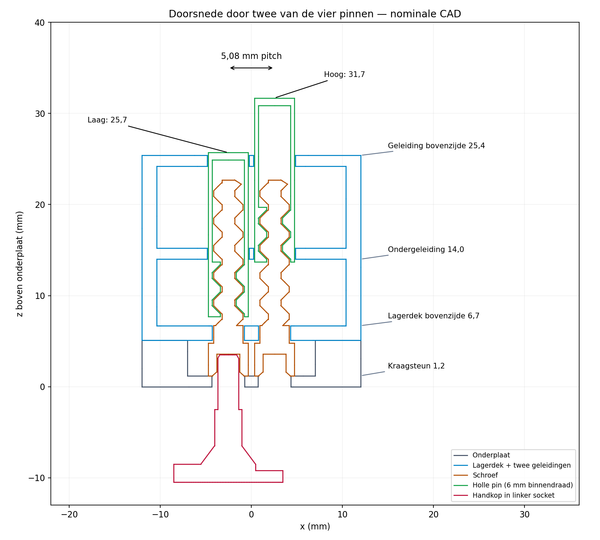

# Printtest — vier onafhankelijk aangedreven schroefpinnen

> Voorwaardelijke mechanische vervolgproef. Nog niet geprint of fysiek bewezen. Eerst de [compacte passingplaat](../compact-screw-fit/test.md); kies daarna hoogstens **één** van onderstaande alternatieve platen.

**Status:** DEFERRED\
**Prioriteit:** geen\
**Laatst beoordeeld:** 2026-10-15\
**Reden:** de compacte draadpassing moet eerst soepel en reproduceerbaar blijken; deze uitgewerkte demonstratie is geen tweede actieve printopdracht.\
**Technische bron:** [E-295](../../06-experiments/E-295-compact-screw-drive-development.md), [CAD-bron](demo.scad), gedeelde [draadbron](../compact-screw-fit/thread-kernel.scad).

## 1. Waarom deze test? — CTO

**Concrete vraag:** kunnen vier pinnen op **5,08 mm pitch** afzonderlijk 6 mm omhoog/omlaag bewegen met één verplaatsbare handkop onder het raster, terwijl de andere pinnen blijven staan? Kunnen we een schroef aankoppelen, draaien en loslaten zonder buurcontact?

De proef combineert dezelfde 90°-draadfamilie als de recente geslaagde brede passingtest met 4,4 mm vierkante pinnen, 6 mm binnendraad onderaan, een geïntegreerde hex-socket, axiale opsluiting en twee vierkante geleidingen. De schroef draait; het staafje draait niet. De 6 mm slag is **twee omwentelingen totaal**, met een fysiek verhoogd neutraal punt halverwege. De test onderzoekt de aansluiting op een latere XY-kop; motorisering en automatische aankoppeltijd worden hier niet bewezen.

**Beslissing:** een geslaagde proef rechtvaardigt het uitwerken van dezelfde koppeling op een beperkte bewegende kop. Vastlopen bij correcte draadpassing wijst op de geleiding/lagering/koppeling en moet daar worden opgelost. Buurcontact of meebewegen betekent geen functionele pass. Onvoldoende statisch houden vraagt een eenvoudige rem-/aandrijfkeuze vóór opschaling.

**Stop:** harde weerstand, scheve pin, losrakende framehelften, afbrokkelende hex, draadschade of buuraanraking. Gebruik alleen lichte handkracht, geen tang, elektrische boormachine of aangedreven eindstop.

## 2. Printklaar — CTO

**Kies pas na fysiek geslaagde compacte passing exact één [Bambu Studio 3MF-variant](../2026-10-15-four-pin-screw-demo/test.md). DEFERRED blijft van kracht.** Bij goed resultaat met meerdere toleranties is de herhaalbaar soepelste, intacte variant een kandidaat; de grootste speling is niet automatisch de beste. Als alleen een incidenteel exemplaar werkt, is deze demonstratie nog niet de volgende print.

| Alternatieve complete plaat | Radiale CAD-speling van alle vier pinnen |
|---|---:|
| [four-pin-demo-015-plate.stl](four-pin-demo-015-plate.stl) | 0,15 mm |
| [four-pin-demo-0175-plate.stl](four-pin-demo-0175-plate.stl) | 0,175 mm |
| [four-pin-demo-020-plate.stl](four-pin-demo-020-plate.stl) | 0,20 mm |

Iedere plaat bevat **12 losse delen**: 4 identieke schroeven, 4 identieke holle pinnen met gesloten vierkante top, 1 onderplaat, 1 geleidekooi inclusief lagerdek, 1 handkop en 1 rechthoekig neutraalmaatje van 3,3 mm hoog. De varianten verschillen alleen in binnendraad; print niet alle drie. Noteer het gekozen bestand voordat delen van het bed komen.

- **Printjob:** één plaat, circa **60 × 65 × 24 mm** exclusief brim.
- **Materiaal/printer:** gewone PLA die al beschikbaar is; X1 Carbon, 0,4 mm nozzle. Geen aankoop nodig.
- **Profiel:** 100% schaal; 0,12 mm lagen inclusief eerste laag, 2 wanden, 100% infill, nominale lijnbreedte 0,45 mm, **Arachne/variabele lijnbreedte**. Kleine/buitenste perimeters maximaal 30 mm/s, eerste laag 20 mm/s, bruggen 20 mm/s, acceleratie maximaal 1000 mm/s²; 220 °C nozzle, 55 °C Textured PEI Plate, flowratio 0,98, partfan 100% na de eerste laag, auxfan 0%; korte-laagvertraging aan (8 s, minimaal 10 mm/s). Geen extra XY-/gatcompensatie voor de eerste vergelijking; noteer bestaande compensatie.
- **Oriëntatie:** geleverd behouden. Schroeven staan op de vlakke 4,4 mm kraag met hexopening op het bed; pinnen staan met open draadzijde op het bed. De kooi ligt op één volledige buitenwand, zodat de twee geleidingen als korte bruggen worden geprint. Niet automatisch heroriënteren; print per laag.
- **Supports:** **uit**, ook geen automatische/tree-supports of raft. De binnendraad en hex blijven leeg. De gesloten pintop heeft een korte brug van 3,52 mm; hex-dak circa 2,54 mm. De kooi bevat bewust korte dwarsbruggen. Supports in deze openingen zouden de test ongeldig maken.
- **Bedhechting:** **3 mm buitenbrim**, afstand tot onderdeel 0 mm; geen binnenbrim in de gaten. De schroef is 21,5 mm hoog op een 4,4 mm kraag; de pin 18 mm hoog op een dunne vierkante rand. Daarom niet zonder buitenbrim printen. Controleer de buitenbrim op schroeven én pinnen. Brimverwijdering is alleen aan buitenste bedranden, nooit door de functionele draad snijden.
- **Bambu Studio 02.08.02.61:** 0,15 / 0,175 / 0,20 mm respectievelijk **2 uur 9 min 28 s / 9,23 g**, **2 uur 9 min 16 s / 9,22 g**, **2 uur 9 min 17 s / 9,22 g**; 200 lagen per alternatief. Dit zijn de ramingen uit de meegeleverde echte X1C-G-code met officiële startprocedure, geen gemeten printwaarden. [Exact profiel, filamentlengte en padcontrole](../2026-10-15-four-pin-screw-demo/test.md). De eerdere PrusaSlicer-raming blijft uitsluitend vergelijkingsbewijs.
- **Extra benodigdheden:** handen; twee kleine stroken gewone tape voor de gezamenlijke frameverbinding of die verbinding tijdens de proef stevig vasthouden. Een reeds aanwezige **2 mm metalen inbussleutel** is optioneel als alternatief voor de meegeprinte handkop. Liniaal en pen zijn handig. Geen vier afzonderlijke lagers, motoren, veren, moeren of bevestigers nodig.
- **STL-controle:** alle drie platen hebben 12 gesloten, afzonderlijke lichamen. [CAD-controle](cad-validation.json): 50 ideale schroef-pinposities per variant over de volledige slag inclusief twee axiale standen; geen berekende doorsnijding met elkaar, frame of correct gefaseerde handkop. Dat is geen passing-, kracht- of slijtagebewijs.

Controleer in de Bambu-preview de dunne pinwanden en de 0,48 mm brede geleidewebben, de eerste laag/buitenbrim, en de daken van hex en pin. De onafhankelijke vergelijkingsslice meldt brugwaarschuwingen; de [controle-uitleg](validation.md) onderscheidt echte vrije overspanningen van een lange doorlopende extrusielijn. Print niet als de eigen preview ontbrekende webben, losse draad-eilandjes, een ontbrekende buitenbrim of support in de draad toont.

**Voor Sander:** open het gekozen [3MF-project](../2026-10-15-four-pin-screw-demo/test.md) als **project** in Bambu Studio en behoud het opgeslagen profiel. De oorspronkelijke STLs blijven beschikbaar. Je hoeft geen CAD of Python te compileren. De andere twee STLs zijn alternatieven, geen extra opdrachten. Deze vervolgproef is vrijblijvend en heeft geen deadline.

## 3. Montage en test — CTO

1. Laat afkoelen; verwijder alleen buitenbrim en losse stringing. Inspecteer de dunne geleidewebben, pinwanden, daken en hex. Noteer iedere nabewerking. Steek een pin van boven door beide vierkante geleidingen voordat de schroeven zijn gemonteerd. Alle vier moeten zonder klemmen recht kunnen schuiven. Neem daarna alle vier pinnen weer uit de kooi voordat je stap 2 uitvoert. Niet de draad bijschuren om een geleidingsprobleem te verbergen.
2. Leg de vier schroefkragen in de open holte van de onderplaat, met hun hexopening boven de vier toegangsgaten en de draad naar boven. Laat de kooi er recht overheen zakken: de schroeven gaan door de ronde gaten van het lagerdek; de vier buitenste positioneerpennetjes vallen in de hoekgaten. Houd de delen op elkaar en zet twee stukjes tape over de naad op de twee gesloten buitenzijwanden. Tape blijft buiten het bewegende raster. De kragen zijn nu axiaal opgesloten en kunnen met circa 0,3 mm CAD-speling draaien.
3. Steek iedere pin van boven door de vierkante geleidingen op zijn schroef. Houd de kooi vast. Breng de handkop van onderen in de betreffende hex; zoek zonder duwen een passende fase door heel licht te draaien. Een aanwezige 2 mm inbussleutel mag dezelfde functie doen. Draai **vanaf onderen gezien rechtsom om de pin te laten dalen**, linksom om hem te verhogen. Controleer de richting eerst met een klein stukje draaien. De pin mag niet meedraaien.
4. Leg het 3,3 mm hoge maatje op de bovenste frameplaat, naast het raster. Stel alle vier pintoppen gelijk met de bovenkant van het maatje; verwijder het maatje. Dit is het neutrale niveau. De pintoppen staan dan nominaal 3,3 mm boven het frame. Gebruik geen aangedreven harde eindstop als nulpunt.
5. Noem de vier posities A/B/C/D (op een schets of met pen op het buitenframe). Kies A: één omwenteling linksom vanaf onderen geeft ongeveer **+3 mm**; twee omwentelingen rechtsom ongeveer **−6 mm**; één linksom brengt terug naar neutraal. Blijf binnen dit bereik. Herhaal vijfmaal en kijk specifiek naar B/C/D. De markering in de handgreep helpt omwentelingen tellen.
6. Trek de kop volledig naar beneden uit de hex **vóór** je naar een buur verschuift. Herhaal stap 5 voor D, B en C. Verander daarna alleen twee diagonale pinnen en laat de twee andere neutraal staan. Observeer afzonderlijk aankoppelen, draaien en loskoppelen: draait/heft de buur mee, raken toppen elkaar, of wordt vooral de geselecteerde schroef door zijn axiale speling iets opgetild?
7. Laat de handkop los bij een lage, neutrale en hoge positie. Observeer gedurende ongeveer 30 seconden of de pin onder eigen gewicht terugloopt. Eventueel heel zacht met één vinger op een top drukken, loslaten en de reactie noteren. Geen breuk-/houdkrachtproef. Een goed passende steile draad is niet automatisch zelfremmend; teruglopen is relevante informatie voor de aandrijfkeuze.

**Succes:** alle vier pinnen doorlopen vijf lage–hoge–neutrale cycli; de gekozen pin reageert in beide richtingen; buren raken niet en bewegen niet zichtbaar mee; koppelen en terugtrekken beschadigen niets. Iedere beweging moet zonder schuren aan draad of forceren mogelijk zijn. Noteer axiale klik/docklift apart: de CAD laat 0,3 mm geselecteerde schroefspeling toe, geen aandrijving van buren.

**Onbekend blijft:** werkelijk koppel, draagvermogen voor miniaturen, 40 mm slag, automatische uitlijning en fasezoeken, motortoerental, scène-updatetijd, levensduur en opbrengst van duizenden delen. De 4,4 mm toppen hebben 0,68 mm nominale voegen. Dit bewijst nog geen vrijwel gesloten groot terreinoppervlak; bredere toppen vragen strengere geleiding.

## 4. Mijn resultaten — Sander

**Testdatum:**\
**Gekozen bestand / passingresultaat P1:**\
**Printer / filament / instellingen / werkelijke tijd en massa:**\
**Print gelukt?** [ ] ja [ ] deels [ ] nee [x] nog niet geprint\
**Brim en daken intact? Nabewerking / supports gebruikt?:**\
**Kop:** [ ] geprint [ ] aanwezige 2 mm inbus

| Pin | Glijdt in lege kooi? | Koppelt beide richtingen? | 5 cycli ±3 mm? | Buuraanraking/beweging? | Schade / klemmen / teruglopen? |
|---|---|---|---|---|---|
| A | | | | | |
| B | | | | | |
| C | | | | | |
| D | | | | | |

**Koppelen/ontkoppelen: lift/weerstand/zoekbeweging:**\
**Verschil na verwijderen kop / lichte vingeraanraking:**\
**Kort filmpje of foto (optioneel):**

## 5. Interpretatie en vervolg — CTO, pas na feedback

Nog geen fysieke resultaten. Geen GO voor automatische koppeling, belasting of opschaling. Status blijft DEFERRED; deze samenhangende ontwerpoplevering eindigt hier. Een volgende ontwerpbeslissing volgt uit de eigenaarresultaten, niet uit een geslaagde CAD- of slicercontrole.
