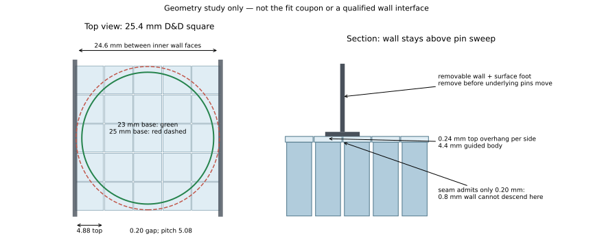

# Fijn raster, vierkante toppen en vrije muurzone

Dit is een **berekend ruimtelijk concept**, geen bewezen pin-top, muur of volledige machine. Het beperkt de aandrijfstudie zonder een nieuw muurproject te starten.

## Raster en oppervlak

5,08 mm geeft precies vijf pinnen per 25,4-mm D&D-vak. 80×80 cellen beslaan nominaal **406,4×406,4 mm** (16×16 vakken), niet exact 400 mm. Wie strikt binnen 400 mm blijft, heeft maximaal 78×78 cellen over 396,24 mm; 75×75 over 381 mm geeft 15×15 volledige speelvakken. Dit is geen reden om naar een grover raster over te stappen.

Een 4,4-mm lichaam laat 0,68 mm tussen de lichamen en bedekt slechts 75,0% van het bovenaanzicht. Voor een vrijwel doorlopend terrein is een eenvoudige integrale vierkante top van bijvoorbeeld **4,88 mm** interessant: 0,20 mm nominale naad, 92,3% oppervlakbedekking en slechts 0,24 mm overhang per kant. Een 45° overgang over minimaal 0,24 mm hoogte kan zonder losse kap worden geprint. Dit is een vervolgmogelijkheid; de eerste passingtest houdt het lichaam eenvoudig. **De 4,88-mm top is nog niet vrijgegeven:** een 4,4-mm vierkant kan in een 4,70-mm geleidegat circa 4,05° verdraaien. Dan wordt de projectie van die top `4,88 × (cos θ + sin θ) = 5,21 mm`, groter dan de pitch. Ook zijwaartse speling kan een naad sluiten. Zelfs de historische 4,64-mm opening geeft in deze uiterste hoek 5,15 mm topbreedte. Daarom behoudt de kleine demonstratie 4,4-mm toppen. Voor 4,88-mm toppen zou de nominale opening, vóór extra printtolerantie, hoogstens `5,08 × 4,4 / 4,88 = 4,58 mm` mogen zijn; dat kan te krap geleiden. De optisch bijna gesloten top is dus een aparte latere passingbeslissing. Werkelijke printmaat, scheefstand en topbotsing blijven te meten; smallere toppen kunnen beter blijken dan een klemmend oppervlak.

De 0,68-mm ruimte tussen lichamen is **geen** vrije mechaniekruimte: een rooster met bijvoorbeeld 4,64-mm openingen laat 0,44-mm schotten en 0,12-mm nominale speling per zijde over. Deze historische maten zijn CAD, geen printerkwalificatie. Twee op afstand geplaatste geleidingen beperken kantelen beter dan vertrouwen op het klemmen tegen buren. Geen extra slot of pal op de bewegende pin is nodig. Een top mag nooit door de kleinere geleideopening hoeven; de assemblagerichting en demontage blijven dan van boven.

## Dunne muren: werkelijk beschikbare ruimte

Een afzonderlijke **0,8-mm** muur gecentreerd op beide begrenzingslijnen van een één-vak-corridor laat **25,4 − 0,8 = 24,6 mm** tussen de binnenvlakken. Reken voor een ronde miniatuurbasis met diameter `D` en gewenste plaatsingsmarge `e` aan elke zijde: `D + 2e ≤ 24,6 mm`. Illustratief: D=23 mm en e=0,3 mm past; D=25 mm of 25,4 mm past niet. Dit zijn rekenvoorbeelden, **geen gemeten basismaten van Sanders miniaturen**. De werkelijke beoogde bases moeten worden nagemeten voordat een corridorgeometrie wordt gekozen; dunne muren lossen dat niet automatisch op.

Een 0,8-mm wand kan niet in de 0,20-mm naad tussen bijna gesloten toppen naar beneden steken. Daarom is de begrensde optie voor deze studie een losse muur met een voet **boven** het terreinoppervlak, of een nog apart uit te werken uitsparing op uitsluitend de D&D-lijnen. De tekening toont de eerste optie. De voet verbindt lokaal toppen; verwijder de muur vóór beweging van die pinnen. Zo is er geen onbeschreven botsing met onafhankelijk bewegende toppen of de onderliggende aandrijfkop. Een permanente, zelfstandig bewegende muurinterface is hier niet geclaimd. Een muur mag zo nodig iets naast de lijn staan, maar de dan veranderde vrije corridorbreedte moet expliciet worden gemeten.

## Slag, verhoogde neutraal en ondersteuning

Voor 40 mm nuttige slag met 6 mm steeds volledig ingrijpende onderdraad moet de werkende schroef minstens 46 mm lang zijn, plus in-/uitloop en veiligheidsmarges. Bij een 48-mm draad en een onderste pinpositie b=1 mm kan de bovenste positie b=41 mm nog 6 mm volledige onderdraad bevatten; controleer de werkelijke taps toelopende schroefpunt apart. Een dichte pin-top moet in de laagste stand boven de schroefpunt blijven. Een circa 50,8-mm hol lichaam kan geometrisch passend zijn, maar lange-printstabiliteit en buiging worden daarmee niet bewezen. Dit pakket test bewust korte onderdelen.

Een mechanische middenstand op 20 mm nuttige slag biedt ±20 mm reliëf; die stand moet daadwerkelijk worden ingesteld en ondersteund. De timingstudie rekent initialisatie afzonderlijk. Eindstops moeten voldoende draadinschakeling bewaren: de historische breuk nabij volledig uitschroeven is een concrete reden om niet op de laatste winding te werken.

Bronnen: [originele Trial 5 actuator](https://github.com/sander-van-damme/project-shape-display/blob/41484f96999847c139b9010e73009d73e9459c89/trial-5-grid-and-cubes-and-rod/actuator.scad), [frame](https://github.com/sander-van-damme/project-shape-display/blob/41484f96999847c139b9010e73009d73e9459c89/trial-5-grid-and-cubes-and-rod/frame.scad), [fabricagecriteria](../../../../02-design-criteria/fabrication-process.md), [actuele prioriteiten](../../../../02-design-criteria/current-prototype-priorities.md). Figuur reproduceerbaar met `python3 tools/curated-experiment-checks/E-295/playable_envelope.py`.
