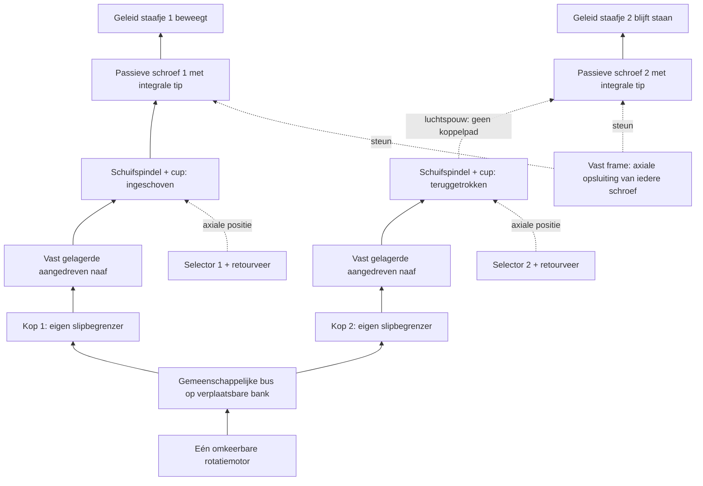

# Gedeelde, gegroepeerde en globale schroefaandrijving

**Datum: 15 oktober 2026. Bewijssoort: mechanische analyse en geraadpleegde primaire bronnen; geen gebouwde of fysiek bewezen aandrijving.**

De onderzoeksvraag is of gedeelde rotatie de hoeveelheid herhaalde mechanica werkelijk vermindert, terwijl ieder geleid, hol staafje door zijn eigen roterende schroef omhoog en omlaag blijft bewegen. De meest kansrijke gedeelde uitbreiding is een **verplaatsbare bank met enkele afzonderlijk aankoppelbare draaikoppen**. Koppeling, selectie en eventuele slipbeveiliging worden dan `k` keer op de bank gebouwd, in plaats van `N` keer onder het hele terrein. Dit is een ontwikkelrichting naast de eenvoudigere XY-kop, geen vrijgave van een automatische 80-kops machine.

## Uitgangspunten en bewijsgrenzen

- Raster 5,08 mm, nominale 80 × 80 = 6.400 schroeven over 406,4 mm; dezelfde redenering geldt voor kleinere tegels.
- De recente vijf handgeteste draadparen bewijzen functioneren van hun eigen brede geometrie, niet hun motorkoppel, slippunt, levensduur of zelfremming. De gemelde variatie tussen identieke exemplaren betekent dat geen gelijk loopkoppel mag worden aangenomen.
- Binnendraad en vierkante antirotatie blijven in het eenvoudige staafje. Alle hieronder bedoelde tandwielen of tandheugels dienen uitsluitend als **transmissie naar een draaiende schroef**, niet als vervanging van de verticale schroefbeweging.
- Een integrale aandrijftip/flens op de onderzijde van iedere schroef is toegestaan. De schroef moet axiaal in het frame worden vastgehouden, ook wanneer de kop ontbreekt. Alleen de kop tegen de schroef drukken is geen permanente lagering.
- Een groep gelijke hoeken draaien verschuift de bestaande hoogtes; het maakt verschillende hoogtes niet gelijk. Initialisatie naar een gemeenschappelijk nulpunt heeft afzonderlijke eindvoorwaarden nodig.
- Eerdere afwijzing van een schroefconcept op een vaste 30-secondenlimiet is geen bewijs tegen onderstaande lokale updates of nieuwe selectieprincipes. De moderne owner-prioriteiten en de expliciete schroefkeuze bepalen deze vergelijking.

## 1. Verschillende complete krachtroutes

| Familie | Krachtroute, selectie en beide richtingen | Herhaling en afscherming | Beoordeling / kleinste beslissende proef |
|---|---|---|---|
| Vaste rij-as met koppeling per schroef | Motor → rij-as → haakse overbrenging → losse aangedreven naaf → selecteerbare koppeling → schroef. Omkeerbare motor levert beide richtingen; alleen ingeschakelde koppelingen bewegen. | `N` naven, koppelingen, retourveren en selectiecontacten, naast alle schroeven. Niet-geselecteerde koppelingen moeten aantoonbaar vrijlopen. | Werkt als mechanische topologie, maar verplaatst de moeilijkheid naar 6.400 kleine koppelingen. Vier koppelingen op 5,08 mm, waarvan één draait en drie vrijstaan, zijn de relevante toets; geen volle rij bouwen. |
| Rij-/kolommultiplexing van die koppelingen | Een rijbalk maakt de koppelingen van één rij beschikbaar; kolomactuatoren schakelen de gewenste doorsnedes. De draaibus levert arbeid. | Minder elektrische actuatoren mogelijk, maar nog `N` fysieke AND-contacten/koppelingen. Niet-geselecteerde rijen moeten werkelijk buiten aangrijpbereik blijven; alleen één stroomlijn uitschakelen voorkomt mechanische doorspraak niet. | Nuttige comparator; geen aangetoonde onderdelenbesparing tegenover een reizende bank. Een 2 × 2 kruisselectie moet alle vier afzonderlijke patronen en de diagonale selectie zonder meebeweging tonen. |
| Verplaatsbare bank met individuele kopselectie | Eén rotatiemotor → bankbus → `k` afzonderlijke kopspindels → ingeschoven cup/dog → geselecteerde schroef. Bankpositie kiest de groep; axiale terugtrekking kiest binnen die groep. | `N` eenvoudige tips; slechts `k` koppelingen, lageringen, selectoren en eventuele slipbegrenzers. Andere schroeven hebben een luchtspouw naar de bank. | Sterkste gedeelde uitbreiding. Eerst één kop op vier pinnen; later twee gelijktijdige koppen waarvan één eerder loslaat. Volledige 80-kops uitwerking pas na die proef. |
| Reizende wrijvingsriem langs schroefflenzen | Motor → ronde riem → tangentiële rand van integrale schroefschijven. Een rij/korte groep wordt door positie gekozen; omkeren van de riem keert de schroeven om. | Geen resident koppeling. Binnen de gekozen groep draaien alle aangeraakte schroeven; individuele selectie vergt kopdrukvingers of een aanvullende kop. | Interessant voor groepsreset, maar de krappe rijruimte en ongelijke contactdruk zijn concrete risico's. Eerst vier schijven plus twee naburige rijen als interferentieproef; nog geen printopdracht. |
| Intrekbare tandlat/kam op schroeftandwieltjes | Lineaire motorbeweging → horizontale tandlat → roterende schroeftandwielen. Lat terugtrekken uit mesh is vrijgave; lineaire omkering keert hoogtebeweging om. | Eén eenvoudig tandwieltje per schroef, plus rijselectie. Individuele hoogte-einden vergen losse kamsegmenten/koppelingen, dus die complexiteit hoort bij de bank. | Alleen zinvol voor gedeelde hoekstappen. Een doorlopende slag voor 40 mm hoogte is lang; korte herhaalde slagen introduceren opnieuw aangrijpen en faseproblemen. |
| Vaste wereldwijde worm-/tandwiel-/riembus | Eén motor → verdeelassen → alle schroeven. Omkeerbaar, maar zonder ontkoppelingen uitsluitend gezamenlijke relatieve verplaatsing. | `N` overbrengingscontacten; bij XY-gebruik moet de hele bus fysiek vrijgeven of iedere schroef een koppeling krijgen. | Goede manier om een reeds gelijkgesteld veld samen te verplaatsen. Geen zelfstandige oplossing voor onafhankelijke hoogtes of veilig gelijkstellen vanuit ongelijke hoogtes. |
| Jacquardachtige selectie op een gedeelde draaibus | Kleine selectoren kiezen een koppeling; de gemeenschappelijke motor levert het schroefwerk. Het textile principe is scheiden van selectie-energie en werkaandrijving. | Een vaste selector per kruispunt blijft `N` precisiefuncties. Plaats dezelfde selectors op een reizende bank en de herhaling wordt `k`. | Bruikbare inspiratie voor de bank, geen reden om verticale haken/pallen of textielkoorden in de terreinpin over te nemen. |
| Gemeenschappelijk magnetisch draaiveld | Veld → magneetrotor op schroef → draadpaar. Veldomkering kan beide richtingen; lokaal stilhouden vereist rem/selectie of veldafscherming. | `N` magneten en gewoonlijk `N` selectiefuncties; een globaal veld biedt op zichzelf geen individuele adressering. | Reserveconcept. Geen claim van isolatie zonder meting aan vier naburige rotoren. Eerst koppel en meedraaien meten, niet coils over 400 mm ontwerpen. |

Een gladde plaat die onder alle ronde schroefkoppen lineair schuift is geen gratis globale draaiaandrijving: bij symmetrisch verdeelde wrijving over een gecentreerde ronde contactzone heffen de momenten rond de schroefas elkaar op. Er is een gedefinieerd tangentiëel randcontact, een echte roterende koppeling of een andere expliciete asymmetrie nodig.

## 2. Wat industrie daadwerkelijk aantoont

**Gedeelde rotatie is bestaand gereedschap; individuele selectie blijft een aparte functie.** ZIMM beschrijft mechanisch gekoppelde schroefvijzels met één motor, verbindingsassen en haakse tandwielkasten. Het artikel noemt assizing, tussenlagering en uitlijning expliciet. Dit ondersteunt de krachtroute en het optellen van lasten, niet miniaturisering naar 5,08 mm of onafhankelijk bewegen. [ZIMM, mechanische synchronisatie](https://zimm.com/wiki/how-are-multiple-screw-jacks-mechanically-synchronised/), geraadpleegd 15-10-2026.

**Een complexe bank mag buiten het pinraster groeien.** Industriële meerassige boorkoppen delen één ingang over meerdere uitgaande spindels. Het principe ondersteunt een gedeelde bank; de catalogus biedt geen kant-en-klare 5,08-mm oplossing: AutoDrills kleinste genoemde verstelbare tweespindelkop start bij 13,5 mm hartafstand. [AutoDrill, één ingang naar meerdere spindels](https://www.drill-hq.com/products/multiple-heads/custom-heads/how-to-drive-a-multiple-spindle-head/) en [verstelbare kopmaten](https://www.autodrill.com/products/multi-spindle-heads/adjustable), geraadpleegd 15-10-2026.

**Printerkoppelingen zijn een relevant mechanisme, geen passende inkoopmaat.** Ogura beschrijft elektromagnetische wrijvingskoppelingen die rollen en nokken selectief starten/stoppen; de geciteerde OA-productfamilie is 22–35 mm diameter en 18–36 mm lang. Die specifieke producten passen niet één-op-één onder een 5,08-mm raster. Dit sluit kleinere maatwerkmechanismen niet uit, maar maakt de goedkope, reeds beschikbare 6.400 mini-koppelingen geen geldige aanname. [Ogura OA micro clutches](https://www.oguraclutch.co.jp/en/en-buisinessarea/en-buisinessarea-oa/), geraadpleegd 15-10-2026.

**Textielmachines leveren selectie-inspiratie én waarschuwingen over geleiding.** EP2313544B1 beschrijft solenoïden die haken selecteren tegenover gedeelde hefmessen, met geleiders en PCB-dragers. Het benoemt selectorproblemen door vervorming van de geleiders. Stäubli gebruikt ook nu afzonderlijke selectiemodules. Overgenomen wordt alleen het scheiden van selectie en arbeid; de pin blijft een geschroefd staafje. Een patent is openbaar beschreven techniek, geen test van onze vorm of een uitspraak over gebruiksrechten. [EP2313544B1](https://patents.google.com/patent/EP2313544B1/en), [Stäubli SX PRO](https://www.staubli.com/global/en/textile/products/jacquard-machine/flat-terry-technical-fabric-sx-pro.html), geraadpleegd 15-10-2026.

**Slippend aandrijven heeft bestaande voorbeelden.** Interroll beschrijft riem-/hoofdasdrukwielen en wrijvingsaandrijving. Mayr onderscheidt doorslippende begrenzers van volledig loskomende begrenzers. De functionele les is dat een stilgevallen uitgang de andere uitgangen alleen laat doorgaan als zijn eigen krachttak kan slippen of loskomen. Geen van beide bronnen bewijst de benodigde lage, herhaalbare koppels in onze FDM-schaal. [Interroll Series 2600](https://www.interroll.com/products/rollers-and-wheels/series-2600), [Mayr torque limiters](https://www.mayr.com/en/products/torque-limiters~48216), geraadpleegd 15-10-2026.

## 3. De verplaatsbare bank concreet genoeg om te falsificeren

De bank bevindt zich onder de vaste schroeftips. Alleen de bovenste kopuiteinden moeten binnen het raster blijven. Tandwielen, de gemeenschappelijke as, selectoren en hun hefboompjes mogen lager liggen en in de rijrichting of in de diepte verspringen. Alle bewegende bankdelen blijven bij verplaatsing onder het laagste schroefuiteinde. Een twee-kops bank kan aanvankelijk handmatig aankoppelen; miniaturiseer elektrische selectors pas als de mechanische proef slaagt.

Een expliciete uitvoeringsroute is:

1. Een gedeelde as drijft wormwielen of een opgebouwde tandwieltrein in de kop. Bij wormwielen draaien alle identiek georiënteerde uitgangen dezelfde kant op. De overbrengingsverhouding en het benodigde motortoerental moeten worden meegerekend; een wormbus wordt niet verondersteld verliesloos of 1:1 te zijn.
2. Ieder aangedreven wiel blijft axiaal op zijn lagerpositie. Een korte splined/D-vormige schuifas draagt de draaicup en kan op/neer door de aangedreven naaf. Deze schuifpassing is een **bankonderdeel**, niet iets in iedere terreinpin.
3. Een veer houdt de cup tegen de schroeftip; een eigen hefboom trekt hem weg. Terugtrekslag moet de volledige overlap plus de som van axiale toleranties en een vrije luchtspouw opheffen. Eén globale Z-beweging is onvoldoende om individuele cups te stoppen terwijl andere doorgaan.
4. De bus draait een opwaartse pass. Elke geselecteerde cup laat los bij zijn eigen doelhoek. Daarna volgt zo nodig een neerwaartse pass voor de andere geselecteerde pinnen. Er is zonder aanvullende omkeermechanica geen gelijktijdige onafhankelijke draairichting.
5. Alle cups trekken los voordat de bank naar de volgende groep gaat. De onderste schroeflagering neemt de aankoppeldruk op; de vierkante staafgeleiding neemt het draadreactiemoment op.

Dit schema toont de voorgestelde topologie. De bronnen van de kleine demonstratie gebruiken een integrale zeskant en bijbehorende handkop; zij realiseren niet de hier beschreven automatische cup, schuifnaaf, selector of slipbegrenzer.

**Ontkoppelen kost ook bewegingstijd.** Bij een nog draaiende bus blijft de schroef aandrijven totdat de cup volledig los is. Een hypothetische 50 ms ontkoppeling bij 600 rpm en 3 mm spoed vertegenwoordigt 1,5 mm verplaatsing. Een tijdige loslaatopdracht kan het gemiddelde compenseren, maar variatie in veer, belasting en slijtage blijft bestaan; onder koppel wegtrekken kan de dog beschadigen. De eenvoudige veilige proef stopt de bus, trekt de gekozen cup terug en start opnieuw. Als een bank alle verschillende doelhoogtes zo afwerkt, telt iedere stop/start en acceleratie mee, niet alleen de langste schroefslag. Een extra zelfstandige koppeling in elke kop kan de tip gezeten houden en sneller selecteren, maar voegt `k` mechanismen en te toetsen restwrijving toe.

Met alleen axiale cups als selectie moeten voor een opwaartse pass uitsluitend de opwaartse cups aangrijpen. De neerwaartse cups worden daarna opnieuw gezet voor de neerwaartse pass. Reken dus met twee aankoppelhandelingen voor een gemengde groep, of specificeer expliciet die extra kopkoppelingen waarmee alle tips al vooraf gezeten kunnen blijven.

**Tolerantiescreen, niet vrijgegeven CAD.** Een cup van Ø4,0 mm houdt nominaal 1,08 mm tussen twee cups op 5,08 mm. Bij twee tegengestelde centrumfouten van 0,15 mm resteert 0,78 mm geometrische spouw. Dat zegt nog niets over een bruikbare spline, veer of selector in die cup. Een fictieve Ø3,2-mm tip met een 1,2-mm sleuf en een 0,8-mm blad heeft maar 0,20 mm zijdelingse halve speling; ±0,15 mm centreerfout laat 0,05 mm over vóór printfout, ruwheid en hoekfout. Dit is juist reden om een toelopende vangmond en geringe lokale kopcompliance te onderzoeken. De dimensies hier zijn een interferentiescreen; de daadwerkelijke demonstratiegeometrie staat in haar eigen bronbestanden.

**Fase en positietelling zijn niet gratis.** Een positieve dog/sleuf moet eerst uitlijnen. Als de gemeenschappelijke bus draait terwijl verschillende cups op verschillende momenten aangrijpen, begint de rotatie van iedere schroef op een andere bushoek. Een motorencoder alleen bewijst dan geen correcte individuele verplaatsing. Handmatige, zichtbare seating is voldoende voor de eerste proef. Voor een automatische bank is betrouwbare individuele seating of een andere fase-onafhankelijke koppeling nodig; de timingstudie mag dit alleen als onopgeloste overhead behandelen.

Een vlakke wrijvingscup grijpt bij elke hoek aan: druk de stilstaande cup aan en start daarna de bus. Hij vermijdt fasezoeken, maar heeft veel meer axiale kracht nodig en kan onder last ongemerkt slippen. De benodigde kracht bij een uniforme contactdruk over een ring is:

`r_eff = (2/3) (R_o³ − R_i³)/(R_o² − R_i²)`; `F = T / (μ r_eff)`.

Met **aangenomen** `R_o=1,8 mm`, `R_i=0,8 mm`, `μ=0,30` is `r_eff=1,364 mm`. Bij `T=0,2 mN·m` volgt 0,489 N per kop; bij `T=2 mN·m` 4,89 N. Voor 80 koppen is dat 39 respectievelijk 391 N totale druk. Beide koppels zijn gevoeligheidsscenario's, geen gemeten schroefkoppels. Een kleine wijziging in frictie of draadweerstand kan daarom de keus tussen wrijvingscup en positieve dog bepalen.

Een positieve dog met een instelbare slipbegrenzer **verderop in de eigen kop** voorkomt dat het volledige slipkoppel via grote axiale kopdruk moet worden opgewekt. Die begrenzer mag groter en lager liggen, mits de krachttak nog zelfstandig kan slippen. Dit is de betere resetvariant als het fasezoeken aanvaardbaar blijkt.

## 4. Groeps- en globale initialisatie zonder een geblokkeerd draadpaar te forceren

Een star gekoppelde bus kan niet veilig vanuit willekeurige hoogtes door blijven draaien totdat alle staafjes onderaan staan. De eerste bereikte onderstop blokkeert zijn schroef; de rest vraagt nog rotatie. Een begrenzer bij de gemeenschappelijke motor stopt dan iedereen of staat toe dat één geblokkeerde tak te veel koppel ontvangt. De veilige varianten zijn:

- **Kop-/bankgewijs gelijkstellen:** iedere aangesloten schroef heeft gedurende reset zijn eigen slipbegrensde krachttak in de kop. Bij de onderstop slipt die tak; andere koppen gaan verder. Daarna alles losnemen. De staafjes behouden slechts hun eenvoudige onderste aanslag en intacte draad.
- **Volledig globaal gelijkstellen:** dezelfde lokale begrenzing is op alle `N` tegelijk aangesloten schroeven nodig. Dat kan een lokale riemcontactslip zijn, maar moet op ieder contact bestaan. Een volledig grote plaat met 6.400 compliant wrijvingskoppelingen is mechanisch mogelijk als hypothese; hij bespaart die 6.400 contactfuncties niet.
- **Gezamenlijk bewegen vanuit een bekende toestand:** wanneer een groep al gelijk staat en alle slagen binnen de eindgrenzen blijven, kan een stijve gedeelde bus een gelijke draaihoek geven. Dit is bruikbaar om een bekend onderniveau naar neutraal te brengen. Het is geen herstel vanuit onbekende hoogtes.

Voor reset is het beslissende venster:

`hoogste normaal loopkoppel < laagste slipkoppel < laagste schadelijke stopkoppel`.

De marges moeten printvariatie, belasting, links/rechtsom, vervuiling en drukverschillen omvatten. Een stroef paar kan anders te vroeg slippen en vals nul lijken. Een te strak contact kan de draad juist beschadigen. De stop moet de verticale beweging beëindigen **voordat** de korte binnendraad van de schroef loopt; ontkoppelen aan het einde en later blind opnieuw invangen is geen betrouwbare bidirectionele reset. Geef de onderste aanslag een frame-gerefereerd draagvlak; gebruik geen scherpe draadflank als geplande crashstop.

Ook terug loskomen verdient een proef: een aan de onderstop vastgedraaid staafje kan een hoger losbreekkoppel hebben dan tijdens de neerwaartse reset. Daardoor kan hetzelfde slipniveau omhoog blijven slippen. Eindig reset zonder extra doordrukken, of trek een fractie omwenteling terug zodra de stop aantoonbaar bereikt is. Bij een volledig sensorloze bank moet juist de veilige omkeerbaarheid onder de gekozen slipinstelling fysiek worden aangetoond; zij wordt hier niet aangenomen.

**Belastingvoorbeeld.** Bij aangenomen `T=2 mN·m` en 600 rpm is `P=Tω=0,126 W` per draaiende/slippende tak. Voor 80 takken is het 10,1 W; voor 6.400 takken 804 W, vóór transmissieverliezen. Bij 0,2 mN·m zijn deze getallen tienmaal kleiner. Vermogen en reactiekracht schalen met het aantal gelijktijdige takken. Dit is een argument om veilige groepsreset te onderzoeken, niet een bewijs dat globaal resetten onmogelijk is.

Voor neutraal op bijvoorbeeld +20 mm: eerst iedere groep naar een veilig bekend onderniveau, daarna een bekende draaihoek omhoog. Als een geselecteerde groep eerder stopt of slipt, is alleen het tweede deel motorhoekgestuurd; dat maakt een goede resetmeting noodzakelijk. Het voorbereiden van een leeg speelveld mag langer duren dan een kleine wijziging tijdens het spel.

## 5. Waarom de riem en kam voorlopig alternatieven blijven

**Riem.** Een schroefflens van Ø4,0 mm heeft slechts `5,08 − 4,0 = 1,08 mm` vrije tussenruimte tot de naastliggende rijflens. Een ronde riem van 0,8 mm laat daar nominaal 0,28 mm voor drukgeleiding, slingering en tolerantie. Bij flenzen van Ø4,4 mm, vergelijkbaar met de nominale staafbreedte, is de volledige rijspouw **0,68 mm**: de riem moet dan dunner dan 0,68 mm zijn en nog extra marge voor drukgeleiding en fout behouden. De 0,8-mm riem past daar dus niet. Een gewone dikke drukrol past in geen van beide ruimtelijke voorbeelden. Een dunne metalen drukstrip, versprongen flenshoogtes of een lager gelegen overdracht kan helpen, maar voegt assemblage toe. Een ronde riem kan zijn retourloop lager leggen; een vlakke riem moet daarnaast de juiste contactvlakoriëntatie en buigrichting behouden. De retourloop mag niet door een aangrenzende rij lopen.

Een lange gespannen riem levert bovendien niet automatisch gelijke contactdruk op alle schijven. De hoogste/excentrische schijven kunnen de riem van andere schijven afhouden. Eigen compliant drukvingers per bankpositie zijn waarschijnlijk nodig. Met aangenomen `T=2 mN·m`, straal 2 mm en `μ=0,4` vraagt iedere contactplaats circa 2,5 N normaalkracht. Ook dit moet door een echte lagering worden opgenomen. Tijdens een lokale XY-update moet de riembank volledig los zijn, anders kan de lokale schroef de riem en zijn buren meevoeren.

**Tandlat als schroeftransmissie.** Voor een schroeftandwiel met steekstraal 2 mm, spoed 3 mm en 40 mm verticale slag is de benodigde directe latverplaatsing `2π × 2 × 40/3 = 167,6 mm`. Een complete rij mag dus niet worden beschreven alsof één paar millimeter kambeweging de volledige slag levert. Korte heen-en-weergaande slagen vereisen op elke terugslag vrijgave en correcte heraangrijping. Een permanente eenrichtingsratel verliest de eenvoudige omkeerbaarheid; daarom hier geen verdere rateluitwerking.

Deze alternatieven vallen niet af op de eis dat schroeven onmogelijk zouden zijn. Ze verliezen voorlopig van de reizende kop/bank doordat de simpele tip daar naast echte selectiviteit ook een duidelijke vrije luchtspouw naar de buren levert.

## 6. Beslissing, eindige vervolgmeter en stopconditie

De eerste toegestane actieve printproef blijft de compacte draadpassing. De kleine handbediende demonstratie toetst daarna het gemeenschappelijke fundament: vier geleide pinnen, blijvende axiale schroefopsluiting, aankoppelen van onderen, omhoog/omlaag en onveranderde buren. Deze analyse start geen extra printwachtrij.

Pas wanneer die delen werken, kan één beperkte bankproef de gedeelde richting kiezen: twee koppen op vier schroeven; eerst beide draaien, vervolgens één kop losnemen terwijl de andere doorgaat, daarna richting omkeren. Noteer of de vrijgegeven schroef door sleepkoppel meedraait en of de losgenomen cup werkelijk vrij is. Voor de resetvariant komen twee verschillende beginhoogtes en een laag ingestelde kopbegrenzer erbij: de eerste schroef stopt veilig, de tweede bereikt zijn stop, beide kunnen weer omhoog. Stop onmiddellijk bij draadvervorming, onzekere seating of groeiende eindstopkracht.

Benodigde metingen zijn bescheiden: handmatig loop-/losbreekkoppel met een bekende hefboomarm en kleine massa/krachtmeter, draaihoek, zichtbare cupzitting, begin/eindhoogte en meebewegen van buren. Er is nu geen camera- of kalibratieonderzoek nodig. Het koppel moet in beide richtingen en op herhaalde prints worden gemeten, niet afgeleid uit "voelt soepel".

**Rangorde:** (1) eenvoudige XY-kop als directe demonstratieroute; (2) enkele parallelle koppen of een kleine bank om wachttijd te verlagen; (3) kopbegrensde groepsreset als die metingen een bruikbaar koppelvenster tonen; (4) pas daarna vergelijken met rijriem of volledig globale koppeling. Vaste 6.400 koppelingen en Jacquardselectie onder elke pin blijven expliciete alternatieven, maar krijgen geen prioriteit zolang minder herhaalde mechanica dezelfde functie kan leveren.

De stopconditie voor dit onderzoek is bereikt met deze mechanische vergelijking en de genoemde meetbeslissingen. Geen automatische bank, torque limiter of homing is fysiek bewezen; geen aanvullende onderzoeken, aankopen of printopdrachten worden zelfstandig gestart.
