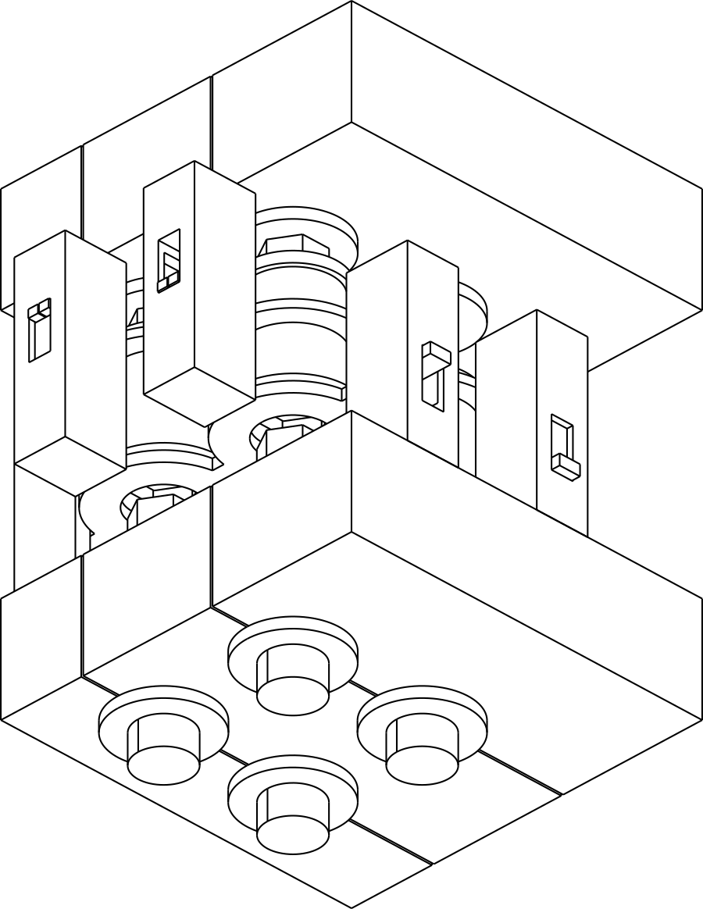

# E-296 — ontwerp en CAD

Begin bij het [korte experimentresultaat](../../../06-experiments/E-296-compact-matrix-clutch-selection.md) of het [volledige ontwerprapport](design-report.md). Daar staan de mechanische keuze, alternatieven, toleranties, kosten en precies één voorgestelde fysieke beslisproef.

- [Open de gemengde 2×2 STEP](cad/matrix_R10_C10.step): alleen kruispunt (0,0) gekoppeld.
- [Open de fasegeblokkeerde STEP](cad/matrix_phase_blocked.step): lokale veer wacht bij verkeerde tandfase.
- [Losse schuifhuls](cad/part_sliding_sleeve.step) en [integrale output/schroefenvelop](cad/part_integral_output_screw_envelope.step).
- [Onafhankelijke review](review.md), [CAD-controles](validation.json) en [onafhankelijke intervalcontrole](independent-geometry.json).


Dit pakket is **mechanische onderzoeks-CAD op werkelijke 5,08-mm pitch**. Het is geen printplaat, geen Bambu-project en geen bewijs dat het mechanisme fysiek werkt. De minuscule hexpassing, lagerbussen en veren veronderstellen een precisieproef; zij zijn niet gekwalificeerd voor FDM.

Reproduceer vanuit deze map met Python 3.12, CadQuery 2.7.0/OCP en Matplotlib:

```sh
python generate.py
python validation.py
python cad_drawings.py
python drawings.py
python alternative_checks.py
python independent_geometry.py --output independent-geometry.json
```

`generate.py` exporteert vijf losse STEP-componentbestanden (de splitkam bevat twee vaste helften) en zes gekleurde STEP-assemblages naar `cad/`. `matrix_R10_C10.step` toont twee rijen en twee kolommen waarbij alleen cel (0,0) is gekoppeld. `truth_R0C0.step` t/m `truth_R1C1.step` tonen de vier uniforme logische toestanden. `matrix_phase_blocked.step` toont een geselecteerde cel met 30° faseverschil, waarbij de veer de resterende commandoslag opvangt. De nominale contactstand met de 0,375-mm mondafschuining is q = 0,91077 mm.

`cad_manifest.json` bevat alle maatparameters en assemblagestanden. `validation.json` bewaart analytische spelingen, faseproeven en de afzonderlijke BREP-botsingscontroles. Vaste frameonderdelen mogen elkaar raken/overlappen voor een gezamenlijke constructie. Veren worden als geometrische draad getoond, maar analytisch via hun enveloppe gecontroleerd; hun gesloten uiteinden zijn een vereenvoudiging. Wrijving, elastische vervorming, krachtverdeling, slijtage, belaste ontkoppeling en fysiek centreren zijn niet gesimuleerd.

De vijf gekleurde doorsneden en drie laagaanzichten in `drawings/` zijn maatvaste verklarende tekeningen uit dezelfde parameters. `assembly-brep-projection.svg` is een echte orthografische BREP-projectie van de koppelingsproef, met de hoge pinnen weggelaten voor zichtbaarheid.

De axiaal vastgehouden input- en outputassen hebben ieder een 4-mm lange nominale Ø2,02-mm lagerboring rond een Ø2,00-mm journal en twee Ø3,6-mm aanslagkragen. De outputhead en schroefenvelop zijn één integraal BREP-lichaam, zonder verborgen verbinding tussen losse rakende delen. De vervaardiging van het exacte E-295-draadprofiel op dit nieuwe integrale onderdeel blijft te kwalificeren. De getekende nominale axiale eindspeling is 0,04 mm totaal, dus 0,02 mm per aanslagvlak. De uiteindelijke axiale stopposities moeten worden gemeten en passend ingesteld; deze eindspeling mag niet ongemerkt bovenop het budget voor koppelingsoverlap worden gestapeld.

Beide uiteinden van iedere rij- en kolomkam hebben 3-mm hoge prismatische geleideschoenen met 0,02 mm nominale speling per zijde. De rij bestaat uit twee in de lengterichting gesplitste kamhelften, met 0,04-mm naad, die buiten het actieve veld aan beide uiteinden worden vastgeklemd. De getekende externe brugklemmen reserveren deze ruimte; hun bouten, voorspanning en reparatietoegang zijn nog precisieproef-fixtuurdetails. Zij moeten vóór belasting werkelijk vast worden gezet. De volledige fixture meet **15,80 × 15,80 × 51,42 mm**, inclusief pinnen; de selectorlaag zelf circa 6,5 mm. Het actieve 2×2-veld is 10,16 × 10,16 mm; de buitenliggende schoenen en het frame zijn geen onderdeel dat tussen de pinnen moet passen.

Assemblage: schuif eerst iedere veer vanaf onder over de integrale Ø3,40-mm onderflens van de huls (veer-ID 3,50 mm). Plaats deze subassemblages op de blootliggende inputhexassen. Sluit daarna beide rij-kamhelften zijdelings tussen onderflens en veervoet en klem ze buiten het veld vast. Plaats de kolomdaken, steek de outputassen van boven in en sluit de gesplitste lagerplaten om de asjournals. Er is geen per-pin C-clip of diepe borggroef nodig.

Schroeven zijn hier Ø3,2-mm **ruimte-enveloppen**, zonder nieuwe functionele draad. Outputkop, journals en schroefenveloppe zijn één geïntegreerd CAD-lichaam: er is geen losse vlakke contactverbinding die zonder bevestiging draaimoment zou moeten doorgeven. Een integraal precisieonderdeel vervaardigen met de werkelijke E-295-draad is een nog ongekwalificeerde maakstap. De 4,4-mm vierkante holle pinnen hebben een 3,52-mm bovenholte en een gesloten top. Twee geleidingsvlakken op z = 19–21 en 29–31 mm omvatten de pinnen. De CAD reserveert slechts een kleine ±1,5-mm demonstratieslag, niet de volledige terreinverplaatsing. Voor de echte onderste 6-mm binnendraad en de bijbehorende 3-mm spoed/0,175-mm relief blijft de geteste E-295-geometrie leidend.

De mechanische EN-functie geldt voor stabiele selectieposities. Een gelijktijdige overgang van rij-uit/kolom-aan naar rij-aan/kolom-uit kan tussentijds outputcontact geven. De geometrische negatieve controle bewaart dit. Wissel daarom met stilstaande aandrijving en verbreek de oude selectie voordat een nieuwe selectie wordt gemaakt. CAD alleen kwalificeert geen snelle of belaste omschakeling.

De conceptdoorsneden, raster-enveloppe, alternatieven en externe omkeerwip staan in `figures/` (SVG én PNG), met `drawings.py` als bron. De omkeerwip is een extern gedimensioneerd principe; de STEP bevat direct omhoog bediende kolomplafonds.

De nominale BREP-controle omvat zes assemblagestanden, 491 volumetrische paren zonder onverwachte botsingen, 18 expliciete axiale-speling/selectorproeven en positieve retentie bij extra overtravel. De onafhankelijke scriptcontrole gebruikt geen CAD-imports en bewaart ook de onveilige kruiswissel als negatief resultaat.

De alternatieven hebben ook [ééncel-CAD van de drie frontklauwen](cad/alternative_B2_one_cell_ON.step) en [ééncel-CAD van de seriekoppelingen](cad/alternative_C_one_cell_ON.step), gegenereerd en op eindstanden/fasen gecontroleerd door `alternative_checks.py`. Zij bevatten geen volledige 2×2-fixture; [alternative-geometry.json](alternative-geometry.json) bewaart de grenzen en negatieve faseproeven.



De PNG-projectie kan optioneel uit de SVG worden gerenderd met Inkscape (`--export-area-drawing --export-background=white --export-width=900`).

`provenance.json` legt de basiscommit, toolversies, commando's, beperkingen en SHA-256-hashes vast. `verify_package.py` controleert de bewaarde bestanden en lokale links zonder CAD opnieuw te genereren. `./repo check` heeft uitsluitend zeven reeds bestaande groottewaarschuwingen buiten E-296; het nieuwe atomaire resultaat blijft binnen de repositorylimiet.
