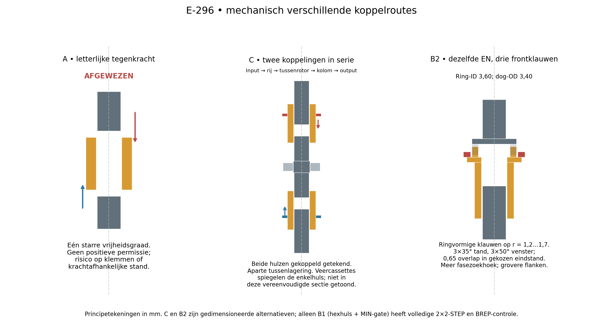
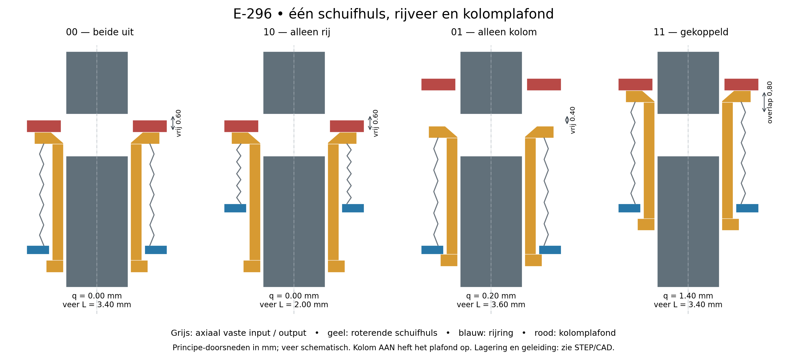
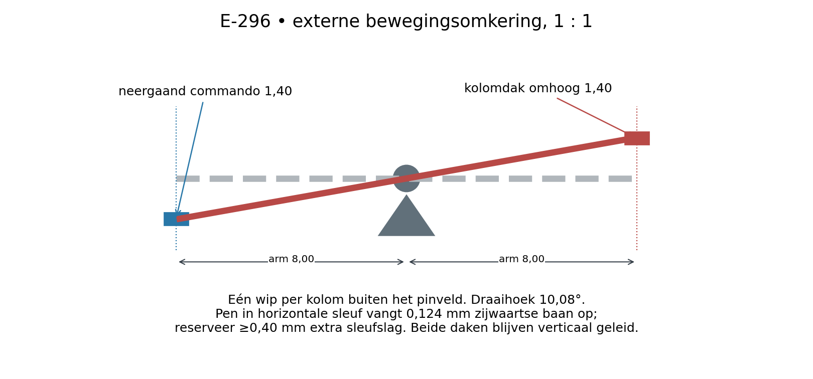
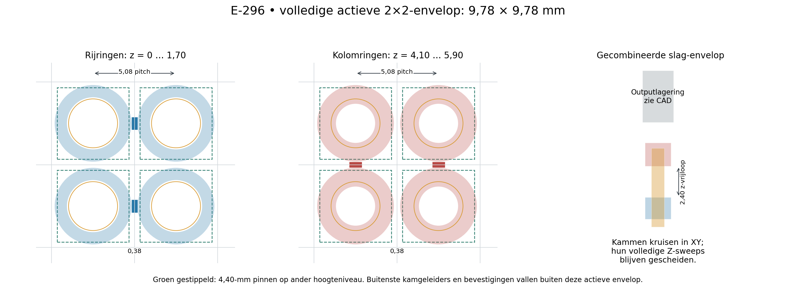

# E-296 — één schuifhuls met rijveer en positief kolomplafond

**Keuze:** valideer eerst **B1: één roterende schuifhuls, een lokale drukveer op de rijring en een positief begrenzende kolomring**. De EN-functie volgt uit twee geometrische bovengrenzen, niet uit twee krachten die elkaar moeten opheffen. De voorkeursrichting van de bovenste ring moet daarvoor veranderen: **kolom AAN heft het plafond op**. Een neergaand bedienuiteinde kan buiten het pinveld met één omkeerhefboom per kolom worden omgezet. De letterlijke uitvoering waarin beide ringen dezelfde starre huls tegengesteld duwen om te koppelen, is mechanisch geen verstandige basis.

Dit is een **geometrisch gecontroleerd precisieprototype**, geen fysiek bewezen koppeling en geen printklaar FDM-onderdeel. De complete 2×2-koppelingslaag staat in CAD. Haar voornaamste beslisrisico is of de kleine veerkracht de huls bij willekeurige tandfase werkelijk laat centreren en volledig zetten, zonder vrijlopende buren mee te slepen. Eén kleine handproef hieronder beslist dat. Twee seriekoppelingen blijven de concrete reserve, met meer onderdelen en hoogte.

Datum: 15 oktober 2026. Basis: `origin/main` **9ce8648**. Geen nieuwe issues, aankopen, motor/transmissieontwerp, elektronica of besturingsontwikkeling. De onderzoeksopdracht stopt bij deze keuze, reproduceerbare CAD/controles en één voorgestelde fysieke proef.

## 1. Wat de bestaande resultaten wel en niet bewijzen

Gelezen: [AGENTS.md](../../../AGENTS.md), [missie](../../../01-project-description/shape-display-mission.md), [actuele prioriteiten](../../../02-design-criteria/current-prototype-priorities.md), de relevante criteria voor [ruimte](../../../02-design-criteria/display-envelope.md), [fabricage](../../../02-design-criteria/fabrication-process.md), [herhaalde mechanismen](../../../02-design-criteria/repeated-mechanism-qualification.md), [buurisolatie](../../../02-design-criteria/update-and-regional-isolation.md) en [kosten](../../../02-design-criteria/cost-and-comparison.md).

- **Nieuwste fysieke eigenaarobservatie:** [compacte vijfparentest](../../../owner-print-tests/2026-10-15-compact-screw-fit/test.md), bijgewerkt in 9ce8648: alle vijf 4,4-mm-paren startten zonder kracht en maakten vijf handcycli. Alle drie nominale paren met 0,175-mm radiale draadrelief waren volgens de eigenaar uitzonderlijk soepel. Dat ondersteunt de compacte schroef/pin; het meet geen koppel, koppeling, lange slag, belasting, levensduur of buurisolatie. De lastige tijdelijke printvoetjes zijn geen blijvend arrayonderdeel.
- [E-295](../../../06-experiments/E-295-compact-screw-drive-development.md), [onderkoppeling](../E-295/research/xy-drive.md) en [gedeelde aandrijving](../E-295/research/shared-global-drive.md): schroeven blijven onafhankelijk axiaal ondersteund; vaste geleiding reageert pinrotatie. Een gedeelde motor bespaart geen lokale selectiefuncties. Een reizende kop/bank blijft economisch een sterke referentie.
- [E-076](../../../06-experiments/E-076-positive-shutter-coincidence-transition-screen.md): positieve blokkering kan EN leveren; een starre gedeelde slag stopt echter op halfgeselecteerde cellen. Daarom hier **een lokale veer per huls**.
- [E-078](../../../06-experiments/E-078-finite-ramp-retention-and-blocked-writer-load.md), [E-079](../../../06-experiments/E-079-short-trip-release-and-passive-seating-bound.md), [E-082](../../../06-experiments/E-082-row-clutched-positive-drive-selector.md): controleer gehele slag, steun, flank en tolerantieketen. Een passend eindplaatje alleen is onvoldoende.
- [E-118](../../../06-experiments/E-118-straddled-follower-and-captive-dog-disconnect.md): een gesloten vork kan zelfstandig terugtrekken blokkeren; geleiding moet blijven bestaan tot volledig vrij. Hier hebben rij en kolom ieder een eigen **positieve** ontkoppelroute, maar geen onafhankelijk noodontkoppelsysteem bij een vastgelopen selector.

Drie onafhankelijke Codex-subagents ontwikkelden concepten, onderzochten geometrie en beoordeelden historische/nieuwe risico's; een vierde maakte CAD. Hun kritiek leidde onder meer tot een grotere vangmond, langere lagering, echte kamgeleiding en het verwijderen van een ongeschikte microclip. [De onafhankelijke eindreview](review.md) vermeldt de resterende voorwaarden.

## 2. Waarom de oorspronkelijke tegenkracht geen EN bewijst

Een stijve huls heeft één axiale vrijheidsgraad `q`. Een harde rijduwer geeft een ondergrens; een harde kolomduwer een bovengrens. Hun gelijktijdige slag kan de huls **klemmen**. Met twee veren ontstaat een van stijfheid, wrijving en slijtage afhankelijke evenwichtsstand. Geen van beide is op zichzelf een positieve EN-functie.

Een vensterhuls die alleen in een middenstand beide vaste assen overlapt, kan vier **statische** standen coderen. Een halfselectie kan bij het doorschuiven echter door dat koppelvenster lopen, door de verkeerde tandfase vastlopen of een ongewenste schroef tijdelijk aandrijven. Daarom valt deze route af als intrinsiek geïsoleerde matrixkoppeling. Meer fijnvertanding of een grotere actuator lost die kinematische tekortkoming niet op.

## 3. B1: één huls met echte mechanische permissie

De axiaal vaste input eindigt in een zeskant. Een doorlopend inwendig zeskantprofiel houdt de huls permanent met die input verbonden. Boven de huls zit het zeskantuiteinde van de apart gelagerde schroef. De huls draait dus ook wanneer zij **niet** gekoppeld is.

De rijring ligt om de huls, onder een drukveer. Omhoog bewegen comprimeert die veer of tilt de vrijgegeven huls. De kolomring ligt als een dak boven de bovenflens: laag blokkeert zij de huls vóór de schroef; hoog laat zij koppelen toe. De onderste integrale hulsflens zit onder de rijring en maakt **positief terugtrekken** mogelijk. Terugkerende kolomring drukt rechtstreeks de bovenflens naar beneden.

Alle coördinaten hieronder zijn mm, `z` omhoog. `r,c` zijn de verplaatsingen van rijring en plafond uit hun lage stand; eindstanden 0 of 1,40. Bij voldoende veerkracht en passende tandfase geldt:

`q = min(c, r + 0,20)`.

Het plafond beperkt `q ≤ c`. De onderste hulsflens tegen de rijring beperkt `q ≤ r+0,20`. De veer zoekt de laagste begrenzing. Stictie kan een foutnegatieve selectie veroorzaken; zij is geen onderdeel van het logische bewijs.

| Rij | Kolom | Huls q | Veerlengte | Verbinding met schroef |
|---|---|---:|---:|---|
| 0 | 0 | 0 | 3,40 | 0,60 vrije luchtspouw |
| 1 | 0 | 0 | 2,00 | 0,60 vrije luchtspouw; lokale veer vangt de rijslag op |
| 0 | 1 | maximaal 0,20 | maximaal 3,60 | minimaal 0,40 vrije luchtspouw; onderste flens wordt gevangen |
| 1 | 1 | 1,40 indien gezet | 3,40 | 0,80 axiale profieloverlap, waarvan 0,425 rechte flank |

**Ontkoppelen werkt via beide adressen:** rij omlaag trekt de onderste flens terug; kolom omlaag drukt de bovenflens terug. De veer hoeft dus geen terugkeer te garanderen. Ontkoppelen onder torsie kan door flankwrijving alsnog veel kracht vragen. De eerste proef stopt en ontlast de input vóór het schakelen.

Een concrete externe omkering kan een wip met twee 8,00-mm armen zijn. Een 1,40-mm neergaande input geeft 1,40 mm opgaande output bij 10,08° rotatie. De eindpennen verschuiven daarbij circa 0,124 mm horizontaal; horizontale sleuven met minstens 0,40 mm extra slag laten de daken verticaal geleid blijven. Reserveer circa 16 mm hevelspan buiten het veld, plus lager/penruimte, op een andere hoogte dan de kamgeleiders. Dit is een gedimensioneerd omkeerprincipe, geen in de STEP uitgewerkte actuator. Direct omhoog bedienen volstaat voor de eerste proef.

### Definitieve hoofdafmetingen

| Onderdeel | Afmetingen / z in lage hulsstand |
|---|---|
| Raster, pin | 5,08; pin 4,40 vierkant; vaste geleiding 4,60 vierkant |
| Input/outputprofiel | mannelijke hex AF 1,80; omgeschreven Ø2,0785 |
| Huls | lengte 4,70; body Ø3,00; doorgaande hex AF 1,95 |
| Onderste hulsflens | integraal Ø3,40; z −0,60…−0,20; geen clip of groef |
| Bovenste hulsflens | Ø4,20; z 3,70…4,10 |
| Vangmond | AF 2,70, 45° overgang over 0,375; volledig in de bovenflens |
| Inputhex | z −1,90…3,30; nominaal 2,50 permanente overlap bij gekoppelde huls (2,48 bij −0,02 inputfloat) |
| Outputhex | begint z 4,70; onafhankelijk radiaal/axiaal ondersteund |
| Rijring | ID 3,20 / OD 4,70 / dikte 0,30; z 0…0,30 of 1,40…1,70 |
| Kolomplafond | ID 2,40 / OD 4,70 / dikte 0,40; z 4,10…4,50 of 5,50…5,90 |
| Verbindingsbruggen | breedte 0,80, buiten de ringgaten; rijen en kolommen op verschillende z |
| Drukveer, ontwerpaanname | OD 3,90 / ID 3,50 / draad 0,20; 5 actieve, 7 totale windingen; vrije lengte 3,716 |

Twee geblokkeerde proefcellen vragen ideaal 0,214 N; een 80-celrij 8,56 N, vóór glijwrijving en eigen gewicht. Alle 6.400 normale voorspanningen tellen intern tot circa 126 N op. Dit bepaalt toekomstige steun en staafstijfheid; een grote vrije plaatstrip is geen afdoende rijstaaf.

De stalen veer is een **ontwerphypothese**, geen geselecteerd catalogusonderdeel. Met aangenomen `G=79.000 N/mm²` geeft `k=Gd⁴/(8nD³)=0,06239 N/mm`: circa 0,0197 N normale voorspanning, 0,1071 N bij geblokkeerde rijslag en 0,00724 N in toestand 01. Solide hoogte is 1,40; bij de kortste werklengte 2,00 blijft 0,60 reserve. Of deze krachten werkelijk voldoende zijn, blijft de fysieke beslisvraag. De 3D-veer toont verpakking; gesloten eindovergangen en vermoeiing zijn niet gekwalificeerd.

### Aangrijpen, backlash en slijtage

De rechte hexflanken brengen beide draairichtingen over. De los passende hex draagt torque aanvankelijk via lokale hoek-/randcontacten, niet via uniforme druk op alle zes volle vlakken; contactspanning en slijtage zijn daarom niet uit de nominale flankoppervlakte te certificeren. De afschuining helpt vangen en centreren; zij is niet bedoeld als blijvend belast koppelvlak. Gecentreerd laat de nominale passing ongeveer ±9,75° vrije relatieve hoek per 60°-periode toe. Bij omkering is de totale dode hoek circa 19,50°, equivalent aan 0,163 mm pinbeweging bij 3-mm spoed, vóór draadbacklash. Dat is voor deze mechanische proef aanvaardbaar, maar geen nauwkeurigheidsclaim.

Bij 30° faseverschil kan de huls ongeveer tot `q=0,911` in de vangmond reizen voordat contact verdere insertie verhindert. De rij kan dankzij de lokale veer haar slag voltooien. Licht draaien moet daarna de fase laten vinden. **Een heel soepel lopende output kan op tipwrijving meedraaien zonder volledig te zetten.** Dat moet juist worden getest; pinbeweging alleen bewijst geen correcte seating. Een industrieel fabrikant beschrijft deze tand-op-tand- en meeloopproblemen ook bij stilstaande inschakeling [S1].

De niet-roterende ringen raken roterende flenzen; veeruiteinden en glijprofielen slijten eveneens. Bij aangenomen `μ=0,2`, contactstraal 1,8 en 0,0197 N voorspanning is de contactdrag circa 0,0071 Nmm per cel. Voor 6.400 cellen is dat ongeveer 0,045 Nm, exclusief journals en overige wrijving. Bij 0,107 N blokkeerlast is de orde 0,039 Nmm per betrokken cel. Dit zijn gevoeligheden, geen gemeten materiaalwaarden of motoreisen.

## 4. Gecontroleerde enveloppe en toleranties

De ringen zitten onder de pinnen rond kleinere naven, **niet om een 4,4-mm pin in de 0,68-mm pinnaad**. Ring-OD 4,70 laat 0,38 mm tussen naburige ringen. De actieve 2×2-envelop is 9,78 × 9,78; de celtegel zelf is 10,16 × 10,16. De volledige rij-sweep eindigt op z 1,70 en de kolom-sweep begint op 4,10: **2,40 mm verticale vrijloop** tijdens iedere combinatie van slagen. Bruggen kruisen daardoor zonder elkaar te raken.

De CAD bevat gesplitste draagplaten met Ø2,00 journals in Ø2,02 boringen, 4-mm lagerlengte en schouders aan beide kanten. De assen hebben geen commandoslag; de getekende constructie laat 0,02 mm axiale speling per thrustvlak toe, 0,04 mm totaal. Dit is een precisie-montagehypothese, geen vrij zwevende as. Last loopt van pin via draad en schroefschouder naar het vaste frame, onafhankelijk van selectie. Huls en selectieringen zijn geen pinlastlager. De aparte vaste vierkante pingeleidingen reageren draaimoment en staan 10 mm uit elkaar.

De **volledige demonstratiefixture** meet 15,80 × 15,80 × 51,42 mm inclusief pinnen en bevat buiten het actieve raster klembruggen en aan beide uiteinden verticale kamschoenen in vaste geleiders. Deze buitenruimte hoort bij de 2×2-proef; zij is geen extra vrije ruimte binnen iedere 5,08-mm cel. De STEP toont ook de ruimte voor Ø3,2-schroeven en 4,4-mm holle pinnen. Outputhead en schroef zijn één integraal gereserveerd lichaam: rakende losse CAD-vlakken zouden geen torqueverbinding vormen. Het E-295-draadprofiel moet op dit nieuwe integrale onderdeel worden vervaardigd; de reeds geprinte schroef is geen zonder meer passende precisiehead. Materiaal/proces en de vervaardiging van die combinatie blijven te kwalificeren. Hun draad is een **envelop**, geen nieuw gegenereerd functioneel schroefprofiel. Gebruik voor een fysieke pin het reeds geteste E-295-profiel. De getoonde korte slagreserve is ±1,5 mm, voldoende voor een 3-mm demonstratie; dit pakket valideert geen 40-mm slag.

De maatketens zijn expliciet, niet gebaseerd op een vermeende universele FDM-tolerantie:

| Controle | Nominaal | Betekenis van fouten / grens |
|---|---:|---|
| C0: outputtip − laag plafond | 0,60 vrij | outputdatum en plafonddatum elk ±0,05 → minstens 0,50 |
| R0C1: outputtip − huls/flensspan − rijvlak | 0,40 vrij | output ±0,05, gemeten huls-span ±0,05, rijvlak ±0,05 → 0,25; losse flensmaten kosten extra reserve |
| Rechte ON-flank | 0,425 | totaal 0,10 ongunstige axiale keten → 0,325 |
| Hex totale vlakspeling | 0,150 | AF-maten elk ±0,02 → minstens 0,110; uitlijning, tilt en ruwheid komen daar nog bij |
| Rijring om huls | 0,100 radiaal | diameters elk ±0,02 laten 0,080 vóór excentriciteit |
| Rijring op onderste flens | 0,100 radiale vangrand | diameters elk ±0,02 laten 0,080 vóór excentriciteit; meet minstens 0,04 daadwerkelijke vangrand |
| Veer over onderste flens bij montage | 0,050 radiaal | veer-ID, ovaliteit en flensmaat moeten worden gemeten; geen generieke springtolerantie aangenomen |
| Kolomring om outputhex | 0,161 radiaal | geen directe torqueverbinding; budgetteer ringregistratie, asoffset en slingering |

De vrije schuifpassing laat op zichzelf hulptilt toe: een conservatieve extrapolatie geeft 0,159 nominale mondoffset en 0,2014 bij een ongunstige ±0,02-AF-combinatie. Daarom is de oorspronkelijke smalle AF2,25-mond **verworpen**. De uiteindelijke AF2,70-mond heeft bij ±0,02-AF-fouten 0,2892 mm all-phase vangruimte. Na 0,2014 hulsuitwijking en **als montagevoorwaarde gemeten** maximaal 0,030 mm asoffset resteert 0,0578 mm geometrische vangreserve. Een gecentreerde eindroute bestaat dan; dit berekent geen wrijving of gegarandeerde zelfcentrering. Meet de asoffset bij de aangrijpzone, inclusief journalspeling/tilt, niet alleen op de lagerplaat.

Een ±0,10-mm AF-scenario kan zowel **vastlopen** (`female 1,85 < male 1,90`) als **verlies van positieve koppeloverdracht** geven (`female 2,05 > 2×male 1,70/√3`). Vergroten van een zeshoekgat voor FDM-slop is dus geen oplossing. De succesvolle 0,175-mm **draad**relief is geen vrijgave van deze hexpassing.

Kamspeling, kantelen en elastische buiging kunnen de vrije spouwen verkleinen. Zelfs 0,02 mm zijspeling over een 3-mm schoen geeft een eindige hoekreserve, geen perfect verticale beweging. **Meet na montage minimaal 0,15 mm werkelijke OFF-spouw in alle cellen**, bij beide uitersten van speling en onder de veerlast. Een nominale CAD-gap vervangt dit criterium niet.

### Buren en adreswissels

De [onafhankelijke berekening](independent_geometry.py) controleert alle 16 rij/kolomcommando's op 2×2. Zij geven 10 verschillende cartesische maskers. Twee rijen en twee kolommen selecteren **alle vier** kruispunten; een diagonaal vereist twee passes. Een heldere luchtspouw naar de eigen output is het geometrische isolatiebewijs; gemeenschappelijke framevervorming, vervuiling en werkelijke sleep zijn niet door CAD afgedekt.

Met een werkelijk uitstaande andere selector blijven eenzijdige slagen veilig. **Gelijktijdig gekruist omschakelen is niet intrinsiek veilig:** bij 10→01 met lineaire slagen bereikt de huls `q=0,80`, dus 0,20 ongewenste overlap, hoewel beide eindstanden OFF zijn. Bij 94 van 256 geanalyseerde lineaire 2×2-overgangen ontstaat ergens een tussentijdse selectie buiten beide eindmaskers. Dit zijn trajecten, geen foutkansen.

Vaste handmatige/mechanische proefvolgorde: **input stoppen en torsie ontlasten → betrokken rijen positief terug → kolommen verzetten → bedoelde rij omhoog → zacht fasezoeken en volledig zetten → draaien**. Voor het verlaten van een actieve cel kan zowel rij als kolom ontkoppelen, maar willekeurig kruiselings wisselen onder een draaiende bus wordt niet geclaimd.

## 5. Andere concrete kandidaten

### B2 — drie frontklauwen met dezelfde rij/plafond-EN

Behoud de onderste inputhex, huls, veer en terugtrekking. Vervang de bovenste hexoverlap door drie axiale sectorklauwen op straal 1,20…1,70: 35° breed, 0,80 hoog, 120° periodiek. De output heeft 50° brede sleuven. De outputkrans is Ø3,40, zodat een vergrote kolomring-ID 3,60 erover kan bewegen; buitenradius 2,35 blijft gelijk. De ring stopt de buitenste hulsflens op r 1,80…2,10.

Concreet z-pakket: klauwen OFF 4,10…4,90; outputkrans ondervlak 5,65, sleufdak 6,50. ON staan de klauwen 5,50…6,30 en hebben 0,65 overlap, met 0,20 dakspouw. OFF is de tandtipgap 0,75, of 0,55 bij 01. Rijen/kolommen blijven ruimtelijk gescheiden. Drie sleuven geven ±7,5° fasevenster per 120°; meer zoekrotatie dan de hex, maar grovere uitwendige flanken en beter zicht op seating. De onderste slidingkey blijft een precisiepassing. De vergrote plafond-ID laat slechts 0,30 radiale stoprand: een duidelijke ruil tegen beter produceerbare outputtanden. De [ééncel-STEP](cad/alternative_B2_one_cell_ON.step) en [BREP-controle](alternative-geometry.json) controleren de vier toestanden en bevestigen dat ±7,4° past en ±7,6° bij geforceerde volle slag botst. Dit is een eindige nominale geometriecontrole, geen volledige 2×2-fixture of fysieke kwalificatie. Niet gekozen vóór de eenvoudiger doorlopende hex, maar eerste alternatieve tandvorm als de proef juist op outputfase/centreren faalt.

### C — twee schuifkoppelingen in serie

Krachtroute: **input → rijhuls → apart gelagerde tussenrotor → kolomhuls → schroef**. Rij omhoog en kolom omlaag kunnen hier rechtstreeks hun eigen koppeling sluiten, zoals oorspronkelijk gewenst. Beide nodig voor de complete torquegraph. Bij 10 draait alleen de tussenrotor; bij 01 zijn tussenrotor en output verbonden terwijl de input vrij is.

Een concreet pakket ontstaat uit twee gespiegelde 4,70-mm-hulscassettes. Onderste sleeve OFF −0,60…4,10 en ON 0,80…5,50; input eindigt 3,30; tussenrotorhex onderzijde begint 4,70. Tussenrotor: onderste hex 4,70…7,70, onafhankelijke centrale journal/keepers 7,70…9,10, bovenste hex 9,10…12,10. Bovenste sleeve OFF 12,70…17,40 en ON 11,30…16,00; outputhex begint bovenaan op 13,50. Ieder koppelvlak heeft 0,60 OFF-gap, 0,80 ON-overlap en ≥2,50 permanente input/output-overlap. De veer/positieve terugtrekcassettes worden gespiegeld; stel de retouraanslag hier op de OFF-positie in plaats van de 0,20-mm plafondspeling. De middensteun mag niet worden weggelaten of als zwevend rotorstuk worden getekend.

De [ééncel-STEP](cad/alternative_C_one_cell_ON.step) en het [controlescript](alternative_checks.py) controleren alle vier nominale toestanden, de onafhankelijke middenlagering (±0,02 mm vrij, ±0,03 mm botst met de keeper) en de buurenvelop. Externe kamverbindingen en de gespiegelde veercassettes blijven gereserveerde conceptgeometrie; dit is geen volledige 2×2-kwalificatie. Het pakket past op dezelfde ring-OD 4,70, maar de koppelingen alleen beslaan circa 18 mm in plaats van circa 6,5. Het heeft twee lokale veer-/terugtrekfuncties, twee tandfaseringen en een extra precisierotor met lagering. In 01 kan kolomfasezoeken bovendien de vrije tussenrotor én zeer lichte output een beetje verdraaien zonder inputkoppel; de torquegraph bewijst geen nultransient. De tweede koppeling lost productie en fasezoeken dus niet automatisch op. Alleen heroverwegen als het positieve plafond of de enkele huls fysiek de zwakke schakel blijkt.

### Fasevrije wrijving, conus en andere profielen

Een vlakke wrijvingsring vermijdt tandfase. Met aangenomen contactring r 0,8…1,8 is `r_eff=1,364`; bij `μ=0,30` vraagt **0,2 / 2 Nmm** respectievelijk **0,489 / 4,89 N** axiale druk. Dat zijn koppelgevoeligheden, geen gemeten draadkoppels. Zij liggen veel hoger dan de gekozen veerkracht. Een conus vergroot het moment per axiale kracht, maar geeft extra radiale reactie en kan bij ongunstige conushoek/wrijving blijven klemmen. Slijtage/vervuiling verandert de slipgrens. Niet de eerste keuze zonder een veel lager gemeten schroefkoppel.

Een vierkant, double-D of twee brede dogs kan meer vormovervang geven dan de kleine hex, maar vraagt andere wand-/hoekruimte. Veel fijne splinetanden verkleinen de zoekhoek en maken juist de kleine tandwortels en maakfouten kritischer. Een gespleten collet, torsieveer- of wrap-springkoppeling vraagt extra vrijgave, vaak richtingsafhankelijkheid en herhaalde gevoelige veercontacten. Geen daarvan verwijdert de noodzaak van een echte EN-gate.

## 6. Maakbaarheid, onderdelen en kosten

| Kandidaat | Compactheid | Betrouwbaarheid / grootste onzekerheid | Lokale extra delen boven input/output | Produceerbaarheid / kostenverwachting |
|---|---|---|---|---|
| A tegenkracht / middenvenster | klein getekend | geen afdoende EN of transiëntisolatie | onbekend totdat gate toegevoegd | niet verder ontwikkelen |
| **B1 hexhuls + plafond** | **OD4,70; circa 6,5-mm selectielaag** | positieve OFF-grenzen; fasezetten, centreringswrijving en retourvangrand te testen | **huls + veer = 2**; gedeelde gesplitste rijkammen en plafonds | laagste onderdelenlast van uitgewerkte EN; precisieserie duur, normaal FDM niet gekwalificeerd |
| B2 frontklauwen + plafond | zelfde XY, iets hogere outputneus | grovere outputflanken; langer fasezoeken, smallere plafondrand | 2 | makkelijker zichtbare/uitwendige tanden; onderste slidingkey blijft precies |
| C twee seriekoppelingen | zelfde XY, circa 18-mm koppellengte + steunen | heldere serielogica; twee faseringen, extra lagersleep en 01-transient | 2 hulzen + 2 veren + tussenrotor = minstens 5 | meer montage/precisiewerk; verwachte herhaalde kosten hoger |
| Wrijving/conus met EN | potentieel klein | fasevrij; slip, hoge druk en eventueel klemmen | vergelijkbaar of hoger | lagere vormprecisie, hogere kracht-/materiaalonzekerheid |

Voor de eerste vier cellen is precisiewerk in metaal met een stijve gemeenschappelijke boor-/positioneermal aannemelijker dan een ongewijzigde 0,4-mm-nozzleprint. Rij-/plafondringen kunnen uit dun plaatmateriaal worden gemaakt; de gedeelde schoenen/klemmen zitten buiten het veld. Een gegoten of geïnjecteerde slijtvaste polymeerhuls kan bij aantallen interessant zijn, maar gereedschap, krimp, kernmaten en herhaalbaarheid zijn niet aangetoond. Outsourced fijnprinten is een alternatief proces, geen automatische ±0,02-mm-garantie. De bestaande FDM-pinnen blijven bruikbaar als afzonderlijk bewezen basis.

**Onderdelentelling:** B1 voegt bij 6.400 cellen 6.400 hulzen en 6.400 veren toe, naast alle bestaande schroeven, inputnaven en lagering. De twee halve rijkammen zijn gedeeld per rij; er zijn geen 6.400 microclips. C heeft minstens 32.000 lokale extra delen. Goedkope motoren zouden deze montage-/slijtagecontacten niet wegnemen.

Er zijn geen offertes. Voor vergelijking is een controleerbaar **inkoopbudgetscenario** eerlijker dan een schijnnauwkeurige productprijs: B1 bij €0,10 / €0,25 / €0,50 per complete lokale huls+veer kost al **€640 / €1.600 / €3.200**, zonder platen, input, arbeid of tooling. Bij C leidt dezelfde veronderstelde prijs per huls+veer alleen al tot het dubbele, plus de tussenrotoren. Deze eenheidsprijzen zijn drempels, geen aangetoonde leverprijzen. Een illustratief totaalbudget van €500 laat circa €0,078 per cel voor **alle** onderdelen toe; een resident precisiekoppeling is daarom economisch ongunstig tenzij batchfabricage zeer goedkoop blijkt.

Voor één uitbestede 2×2-precisieproef is **€300–1.000 exclusief eigen arbeid** een voorlopig reserveringsscenario met lage zekerheid, niet een offerte of koopadvies; unieke opspanningen en kleine afmetingen domineren. Zelf fabriceren met aanwezige middelen kan dit sterk veranderen. Binnen deze opdracht wordt niets besteld. C verwacht meer precisieonderdelen en werk dan B1; absolute seriekosten vragen een echte fabricageroute en offerte.

Montage is waarschijnlijk belangrijker: 5 / 10 / 20 seconden per cel betekent **8,9 / 17,8 / 35,6 uur**, exclusief frame en fouten. Zelfs B1 is dus geen bewezen weekendassemblage. De kleine 2×2-kammen mogen ook niet als 406-mm vrijdragende plaatstrips worden opgeschaald: langere rijen vragen stijve ruggen en lokale geleiding op gereserveerde hoogtes. Een full-board frame/staafontwerp is hier niet vrijgegeven. E-295's reizende bank houdt dit soort kritische delen slechts enkele keren aanwezig en blijft het economische alternatief.

## 7. Eén eerstvolgend fysiek experiment

**Proef: één 2×2-selectiecartridge op 5,08 mm, handbediend, met de vier reeds gekozen compacte schroef/pininterfaces en vaste geleiding.** Vier identieke hulzen/veren, twee gesplitste rijkammen, twee plafonds en de eigen axiaal opgesloten in-/outputassen. Geen nieuw motor- of transmissieproject: draai de vier blootliggende inputs beurtelings met dezelfde handkop. Daarmee wordt per tak de roterende input beproefd; dit valideert geen gedeelde aandrijftransmissie. Het CAD-frame dient als geometrische basis, geen ongetoetste printplaat.

1. Meet eerst in hetzelfde artikel de ene sleutelpassing: AF-maten, asoffset bij de aangrijpzone ≤0,030, vrije montage van veer over Ø3,40-flens, intacte retourvangrand ≥0,04 en alle OFF-spouwen ≥0,15. Als dit niet haalbaar is, stop de assemblage; dan is het gekozen precisieproces of profiel onvoldoende.
2. Markeer alle outputassen, hulsseating en pinhoogtes. Gebruik zowel onbelaste pinnen als één kleine **gewogen en genoteerde** miniatuurlast. Test per cel 00/10/01/11, beide ingangen naar 11 en ieder afzonderlijk ontkoppelpad. Neem een korte zichtbare slag van 3 mm; geen eindstops op kracht zoeken.
3. Verdraai iedere input in elke OFF-toestand tien langzame handomwentelingen linksom en rechtsom. Geen outputrotatie of buurbeweging boven de vooraf vastgelegde waarnemingsresolutie; bijvoorbeeld een markering/video die 5° asrotatie en een schaal die 0,2 mm hoogte onderscheidt. Noteer die resolutie en ook kleinere twijfelgevallen, claim geen exact nul.
4. Herhaal de geselecteerde toestand bij startfasen 0/10/20/30/40/50° over één 60°-periode. Zet doelbewust twee geselecteerde cellen verschillend uit fase: de ene moet kunnen zetten terwijl de andere veer wacht. Controleer **volledige hulsseating** vóór draaien, vooral bij de zeer soepel lopende output. Laat de rij niet hard doordrukken.
5. Stop en ontlast torsie, trek eerst rijen terug en wijzig dan kolommen. Controleer beide positieve retourroutes, blijvende OFF-spouwen, ring-/veerwrijving, beschadiging en ongewenste beweging bij ontkoppelen. Meet zo mogelijk de benodigde lift-/terugtrekkracht met een kleine krachtmeter; vergelijk met de voorspelde circa 0,02–0,11 N in plaats van die te veronderstellen.

**Beslisregel:** doorgaan met B1 alleen als alle halfselecties en hun veilige overgangen vrij blijven, alle gekozen fasen zacht en volledig zetten, iedere geselecteerde pin beide richtingen beweegt en beide retourroutes zonder hulp vrijmaken. Stop onmiddellijk bij vastlopen, niet volledig gezette meeloop, tandschade, openende splitkam of niet-geselecteerde outputbeweging. Bij falen op outputinvangen is B2 de eerstvolgende **keuze**, bij falen op de permissie-/retourfunctie C; start geen van beide automatisch. Deze ene proef wordt voorgesteld, niet als nieuwe READY-printopdracht of bewezen resultaat geregistreerd.

## 8. CAD, controle en bewijsgrenzen

Bestanden en reproductie: [CAD README](CAD-README.md), [generator](generate.py), [BREP-controles](validation.py), [onafhankelijke interval-/kinematicacontrole](independent_geometry.py), [tekeningenbron](drawings.py). STEP bevat vier uniforme 2×2-toestanden, een gemengde 2×2 en een fasegeblokkeerde stand, plus vijf componentbestanden (de splitkam bevat twee helften). Daarnaast zijn er twee ééncel-STEP-bestanden voor de alternatieven. Doorsneden en een echte BREP-projectie zijn afzonderlijke SVG/PNG-bestanden. De maat-/standenlijst staat in het CAD-manifest; bestandshashes staan in provenance.json.

De controles omvatten vormgeldigheid, echte volumetrische intersecties, meerdere selectorstanden/rotatiefasen, positieve spleten, alle binaire maskers en expliciete foutgevallen. Eindige BREP-samples zijn geen bewijs voor alle continue contactbewegingen; de bijgevoegde intervalgrenzen dekken de genoemde affine sweeps. Ze simuleren geen wrijving, elasticiteit, fysieke passing, montageopbrengst of levensduur. Een ongunstige hoekfase moet **juist** botsen bij geforceerde volledige slag; de lokale veer is ontworpen om op dat moment te wachten.

De onafhankelijke review bewaart ook de negatieve resultaten: starre tegenkracht, venstertransiënten, te kleine vangmond, ongeschikte microclip, onvoldoende initiële kamgeleiding en arbitraire adrescrossfades. Het actuele ontwerp lost een deel daarvan geometrisch op; fasezetten en vrijlopen blijven de afgebakende fysieke stopgate. **Geen fysieke werking wordt op basis van CAD geclaimd.**

## Technische bron

**[S1] Miki Pulley, [Tooth Clutch catalogus](https://www.mikipulley-us.com/documents/Catalog/Catalog_Tooth_Clutch.pdf), geraadpleegd 15 oktober 2026, catalogus pp. 374–375.** De gebruiksaanwijzingen behandelen tandtipcontact, mogelijk meedraaien van een lichte last vóór goed aangrijpen, onvolledig zetten na stilstaande inschakeling en smering van schuifspline/tandtips. Overdracht hier: fase, compliant zetting en slijtage verdienen een echte proef. De grote catalogusproducten bewijzen geen werking, smeringskeuze of maatnauwkeurigheid op 5,08 mm.
