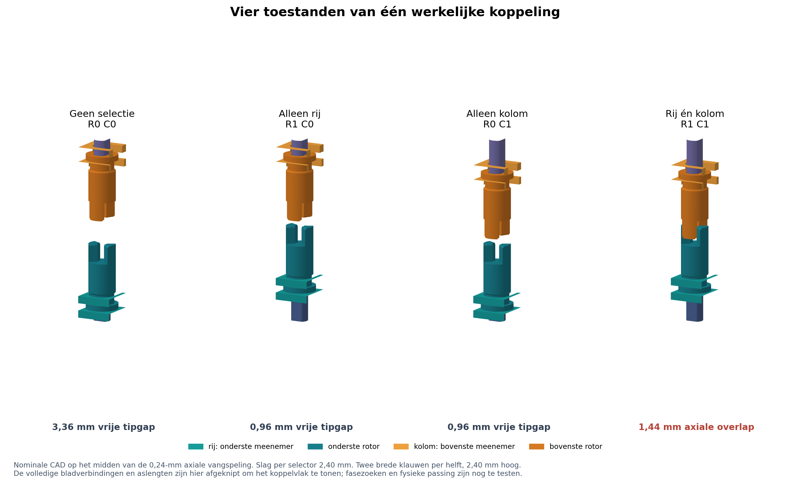

# E-297 — twee naar elkaar bewegende koppelingshelften

**Eigenaarsopdracht, 16 oktober 2026.** Basis: `main` op `8511bb21b6c358a295d286cab2194ef0f37f7520`. Dit pakket ontwikkelt uitsluitend de oorspronkelijke tweedelige koppeling. Printen en fysieke werking zijn nog niet uitgevoerd door de eigenaar; CAD- en slicercontroles worden afzonderlijk geregistreerd.

## Vastgelegde krachtroute

Per pin bestaan twee afzonderlijke rotoren. De onderste blijft met een verschuifbaar vormprofiel aan de roterende input verbonden; de rijstaaf tilt hem op en trekt hem terug. De bovenste blijft met een verschuifbaar vormprofiel aan de afzonderlijk axiaal gesteunde schroef verbonden; de kolomstaaf brengt hem omlaag en terug omhoog. Beide selectorverbindingen laten rotatie toe en grijpen axiaal aan beide kanten aan. De frontklauwen vormen precies één koppeling. Rechte dragende flanken werken in beide draairichtingen.

De vaste lagering draagt de schroeflast naar het frame. De geleide vierkante pin neemt het reactiekoppel op. Selectorbeweging hoort daardoor alleen de koppelingshelften te verplaatsen. De pinnen staan op 5,08 mm pitch en zijn 4,40 mm breed. Buren hebben nominaal 0,68 mm tussen de vierkante pinvlakken; daadwerkelijke scheefstand en speling moeten in de proef worden bekeken.

Geen veren per pin, omkeermechanisme, centrale enkele huls, tweede seriekoppeling, tussenrotor of individuele actuator is toegepast. De inputaandrijving van de proef is handmatig en wordt per ingang aangebracht; de gezamenlijke rij- en kolomstaven verzorgen de mechanische selectie.

## Bewijsbasis

- Gelezen: repository- en printtest-`AGENTS.md`, missie, huidige prototypeprioriteiten, fabricagecriteria en ruimtecriteria.
- [E-295](../../../06-experiments/E-295-compact-screw-drive-development.md) levert de compacte draadfamilie. Het [nieuwste fysieke resultaat](../../../owner-print-tests/2026-10-15-compact-screw-fit/test.md) is leidend boven oudere, nog voorwaardelijke zinnen in E-295: vijf van vijf compacte paren startten zonder kracht en maakten vijf handcycli. Drie nominale exemplaren met 0,175 mm radiale draadrelief waren volgens de eigenaar alle drie “supersoepel”. Het oorspronkelijke X1C-project is volgens de eigenaar ongewijzigd gebruikt.
- De schroefdraad behoudt Ø3,2 mm, spoed 3 mm, diepte 0,9 mm, profielhoek 90° en 6 mm binnendraad in de 4,4-mm-pin. Deze handpassing kwalificeert geen nieuwe schuifprofielen, koppelingsflanken, lagering of meenemers.
- De eigenaar vond de CAD-printvoetjes moeilijk te verwijderen. De nieuwe printoriëntaties en bedhechting worden daarom expliciet gecontroleerd; er mag geen support in functionele draad of koppelprofielen komen.
- E-296 is alleen gelezen voor technische bevindingen: tand-op-tand blokkering, meeslepen van een zeer lichte output zonder volledige aangrijping, tolerantieopbouw, werkelijke axiale ondersteuning en de noodzaak van een monteerbare selector. Zijn enkele huls, veer, plafond en omkering zijn niet overgenomen. Zijn kritiek op twee krachten op één starre huls is niet van toepassing op de twee onafhankelijke axiale vrijheidsgraden hier.

## Bediening en grenzen

Een rij en een kolom selecteren één kruispunt. Twee rijen en twee kolommen selecteren alle vier kruispunten; een diagonaal wordt in twee afzonderlijke stappen ingesteld. Voor iedere adreswijziging: input stoppen en torsie ontlasten, rij terug, kolommen instellen, rij selecteren, zacht fasezoeken tot volledig gezet, daarna pas draaien. Ook bij deselectie blijft gedurende een deel van de slag nog tandflankoverlap bestaan; niet blijven aandrijven tijdens schakelen.

De gezamenlijke stijve staven kunnen op één tand-op-tand contact stoppen. De handtest mag daarom niet alleen pinbeweging als bewijs gebruiken: de selector moet zijn eindpositie halen en de rechte flanken moeten werkelijk in elkaar staan. Een vrijlopende schroef kan door tandtipwrijving al meedraaien zonder volledig te zetten. Gelijktijdig selecteren van meerdere verschillend gefaseerde schroeven wordt apart beproefd. Er wordt geen automatische fase-invang of grote gedeelde aandrijfbus geclaimd.

De steile E-295-draad is niet door deze berekeningen als zelfremmend gekwalificeerd. Axiale opsluiting van de schroef voorkomt niet vanzelf terugdraaien door gewicht. Registreer ongewenste inputoverdracht, axiale speling en zelfstandig teruglopen als verschillende observaties. De proef werkt eerst onbelast en met lichte handkracht.

## Oplevering en bewijsniveaus

Het CAD-manifest, de tekeningen, onafhankelijke geometriecontrole, Bambu-profielen en daadwerkelijke padcontroles bevatten de uiteindelijke maatvoering en bestandsherkomst. De twee fysieke tests hebben een eigen montagehandleiding en invulformulier; samen ook als [printbare PDF](print-and-assembly.pdf):

1. [Test A — passing en aangrijpen](../../../owner-print-tests/2026-10-16-two-half-clutch-fit/test.md).
2. [Test B — functionele 2×2](../../../owner-print-tests/2026-10-16-two-half-clutch-matrix/test.md).

Berekening bewijst uitsluitend de opgegeven ideale geometrie en expliciete foutbudgetten. Een gesloten mesh bewijst geen printbaarheid. Slicerpaden bewijzen dat de geselecteerde slicer het materiaal daar plant, geen hechting, laagsterkte of fysieke passing. Alleen ingevulde eigenaarresultaten kunnen die laatste vragen beantwoorden. Er zijn geen vervolgissues, aankopen of nieuwe onderzoeksprojecten aangemaakt.

## Definitieve maatvoering

Alle maten in mm, nominale CAD; [parameters](cad/parameters.json) en [tandnotitie](tooth-design.md) zijn de technische bron. `z` is omhoog vanaf de framevoet.

| Functie | Maat / uitvoering |
|---|---|
| Actief raster | 2×2, hartafstand 5,08; vierkante pin 4,40; pinlengte 18 |
| Twee rotorhelften per pin | Identiek geprint, bovenste omgekeerd gemonteerd; totale lengte 8,60 |
| Vangflens / hals / koppelkop | Ø4,30 × 0,72 / Ø3,20 / Ø3,60 |
| Klauwen | Twee tegenoverliggende sectoren; radius 0,60–1,80; 76°; hoogte 2,40; bovenste 0,24 naar 56° versmald |
| Double-D-as | Ø2,20 met 1,60 tussen de twee vlakke kanten |
| Nominale blinde double-D-socket | Ø2,50 / vlakafstand 1,90; diepte 5,48; gesloten kap 0,72 |
| Gedeelde selector | Twee bladen van 0,96; ruimte ertussen 0,96 om flens van 0,72; halsopening 3,50, asopening 2,50; stationbreedte 4,60 |
| Axiale vangspeling | 0,24 totaal per rotor, dus ±0,24 gecombineerde relatieve afwijking rond beide middenposities |
| Rijslag / kolomslag | +2,40 / −2,40, met beide richtingen actief via de vangflens |
| Rotorbasis bij UIT | Onder z=7,00; boven z=27,56, gespiegeld |
| Vaste radiale rotorgeleiding | Ø4,00 boring rond glad Ø3,60 lichaam; onderste z=11,80–13,00; bovenste z=21,56–22,76 |
| Permanente DD-overlap | Nominaal minimaal 2,52 bij selectie; maximaal 4,92; 0,56 ruimte tot blinde socketbodem in UIT |
| Inputlagering | Flens Ø4,30 in Ø4,60 holte; 0,24 axiale speling; bovenste radiale boring Ø2,60, lengte 2,36 |
| Schroefsteun | Integrale DD-staart, 45° overgang naar vlakke bovenkraag; conische onderzijde draagt op de ronde framezitting; 0,24 axiale vangruimte |
| Pinbegeleiding | Twee vaste vierkante openingen van 4,60 op z=42,00–43,20 en 51,20–52,40 |
| Schroef/pin | Exacte E-295 draadmesh, 16 mm lang; 6 mm binnendraad, relief 0,175; gesloten top op bed geprint |
| Pin middenstand | Onderkant z=38,21, top z=56,21; circa 3,81 boven het hoogste framevlak |
| Rekenkundige testslag | ±3 mm rond midden; fysieke eerste handproef gebruikt ±1,5 mm om ruimte aan beide uiteinden te behouden |
| Handmatige vastzetting | Twee verwijderbare stopstukjes van 2,40 per gedeelde selector, buiten het pinveld; geen veren |

### Vier eindstanden

| Rij | Kolom | Vrije tipafstand / penetratie | Rechte dragende flank |
|---|---|---:|---:|
| UIT | UIT | 3,36 vrij | geen |
| AAN | UIT | 0,96 vrij | geen |
| UIT | AAN | 0,96 vrij | geen |
| AAN | AAN | 1,44 penetratie | 0,96 nominale overlap |

Een **bewust conservatief axiaal toetsbudget ±0,72** laat minstens 0,24 mm enkelvrijloop, rechte overlap en wortelvrijloop over. Dat budget bestaat uit ±0,24 gecombineerde gecentreerde vangspeling, ±0,24 gezamenlijk Z-/stopbudget en ±0,24 extra reserve; de laatste posten zijn niet gemeten printerfouten. Het is geen vergunning om de fysieke flensspeling met 0,72 mm te vergroten: kanteling en radiale vrije ruimte hebben eigen grenzen.

De integrale framegeleidingen begrenzen het rotorlichaam vlak bij het koppelvlak. Zij werden toegevoegd nadat een daadwerkelijk toelaatbaar gekanteld paar van het eerdere Ø4,30-kopmodel een buur doorsneed. De onafhankelijke controle bewaart het afgekeurde model als negatief bewijs en toetst de herstelde geometrie afzonderlijk. Nominale 16-maskerbotsingsvrijheid alleen is onvoldoende bewijs.

De losse handgreep en beide DD-overgangen hebben hoekspeling. De twee nominale DD-overgangen plus frontklauwen geven berekend circa 80° mogelijke gezamenlijke omkeerspeling, ongeveer 0,67 mm schroefhoogte bij 3-mm spoed; de afneembare handgreep en draad kunnen daar nog speling aan toevoegen. Dit is een demonstrator voor selectie en beweging, geen positioneerprecisieclaim.

## Meenemerkeuze, ondersteuning en montage

Een open enkele U-vork in een rotorgroef heeft weinig delen, maar de bovenste groefflens introduceert een horizontale printoverhang op het functionele glijvlak. Een volledige schuine onderzijde maakt juist een wigcontact. Een gesloten ring of microclip vraagt een extra split- of elastische montage. De gekozen dubbele kam vangt de **enkele integraal geprinte basisflens** tussen vlakke bladen; de twee bladen zijn buiten het pinveld tot één stijve selector verbonden. Er is geen aparte ring per pin.

De onderste rotoren en rijstaven liggen onder de bovenste rotoren en kolomstaven. Hun volledige bewegingen kruisen daardoor op verschillende hoogteniveaus. Aan beide uiteinden lopen de staven in framevensters. De acht externe vulstukjes houden de vier hoge selectorstanden horizontaal vast. Voor deselectie worden ze verwijderd en wordt de staaf actief naar de andere stop bewogen.

De input is zelfstandig axiaal opgesloten. De outputschroef is één geprint lichaam met DD-staart en thrustkraag; er is geen onbewezen lijm-/kopverbinding. De conische onderzijde van de schroefkraag rust op de framezitting, het bovenste vlak wordt door een tweede plaat gevangen. Dit is een glijlager en kan wrijving hebben; er wordt geen kogellagerprestatie geclaimd. De dubbele vierkante pinbegeleiding reageert schroefkoppel en begrenst kanteling.

Het frame bestaat uit **drie** delen, gesplitst door de aslijnen. Daardoor kunnen de grotere opgesloten kragen zijdelings in de open halve boringen worden gelegd. Geïntegreerde registratiepennen richten de delen uit; externe tape sluit de gedeelde framesplitsingen. De montagebaan is eerst met het middenframe uitgevoerd: achterste rij, haar vanaf de zijkant aangebrachte en daarna axiaal in het vlak geschoven vork, voorste rij, kolommodules vanaf beide zijkanten, en pas daarna beide buitenframes. De concrete montage staat bij Test B. Deze proef heeft 36 geprinte delen: vier pinnen, vier integrale schroeven, vier inputs, acht rotorhelften, vier gedeelde selectors, drie framedelen, één handgreep en acht gedeelde stopstukjes. Buiten de test is het handgereedschap geen permanent onderdeel per cel.

## Tekeningen en gebruiksklare bronnen

[Flensdoorsnede en raster](drawings/collar-and-pitch.png) · [onderdelenkaart A](drawings/plate-a.png) · [onderdelenkaart B](drawings/plate-b.png). De PNG/SVG-tekeningen worden uit de werkelijke geëxporteerde meshes gemaakt; [bronmanifest](drawings/source-manifest.json).

[CAD-maatvoering en montage](cad/cad-guide.md) · [onafhankelijke review](review.md) · [Bambu-reproductie](printing/reproduction.md). De STEP-bestanden bevatten de nieuwe parametrische onderdelen. De schroef en pin hebben hun volledige functionele STL-draad; er is geen gladde vervangingsschroef als vermeend functioneel STEP-model geleverd. De samenstellingen zijn inspectiemodellen, niet de printplaten.

## Afgeronde controles en vrijgave

- **Geometrie en montage:** 1.071 bemonsterde standen, 7.653 daadwerkelijke meshdoorsneden, geen onverwachte botsing. Daaronder de 16 selectiemaskers, tussenstanden, ±3 mm pinbeweging en 12 montagepaden met 668 posities. Verkeerde tandfase en verkeerde schroefbewegingsrichting geven de verwachte botsingen. Dit is eindige geometrische toetsing.
- **Kanteling:** twee onafhankelijke bemonsteringen, inclusief 39.000 kandidaten en een herhaling van 25 grensgevallen op de definitieve meshes. De ruime omhullende zonder asbegrenzing heeft in UIT uitslagen die een vaste verticale inputas doorsnijden. Gecombineerde askanteling en werkelijke printspeling zijn niet volledig gekwalificeerd; er is geen algemene continue tolerantiegarantie. Ook de kleine buurreserve van de pinpunten vraagt fysieke observatie.
- **Schuifsockets:** de nominale dakruimte van 0,56 mm kan na capture-/asbeweging en een aanvullende 0,12-mm stopfout tot 0,08 mm dalen, vóór verdere printfout. Voel daarom vóór koppelen of iedere rotor zijn volledige slag vrij aflegt zonder de schroef axiaal mee te bewegen.
- **Echte Bambu-projecten:** beide projecten zijn met Bambu Studio 02.08.02.61 opgeslagen en zonder externe profielen heropend en opnieuw gesliced. Printer, filament, proces, objecten en echte G-code zijn ingebed. Bronmeshes, projectinhoud, MD5 en actuele SHA-256 zijn onafhankelijk gecontroleerd. Geen supports of nieuwe zwevende laagcomponenten. Alle acht nominale rotorhalzen en tanden van B blijven in de gecontroleerde paden aanwezig. De circa 5,12-mm langste vrije brug-/overhangmiddellijn en smalle schroefvoeten zijn nog fysiek te beoordelen.
- **FDM-beperkingen:** Arachne laat bij de krappe A-variant enkele lokale nekonderbrekingen en bij de dunne E-295-binnendraad lokale wandopeningen zien. De nominale rotorhalzen en volle pinbuis blijven in de gecontroleerde lagen doorlopend. Heropenen geeft kleine padverschillen; ook die slice is inhoudelijk gecontroleerd. Slicercontinuïteit bewijst geen sterkte. Als nominaal niet bruikbaar schuift of breekt, kwalificeert dit pakket geen FDM-matrix en moet juist die contactfunctie worden herzien of preciezer vervaardigd; er is nu geen specifiek onderdeel aantoonbaar onmogelijk gebleken.

**Test A: READY/P1**, 20 delen, 44 min 08 s en 1,94 g PLA. **Test B: READY/P2 na geslaagde nominale Test A**, 36 delen, 4 uur 29 min 43 s en 17,85 g PLA. Alle tijden en massa's zijn slicerramingen. Er zijn nog geen fysieke resultaten voor deze koppeling.

De [onafhankelijke review](review.md), [geometriecontrole](independent-geometry-report.md) en lokale Bambu-controlebestanden bevatten de grenzen en reproduceerbare bewijsstukken. De repositorycontrole wordt vergeleken met dezelfde uitgangsversie; bestaande waarschuwingen worden niet als nieuwe ontwerpbevinding gepresenteerd.

**Repositorycontrole:** `./repo check` op een schoon archief met uitsluitend deze oplevering geeft exact dezelfde zeven bestaande meldingen als de uitgangsversie (vijf te grote oude experimenten en twee te grote instructiebestanden), geen nieuwe. Zie [vergelijking](validation/repository-check.json). De pakketcontrole controleert bestandsherkomst en lokale documentlinks: [controlebron](verify_delivery.py), [uitslag](validation/delivery-integrity.json). `git -c core.whitespace=-blank-at-eol diff --cached --check` slaagt; eindspaties uit STEP/SVG-export en conventionele Markdown-regelafbrekingen zijn daarbij bewust uitgezonderd.
