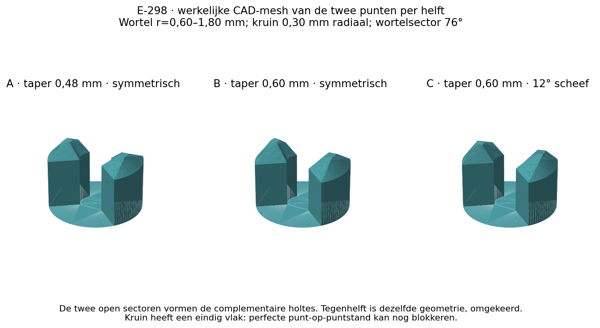
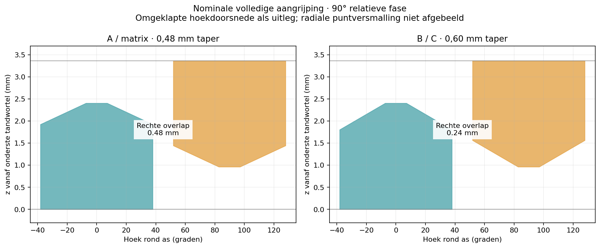
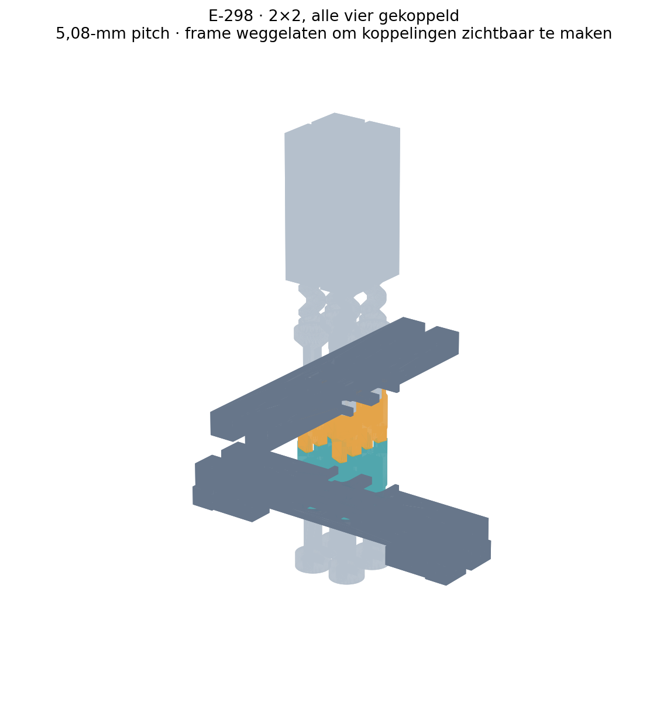

# E-298 — twee scherpe punten en twee holtes per koppelingshelft

**16 oktober 2026.** Nieuwe ontwikkeling op `main`-commit `f7721f3abbf2cc35fb59dd5440c5d0b1c42d1315`. E-297 en alle bestaande printtests zijn ongewijzigd. Dit pakket verandert alleen het koppelvlak van de twee afzonderlijk axiaal bewegende rotoren; de rij beweegt de onderste omhoog, de kolom de bovenste omlaag. Geen veren, extra selectoren of andere aandrijfarchitectuur.

## Ontwerpbeslissing en bewijsgrens

We werken het gevraagde principe uit als twee tegenoverliggende, in twee richtingen toelopende punten boven brede tandvoeten, met twee open complementaire holtes. Beide helften van iedere variant zijn dezelfde geometrie; één wordt voor montage omgekeerd. De schuine vlakken moeten axiale selectiekracht omzetten in relatieve rotatie. De schroef mag daarbij draaien en de pin mag van hoogte veranderen. Tijdens deze test wordt de input stilgehouden: handmatig fasezoeken telt niet als geslaagde zelfuitlijning.

Een minuscuul CAD-topvlak is geen gegarandeerd even scherpe PLA-punt. En ook een ideale scherpe punt heeft bij exact tegenovergestelde punten geen gegarandeerde draairichting. Een kleine asymmetrie kan de contactvolgorde en voorkeur wijzigen, maar verwijdert niet alle blokkerende fases van twee identieke periodieke helften. De fysieke proeven onderzoeken hoe breed en hinderlijk die zones daadwerkelijk zijn. Er wordt geen betrouwbare invang vanuit iedere willekeurige fase geclaimd.

[Contactberekening](contact-analysis.md) · [onafhankelijke review](review.md) · [printbaarheid en slicerbewijs](printability.md).

## Behouden uitgangspunt

De twee rotoren blijven schuiven op de E-297 double-D-assen, met dezelfde gevangen flenzen en gedeelde dubbele kammen. De schroeven zijn afzonderlijk axiaal gesteund; de pinnen draaien niet in hun vierkante geleiding. Raster 5,08 mm, pinbreedte 4,40 mm, rotorhuls en tandkop maximaal Ø3,60 mm, vangflens Ø4,30 mm. Beide selectoren hebben 2,40 mm slag. Het vaste frame, de geleiding, de assen en de E-295-schroef/pinbronnen blijven behouden.

De E-295-binnendraadrelief van 0,175 mm komt uit de eigenaarproef waarin alle vijf compacte paren zonder kracht startten en vijf handcycli doorliepen; de drie nominale exemplaren waren volgens de eigenaar “supersoepel”. Dat is positieve draadpassing, geen gemeten schroefkoppel of kwalificatie van de nieuwe punten.

## Zelfuitlijning en koppeloverdracht zijn verschillende functies

Tijdens sluiten moet de output de contacthelling kunnen volgen. Bij equivalente omtrekshelling α, contactradius r en ideale axiale contactkracht F is het beschikbare geometrische moment ongeveer `F r tan(α)`. Wrijving verlaagt dat moment. Voor een eenvoudig enkel glijvlak met Coulombcoëfficiënt μ is de gunstige richting slechts beschikbaar wanneer `tan(α)>μ`, met benadering `T/F = r (tan(α)−μ)/(1+μ tan(α))`. Meerdere contacten, laagtrappen, kanteling, de DD-socket en schroefwrijving kunnen ongunstiger zijn. De gebruikte μ-waarden zijn scenario's, geen gemeten PLA-eigenschappen.

Een steilere flank levert bij dezelfde axiale kracht meer ideaal moment, maar concentreert contact en vraagt printbare, sterke materiaaldoorsneden. Een langere geleidehelling verbruikt bovendien de hoogte die anders rechte dragende flanken oplevert. Daarom wordt geen universele optimale hellingshoek opgegeven: de kleine varianten vergelijken die concrete afweging binnen dezelfde E-297-inbouwruimte.

Na volledige zetting moeten de brede onderste flanken in beide richtingen kunnen dragen. Wanneer alleen de schuine toppen contact maken, kan aandrijfkoppel de helften uit elkaar drukken. Een bewegende pin of meedraaiende output bewijst daarom geen volledige aangrijping. Controleer selector-eindstand en koppeldiepte afzonderlijk. Ontkoppelen gebeurt pas na stoppen en ontlasten van torsie, door één van beide gevangen rotoren positief terug te trekken.

## Meerdere verschillende fases op een stijve selector

Iedere geselecteerde output mag onafhankelijk roteren, ook wanneer alle inputs stilstaan. Daardoor kunnen verschillende schroeffases in beginsel ieder langs hun eigen helling uitlijnen terwijl één rij/kolomslag wordt uitgevoerd. Er is geen geometrische noodzaak dat alle schroeven vooraf dezelfde fase hebben.

De gedeelde selector heeft echter geen onafhankelijke axiale uitwijking per cel. Eén paar op een dood topcontact of één te stroeve schroef kan dus de hele staaf stoppen. Axiale kracht verdeelt zich niet vanzelf gelijk over de koppelingen; de eerste/hoge contactplek kan bijna alle kracht dragen. Deze beperking wordt expliciet getest met twee cellen op één rij, twee op één kolom en alle vier tegelijk, inclusief één bewust ongunstige fase. Doorbuigen of één koppeling met de hand verdraaien mag niet als succesvolle gelijktijdige zelfuitlijning worden geregistreerd.

Een verwijderbare reactiehulp onder het frame houdt de vier inputs tijdens deze proef tegen bewuste fasezoekbeweging. Het is uitsluitend een proefhulpmiddel; het vervangt geen transmissie en voegt geen selectie toe. Na zetten wordt de hulp verwijderd en wordt de bestaande losse handgreep gebruikt om de echte inputkoppeling in beide richtingen te controleren.

De vastzetting heeft wel DD-hoekspeling. Eén nominale verbinding kan circa 26,14° totale omkeerspeling hebben; reactieplaat → input → onderrotor telt twee verbindingen, samen circa 52,28° volle breedte. De bovenrotor/schroefverbinding voegt haar eigen speling toe. Test B observeert daarom ook onderrotor en input: passieve spelingsopname is geen motorische fasezoekactie, maar bewijst evenmin zelfuitlijning bij een exact star gehouden onderhelft.

## Hoogteverandering

Met de bestaande spoed van 3 mm geldt `Δh = 3 Δθ/360°`: 10° is 0,083 mm, 30° 0,250 mm en 90° 0,750 mm. Dit is een kinematische omzetting, geen voorspelling dat iedere koppeling 90° draait. Leg de werkelijk gevolgde draairichting en hoek vast. Bij voorkeur fotografeer/markeer zowel de schroef als de pinhoogte voor en na selecteren. Reken eventuele asspeling, draadspeling en zelfstandig teruglopen niet automatisch aan zelfuitlijning toe.

De demonstrator start rond de middenhoogte en gebruikt bij aandrijven maximaal ±1,5 mm handmatige pinverplaatsing. Tel de tijdens koppelen ontstane hoogteverandering daarbij op en blijf van eindstops en bijna uitgeschroefde posities weg. Hoogteverandering tijdens koppelen is toegestaan, schade of onvoldoende draadinschakeling niet.

## Fysieke oplevering en stopconditie

- [Test A — kleine variantenplaat met identieke herhalingen](../../../owner-print-tests/2026-10-16-self-aligning-point-fit/test.md): scherpte, contactfase, noodzakelijke kracht/rotatie, volledige zetting, beide koppeldraairichtingen en lossen.
- [Test B — geïntegreerde 2×2](../../../owner-print-tests/2026-10-16-self-aligning-point-matrix/test.md): vooraf gemaakt printproject, fysiek uit te voeren nadat A de gekozen vorm kansrijk maakt. Verschillende outputfases, stilstaande inputs, gedeelde selectoren en pinhoogtes worden daadwerkelijk beproefd.

B blijft **DEFERRED** totdat de fysieke A-uitkomst bekend is. Dat betekent niet dat het 3MF een onvolledig CAD-bestand is: beide projecten worden met opgeslagen X1C-instellingen geleverd en gesliced. De status voorkomt een onbewezen geïntegreerde proef als reeds gekwalificeerde stap te presenteren. De twee bestaande READY-tests blijven op verzoek ongewijzigd; de nieuwe A gebruikt de derde READY-positie.

De eindbeslissing is beperkt tot deze ontwerpen en twee printprojecten. Er volgen geen nieuwe issues, automatische printopdrachten of onderzoekscampagne. Bij punt-op-puntblokkering blijft het oorspronkelijke principe intact en wordt de beperking gerapporteerd; een veer of andere koppeling wordt niet stilzwijgend toegevoegd.

## Eindige scherpte in de echte printpaden

De poging met een 0,16-mm CAD-kroon is verworpen nadat Bambu de hoogste puntlagen wegliet. De uiteindelijke kroon is 0,30 mm; de gekozen 0,4-mm nozzle blijft behouden, zodat geen andere hardware nodig is. De fijne 0,08-mm lagen en Arachne met 75% minimale lijnbreedte zijn daadwerkelijk gesliced. Zelfs dan blijft de geplande punt van A circa 0,16 mm lager dan CAD en die van B/C circa 0,24 mm lager. De laatste geëxtrudeerde doorsneden zijn aanzienlijk breder dan de CAD-kroon. Exacte waarden en verschillen bij heropenen staan in [printbaarheid](printability.md).

Dit heeft mechanische betekenis: de werkelijke startcontactfase kan breder zijn dan het circa 28,65° brede ideale CAD-topplateau. De CAD-contactgrafiek mag niet als voorspelde printprestatie worden gelezen. De rechte wortelflanken blijven geometrisch dezelfde; het afkappen verkort vooral het bovenste geleidegebied. Test A vergelijkt dus het werkelijk met deze X1C-instellingen vervaardigbare compromis. Een kleiner compatibel 0,2-mm mondstuk is een mogelijke fabricageoptie, maar er is geen aanschaf of ongeteste 0,2-mm-printtest aan deze oplevering toegevoegd.

## Controleerbaarheid

De onafhankelijke controle verifieert de overgenomen E-297-bestanden byte voor byte. De nieuwe rotoren en reactiehulp hebben echte STEP/STL-bronnen; de functionele schroefdraad is niet door een gladde STEP-omhulling vervangen. De verschillende geometrietoetsen, exact opgeslagen printerinstellingen, heropen/reslice en archiefcontroles zijn aan bronhashes gekoppeld. De pakketcontrole legt ook vast dat uitsluitend nieuwe E-298-bestanden en nieuwe gedateerde printtestfolders zijn toegevoegd.

`./repo check` geeft dezelfde zeven bestaande meldingen als de uitgangsversie: vijf te grote oude experimenten en twee te grote instructiebestanden. Deze worden niet in deze gerichte ontwerpwijziging aangepast. Er zijn geen nieuwe structuurmeldingen door E-298.

De [gemengde-fasecontrole](cad/mixed-phase-path.json) houdt de vier inputassen geometrisch vast en schrijft afzonderlijke outputfases 30°/60°/120°/150° naar 90° voor. De echte draad/pinnen volgen met −0,50/−0,25/+0,25/+0,50 mm hoogteverandering. Achttien posities, 1.622 kandidaatparen en 759 unieke meshdoorsneden geven geen onverwachte botsing. Dit toont uitsluitend een beschikbare voorgeschreven bewegingsroute; de berekening lost niet op of axiale druk die route vanzelf volgt. De 1.504 botsingscontroles van de zestien eindmaskers zijn een afzonderlijke toets.
