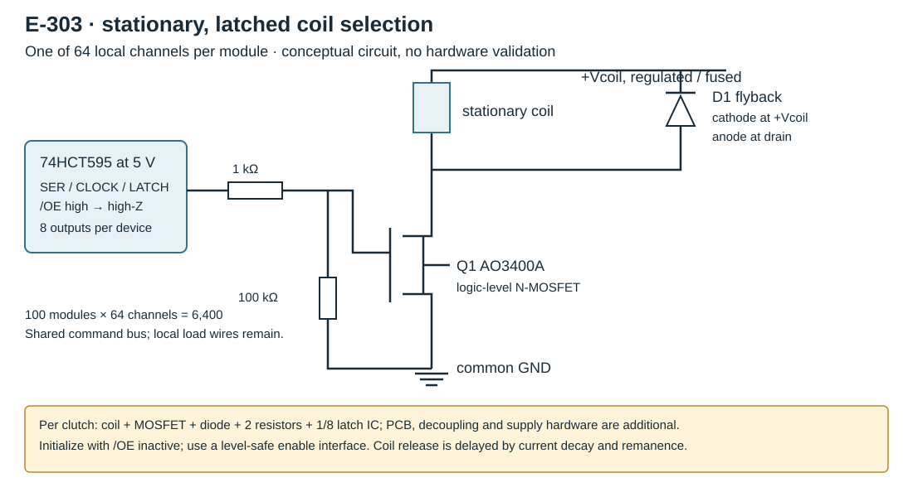

# Electrical selection: local switches, shared digital commands

[Report](engineering-report.md) · [Models and matrix tests](calculations.md) · [Components and costs](components-and-costs.md)

**Engineering proposal, 23 October 2026; no circuit built.** Prefer 64-channel stationary modules with latched outputs and short local coil wires. This removes thousands of long controller wires, not the individual electrical connection and switch at each clutch. Coil power remains the larger scaling problem. No full transmission or control firmware is developed here.

## What each addressing method actually permits

| Arrangement | Electromagnetic A/D | Electrostatic B | Repeated hardware / limitation |
|---|---|---|---|
| Common supply, individually switched returns | Arbitrary simultaneous states; continuously supply holding current | Common electrode plus separately charged/discharged electrodes gives arbitrary states | One controlled channel per clutch; connections remain, but can be short PCB traces |
| Bare passive rows/columns | Voltages/currents are coupled by network; floating lines create sneak paths | Capacitors retain charge only with suitable isolation; half-selection produces force | Fewer buses, no general independent stored states |
| Series diode at each crossing | Blocks reverse sneak current; still cannot independently hold two same-polarity diagonal cells with both rows/columns asserted | A diode can charge a capacitor, but controlled erase, polarity reversal and leakage still need a defined circuit | One diode per cell does not supply a memory or arbitrary-selection function |
| Time multiplex / PWM | Suitable for reducing measured holding current, but an 80-row scan cannot assume continuous holding at 1/80 duty | Refresh possible only if isolated cell charge lasts; capacitive redistribution and unintended charging matter | Peak current, inductance, saturation, discharge and duty must be calculated |
| Active matrix, local storage/switches | Local transistor and latched bit hold arbitrary states | HV-rated switch and storage capacitance retain selection; explicit discharge required | Electronics per cell; PCB/connector/repair complexity |
| Modular latched zones, recommended comparison | Simple stationary coils, local MOSFETs, common low-voltage supply | Latched HV push-pull driver can charge/discharge each powered rotor channel | 100 modules ×64 outputs for 6,400; shared command bus, power segmented by current |

### The diagonal test has an important exception

For an ideal passive matrix, `d_ij = row_i - column_j`, so `d11+d22=d12+d21`. Requiring **+V on both diagonal cells and zero on both others** violates that identity. Diodes do not make these four voltage constraints compatible. Turning on two source rows and two sink columns activates four crossings, not two.

However, a magnetic attraction coil without a permanent magnet is approximately insensitive to current sign, and electrostatic pressure depends on voltage squared. Set rows `[0,V]`, columns `[V,0]`: the actual cell voltages are `[[-V,0],[0,+V]]`. **A bipolar passive 2×2 can produce that diagonal force pattern.** A unidirectional series diode blocks one selected diagonal, so the exception does not rescue the diode scheme. The code explicitly tests both cases.

This is still not arbitrary selection. Three cells at exactly `|V|` and the fourth at zero are impossible in a passive 2×2 with equal selected force: the zero cell identifies two bus potentials, making the remaining diagonal difference either zero or `2V`, rather than `V`. More voltage levels or accepting half-selected force is a different, nonuniform operating requirement. Binary-bus enumeration and a three-corner counterexample are included in the model tests. An analog three-corner example is rows `[0,V]`, columns `[-V,0]`, which produces `[[V,0],[2V,V]]`: one selected crossing has four times the ideal force. More generally, even arbitrary analog bus voltages cannot produce a 3×3 identity mask with a common absolute-voltage threshold and all other cells below that threshold. Sort the three column voltages: a row cannot be far from only the middle column while remaining close to both extremes. The calculations give this argument and a bounded numerical check. These are circuit-state arguments, not experiments.

## A: representative low-voltage channel



```text
Vcoil (regulated, fused per zone) ----- coil -----+---- drain Q1
        |                                       |
        +---- cathode D1 | anode ----------------+

HCT595 Qn ---- 1 kΩ ---- gate Q1     source Q1 ---- GND
                           |
                         100 kΩ
                           |
                          GND
```

Q1 is a logic-level MOSFET such as AO3400A; D1 is a flyback diode rated for the **measured** peak current and supply voltage (SS14 is a candidate, not a verified coil design). The diode's cathode connects to positive supply. The gate resistor limits initial HCT output current to about 5 mA. The gate pulldown turns Q1 off when output-enable makes the shift-register outputs high impedance. Eight channels share one 74HCT595, and eight such registers form a 64-channel module. Count one MOSFET, diode, two resistors and 1/8 register **per clutch**, plus decoupling, PCB, supply protection, connectors and zone controller/interface allocation. [AO3400A manufacturer data](https://www.aosmd.com/products/mosfets/low-voltage-mosfets-12v-30v/ao3400a) specifies resistance at 2.5/4.5-V gate drive; threshold voltage alone is not a conduction rating.

The [TI SN74HCT595](https://www.ti.com/product/SN74HCT595) uses 4.5–5.5-V supply and TTL input thresholds, allowing a properly referenced 3.3-V command output to drive its logic inputs. Its outputs are logic signals, not coil drivers. Latch only after shifting the complete desired word. Hold output-enable inactive at startup, latch zeros, then enable. Use a level-safe enable interface: a 5-V pullup must not be connected directly to a non-5-V-tolerant MCU pin. An open-drain/interface transistor and resistor allocation belongs to each zone. A shared hardware supply cutoff is separate from the stored command and can stop coil power if software stalls. Output off does not instantly eliminate coil current or magnetic remanence.

For a voltage step into an unsaturated coil, `I(t)=V/R·(1-exp(-tR/L))`, `tau=L/R`, `E_L=LI²/2`. Core/gap-dependent inductance is unknown until measured. The freewheel diode gives slow current decay, which can delay clutch release; its current initially equals coil current. A properly rated clamp can shorten decay but raises switch voltage and dissipates energy. Do not remove the diode and assume avalanche is unlimited. Review coil voltage/current, diode heating, wiring resistance, PWM frequency and measured release before selecting final components.

The [TPIC6B595](https://www.ti.com/lit/ds/symlink/tpic6b595.pdf) is a lower-part-count alternative for genuinely low-current coils: eight latched power outputs with 150-mA/channel rating and inductive clamps. Its typical 5-Ω output resistance would dissipate 0.05 W per channel at 100 mA, or 320 W for 6,400 channels, before coil power. Package thermal limits and simultaneous output conditions still apply. This is why an inexpensive logic register plus low-resistance MOSFETs is the preferred comparison, despite more components.

At an illustrative 0.25 W and 100 mA per coil, the coil needs about 2.5 V and 25 Ω. All 6,400 would draw 640 A at that rail and dissipate 1.6 kW. Distributed conversion can reduce upstream bus current, not energy use. This is **not a proposed coil specification**; use the calculated winding examples and real temperature measurements. Restricting simultaneous activity trades update time for power. The original illustrative 10 mW/channel remains 64 W total, not a demonstrated design.

An 80-row scan with sufficiently fast current decay supplies only 1/80 average duty. Maintaining the same average `I²` would require about `sqrt(80)=8.94` times peak current in an ideal unsaturated model. It does not reduce average copper heating, and real peak force, saturation and intermittent torque invalidate that simplistic equivalence. Slow decay can preserve force, but also defeats rapid deselection unless local paths and states are controlled. A bistable C clutch can use scanning **pulses** instead, after a real magnetic threshold/half-select margin has been demonstrated.

## B: capacitive selection and the rotating connections

For B1, both electrodes need a conductive path. If one rotates with the common input and the other independently with the screw, there is an input-side and an output-side rotating contact unless one is provided through a deliberately conductive shaft/bearing path. Ordinary printed bearings and incidental metal contact are not reliable electrical connections.

For B2, one input half can be a common return and the other individually switched. **Both halves rotate with the input.** A stationary driver therefore still needs two brush/ring functions at each independent input rotor, or an explicitly designed conductive shared rotor network plus one individually insulated contact. A single shared shaft could carry common return; printed gears or an electrically continuous gearbox cannot silently distribute 6,400 separate control potentials. Putting the driver on a rotating common structure moves the rotary boundary to its supply/data links but adds electronics and packaging there. The floating screw-side disc removes only its own wire/contact.

For a floating conductor, `Vf=(C1V1+C2V2+CgVg+Q0)/(C1+C2+Cg)`. Equal halves, negligible stray capacitance and zero trapped/net charge give `Vf=(V1+V2)/2`; each dielectric sees half the terminal voltage. Real asymmetry, stray coupling to the supported shaft, contamination and trapped charge change the balance. All phases of rotation must preserve overlap; the annular split design keeps the total overlap constant only if the passive disc is continuous and concentric. Film seams, runout and the separating slot disturb it.

One possible **≤300-V** stationary driver is the [Microchip HV507](https://ww1.microchip.com/downloads/en/DeviceDoc/20005845A.pdf): 64 latched push-pull outputs. Each output can charge and actively discharge a switched electrode against the common reference. It is not a 420-V part. Its 5-V CMOS input requires level shifting from a 3.3-V host; output/source impedances, contact resistance and capacitive load determine switching time. At unchanged geometry, 300 rather than 420 V gives only `(300/420)²≈0.51` ideal force. For equal split halves, doubling terminal voltage to restore B1 field would exceed this driver range again.

Driver overhead is not zero: the HV507 datasheet gives maximum high-voltage supply current 0.5 mA at 300 V for the specified all-high/all-low conditions. For 100 devices that is a 15-W upper-budget example under those conditions, before supply loss or clutch leakage. It is not a measured always-present consumption. Dynamic power includes `C_total V² f` for each complete resistive charge/discharge cycle, where cable/ring/PCB parasitics may exceed the tiny clutch capacitance. Stored clutch energy `CV²/2` is only half that cycle energy. Constant DC hold ideally needs no displacement current, but has leakage and driver/supply overhead.

If a cell is isolated, `V(t)=V0 exp(-t/(R_leak C))`, so force proportional to `V²` decays twice as fast in the exponent. To retain at least 90% ideal force over 0.1 s requires `R_leak C≥1.90 s`; for 20 pF this is about 95 GΩ. This deliberately illustrative value excludes larger deliberate storage capacitance, which increases switching energy and charged hardware. A row/column diode and the clutch's own tiny capacitance are therefore not a demonstrated active matrix. Half-select at V/2 gives one-quarter force, not OFF.

Release requires an intentional output discharge path even when commands or supply disappear, plus measured residual adhesion after electrical discharge. A bleed resistor trades hold power against release time: at 300 V, 100 MΩ dissipates 0.9 mW and, for 20 pF alone, gives a 2-ms RC. Add parasitic/supply capacitance and dielectric charge trapping before interpreting that number. Size series resistance, resistor voltage ratings, insulation and discharge verification as a complete enclosed setup; this report does **not** supply an owner-ready energized HV build.

## Decision

Use local latches and switches for the first credible cost comparison. Passive addressing is a useful counterexample exercise, not a free replacement for 6,400 selection elements. Keep the first physical test mechanical and low energy. A later energized A test can use one current-limited channel; an energized B test needs engineered insulation, current limiting, stored-energy accounting, discharge and guarded contacts before owner use. Neither is validated by the passive printed rig.
