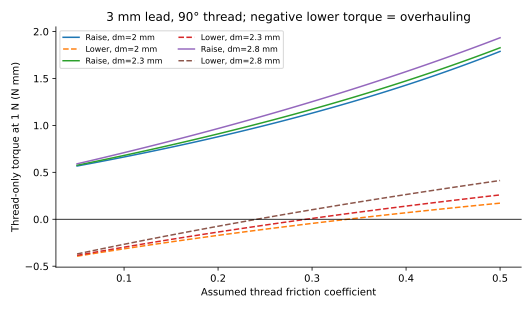
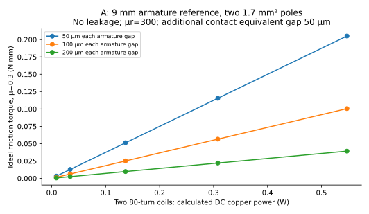
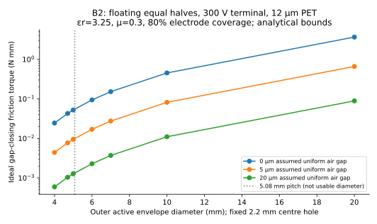
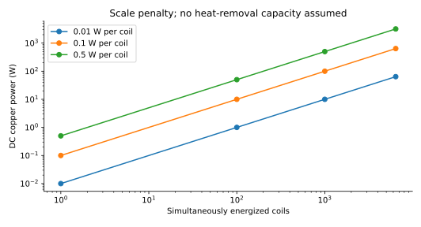

# Quantitative screening and limits

[Experiment](engineering-report.md) · [Generated tables](analysis/results/tables.md) · [Inputs](analysis/inputs.json) · [Model](analysis/model.py) · [Tests](analysis/test_models.py)

**Result:** neither a useful 5.08-mm-pitch clutch nor a 10-mW electromagnetic actuator is established. The estimates put the first decision at the friction interface: measure required screw torque, OFF drag and torque versus applied normal force. For the concrete larger magnetic reference, even an idealized **0.10 N mm** requires approximately **0.55 W** in its two coils. The 4.7-mm floating electrostatic PET example gives **0.043 N mm** at a perfectly conformal interface and only **0.0077 N mm** with a uniform 5-µm gap, at 300 V terminal. These are analytical scenarios, not measurements or predictions with known error bars.

All computations use SI internally. Displayed torque uses **N mm = mN m**; both equal 0.001 N m. This distinction matters: the published 83.4 mN m reference is 83.4 N mm, not 0.0834 N mm. Load, friction coefficients, air gaps and material properties below are assumed screening inputs. Existing E-295/E-301 evidence establishes qualitative fit/motion, with no torque calibration.

## Reproduction and verification

From the repository root:

```sh
python tools/curated-experiment-checks/E-303/analysis/generate.py
python -m unittest discover -s tools/curated-experiment-checks/E-303/analysis -p 'test_*.py' -v
```

Python 3 plus NumPy and Matplotlib generates CSV, Markdown and vector SVG. `inputs.json` records baseline values and provenance; `generate.py` explicitly defines the scenario sweeps and the separate A/B reference geometries, so the JSON is not a complete parameter-control interface. Tests use only Python's standard library. **38 tests passed** during this investigation. They check independent energy identities, numerical virtual-work derivatives and annular integration, unit conversions, magnetic series gaps and saturation screening, geometric scaling, shaft interference, and positive/negative matrix-selection examples. They do not validate unknown friction or magnetic material properties. No finite-element simulation or physical measurement was performed.

## Screw load comes first

Repository geometry: 3-mm lead, nominal 3.2-mm screw OD, 0.9-mm radial thread depth, 90° included profile, 4.4-mm guided square pin and 6-mm internal engagement. The nominal thread mean diameter **2.3 mm = 3.2 − 0.9 mm** is a geometric approximation, not a measured load-bearing pitch diameter. The model sweeps 2.0–2.8 mm. Thread contact, clearance, printed flank shape and distortion can move the effective value.

For lead `l`, axial load `F` and overall efficiency `η`:

`T = F l / (2π η)`.

The [efficiency table](analysis/results/screw-efficiency.csv) spans η = 0.10/0.25/0.50/0.75. For 0.2 N axial load this gives **0.955/0.382/0.191/0.127 N mm**, before separately adding guide or support friction if η represents threads alone. Do not add those losses twice if efficiency has already been measured for the complete assembly.

For a V-thread approximation, set `q = l/(π dm)` and `μ′ = μ/cos45°`:

`T_raise = F dm/2 × (q + μ′)/(1 − μ′q)`

`T_lower = F dm/2 × (μ′ − q)/(1 + μ′q)`.

`T_lower` is the required torque **in the lowering direction**. A negative value means gravity can backdrive the ideal thread and braking is needed. At dm=2.3 mm the lead angle is about 22.6°, and the thread-only self-lock threshold is μ≈0.294. The uncertain plastic friction range straddles this threshold. Clutch OFF therefore does not prove retained terrain height; a separate hold function may increase parts and drag.

The [scenario table](analysis/results/screw-scenarios.csv) distinguishes running μ=0.10–0.30 and starting μ=0.15–0.45. These ranges are **sensitivity choices, not material test data**. It adds guide resistance of 0.01–1 N depending on the scenario, a small explicit parasitic torque for fit/misalignment, and an illustrative plain thrust contact μ=0.10 at 1.2-mm radius. Guide resistance acts against travel, so its sign relative to gravity reverses on lowering. A loaded/cocked guide can produce much more friction than these finite scenarios; binding is not bounded by the model.

The assumed 0.05-N light load requires approximately **0.053 N mm running / 0.060 N mm starting**. A 0.2-N load with more guide friction requires **0.277 / 0.343 N mm**. These are useful measurement ranges, not specifications. The 5-N and 20-N cases represent external obstruction loads, not finger injury thresholds. They require far more torque and are intended to slip rather than move.

For an applied slip torque `T`, the ideal axial-force ceiling at η≤1 is `F ≤ 2πT/l`; with known efficiency the idealized transmitted force is `2πTη/l`, before guide/parasitic deductions. This bounds quasistatic powered raising, not an externally imposed static load or an impact. At **0.10 N mm**, η=0.10–0.75 gives **0.021–0.157 N**, with the lossless ceiling 0.209 N. At **0.50 N mm**, the corresponding range is 0.105–0.785 N, ceiling 1.047 N. Real static contact, kinetic torque and transient impact differ. Slipping does not establish a safe human-contact force.



## Friction force, OFF drag and heat

For one annular interface, `T = μ N r_eff`. With uniform pressure:

`r_eff = (2/3) (Ro³ − Ri³)/(Ro² − Ri²)`.

Under a uniform-wear assumption, `r_eff = (Ro + Ri)/2`. These are competing contact-distribution assumptions, not known wear states. For a full disc the pressure radius is `2Ro/3`. Use static μ for onset/breakaway and dynamic μ for sustained slipping; a higher breakaway peak may defeat an otherwise acceptable running slip limit.

At OD4.7/ID2.2 mm, `r_eff=1.800 mm`. With μk=0.3, **0.185 N** normal force is needed for 0.10 N mm, and **0.926 N** for 0.50 N mm. Both material pairing and contact pressure must be measured. PLA against steel, PET against metal, compliant friction film and bonded coatings cannot share one qualified μ. A compliant film may improve area while adding thickness, hysteresis and OFF drag.

At that radius, OFF preloads **0.001/0.005/0.020/0.050 N** give **0.00054/0.00270/0.01080/0.02700 N mm** when μk=0.3. These values exclude runout, journal drag, electrostatic residual charge, magnetic remanence, rubbing wires and wear debris. Always-contacting interfaces cannot guarantee zero torque. Wear can polish a surface and lower μ, or create debris, waviness and adhesive transfer that raise drag; its sign is not predictable from a Coulomb model.

Pin axial load must bypass the clutch. Output thrust/journal drag belongs in the screw's required torque. A stationary thrust face supporting the **input** under magnetic clamp load adds shared-drive power and heat; at imposed input speed it is **not automatically subtracted from the output interface's friction capacity**. If a stationary member directly rubs the output armature, that is an unwanted output brake and does subtract useful output torque. Trace the actual contact instead of merging these cases.

`P_slip = T |ω_input − ω_output|`. At 0.10 N mm and 600 rpm relative speed, the interface dissipates **6.28 mW**, or **40.2 W** if all 6,400 interfaces slip at that torque. At 0.50 N mm these become 31.4 mW and 201 W. This is additional mechanical heat, independent of coil copper losses. Engaged rotation with no relative sliding transfers power but ideally produces no interface slip heat. Continuous OFF drag also heats the array while the shared input turns. [Full slip table](analysis/results/slip-heat.csv).

## Magnetic force requires a complete circuit

The model uses one series flux:

`ℜ = Σ(g/(μ0 A_gap)) + Σ(length/(μ0 μr A_steel))`, `Φ = NI/ℜ`.

For each air gap acting on the armature, `B = Φ/A` and `F_gap = B² A/(2μ0)`. Sum closing forces only for the intended moving armature gaps. A fixed screw-head/yoke contact adds reluctance; it is not an additional output force surface. Two equal gaps in series halve B relative to one gap at the same NI, so their **total** force is half the one-gap result, not double.

The **concrete A reference** uses two standard M2 steel poles, effective root area 1.7 mm² each, two nominal 0.10-mm armature gaps, a 25-mm steel path at assumed μr=300, and an extra 0.05-mm equivalent gap for imperfect fixed joints. Two 80-turn coils in series use 0.10-mm copper wire, ID2.4/OD3.8 mm and winding height4 mm. Their calculated total wire length is 1.56 m and 20°C resistance 3.42 Ω. The steel washer is OD9/ID3.2/t0.8 mm; the friction annulus is radius4.0–4.5 mm. The housing is larger again; **this is not a 5-mm assembled clutch**.

At **0.30 A** the ideal model gives **0.181 T**, 0.0443 N attraction, **0.0566 N mm** friction torque and **0.308 W** copper dissipation. At **0.40 A** it gives **0.1005 N mm / 0.547 W**. At 10 mW, interpolation of this unsaturated model gives only about **0.00184 N mm**. Flux leakage, pole overlap, plating, joint reluctance, actual steel B–H behavior, armature deflection and preload can worsen these estimates. Reducing both controlled gaps helps quadratically only while the other reluctances and limits remain small. Bare stationary poles must never become rubbing brakes.

The coil contains approximately **0.110 g copper**. Copper-only initial adiabatic heating `dT/dt=P/(m×385 J/kgK)` is **7.3 K/s at 0.30 A** and **13.0 K/s at 0.40 A**. This is a short-time heating estimate without heat loss, not a steady-state temperature prediction; the surrounding steel and support add thermal mass but may also impede heat escape. No thermal resistance or continuous duty rating is established. Copper resistance rises approximately 0.39%/K: +60 K raises constant-current losses about23%, or reduces constant-voltage force approximately34% in the unsaturated model. Neither high current nor low duty is released for an owner energized test by this calculation.

The complete circuit estimate gives **L≈0.164 mH**, `L/R≈48 µs`, neglecting leakage and nonlinear inductance. This suggests little inherent current storage between slow matrix scans. A freewheel diode reduces voltage stress but prolongs current decay relative to an actively clamped release; its forward voltage can shorten decay relative to the ideal shorted-coil `L/R` exponential. Exact release requires measuring the current and magnetic force waveform.

The code flags linear results above a chosen **1.2-T core screening limit** using the smallest flux cross-section, including a washer bridge. It does not implement saturation via an unrealistically constant μr, nor claim that clipping flux proves obtainable force. The 9-mm reference washer has roughly4.64 mm² of combined bridge area, larger than the pole root, but a small thin washer in a compact design may be the bottleneck. Actual ordinary steel permeability, remanence, plating and magnetic continuity remain unknown; nonmagnetic stainless hardware is unsuitable.

The [winding envelope sweep](analysis/results/winding-envelope.csv) shows physically finite wire volume for other diameters. A coil fitting its own 4.6-mm envelope does not leave space automatically for a return pole, insulation, support and rotating input. Its electrical result must not be paired with the larger reference's magnetic circuit as though they were one design.

A PCB spiral is not a shortcut to large NI. Matching the A report's 2.4-mm core opening, an illustrative 4.6-mm OD, 0.1-mm track/space, 35-µm copper spiral fits about five turns, approximately0.055 m of track and0.27 Ω. **30 A turns would need6 A and about9.7 W in one layer**; two identical series layers would still need3 A and about4.9 W, before vias/leads and thermal limits. These are deliberately unfavorable demands, not acceptable operating ratings or a released PCB. A nine-turn example at similar OD would remove the required core opening and is not an equivalent actuator. PCB distribution is useful; wound wire better uses vertical volume.



## Electrostatic force: specify the virtual displacement

Let `t` be total solid dielectric thickness in a local field path, relative permittivity `εr`, uniform microscopic air gap `g`, and active overlap area `A`. Define `s = g + t/εr`. A single connected capacitor has:

`C = ε0 A/s`, `U = ½ C V²`, `E_dielectric = V/(t + εr g)`.

Closing a microscopic **air gap** at fixed voltage gives `p_gap = ½ ε0 (V/s)²` by differentiating capacitance. Compressing a uniform **dielectric thickness** gives the alternate material stress `p_bulk = ½ ε0 εr E_dielectric²`. At the same series field these differ by εr. They describe different displacements; choosing the larger expression is not evidence of usable normal traction. Real nonuniform rough surfaces, asperities, unsupported film, seams, debris and dielectric compliance need contact mechanics or direct force/torque measurements.

For a passive floating conductor above two powered regions, charge neutrality gives:

`V_float = (C1 V1 + C2 V2 + C_stray V_stray + Q)/(C1+C2+C_stray)`.

With equal halves, negligible stray capacitance and Q=0, the floating electrode sits midway between the terminals. Each local field sees **Vterminal/2**, so at the same terminal voltage the torque is **one quarter** of B1's otherwise identical connected-electrode geometry. Each half capacitor is Cfull/2; the two in series give **Cterminal=Cfull/4**. Unequal contact area, parasitics or deposited charge invalidate exact midpoint voltage. A floating output avoids one electrical contact but does not remove the two rotating powered-input connections.

The size table uses 12-µm PET, assumed εr=3.25, μ=0.3, 80% annular electrode coverage and a fixed 2.2-mm centre hole. The **4.7-mm B2** estimate at300 V falls from **0.0428 N mm at g=0** to **0.00772 N mm at5 µm** and **0.00104 N mm at20 µm**. B1 gives four times those values at the same terminal voltage. Increasing voltage from300 to500 V multiplies the ideal force by2.78 but also increases dielectric stress, edge-field and insulation demands; it is not an instruction to energize such a coupon. At zero gap, B2 local PET field is12.5 MV/m; this does not certify pinhole-free insulation or safe edge clearance.

The separately drawn **B concept** uses an active radius1.8–4.5-mm annulus on a10-mm carrier, before allowance for its insulating seam. B2 estimates are **0.392 / 0.0707 / 0.00951 N mm** at0/5/20-µm air gap. For two12-µm insulating layers in each local path, use t=24 µm; do not model two layers as t=12 µm. The [film/voltage sweep](analysis/results/electrostatic-film-voltage.csv) exposes thickness and gap sensitivity. Adhesive under the powered electrode is outside the ideal capacitor; adhesive in the electric field path adds its own `t/εr` term.

For a full resistive0→V→0 cycle, energy drawn/lost is **CV²**, twice the peak stored energy. At4.7 mm B2/g=0, terminal C≈6.50 pF, stored energy0.292 µJ and cycle energy0.585 µJ. Cycling6,400 cells at10 Hz ideally consumes only0.037 W, but this excludes converter quiescent power, switching losses, leakage and discharge hardware. A permanently connected100-MΩ discharge resistor at300 V consumes0.9 mW per cell, **5.76 W** across6,400; a10-GΩ leakage path gives0.0576 W. These are resistance scenarios, not verified circuit leakage.

An ideal discharge gives `V(t)=V0 exp(−t/RC)` and force fraction `exp(−2t/RC)`. Surface/trapped charge, polarization and dielectric adhesion do not necessarily follow this law. Shorting the powered electrodes alone does not guarantee instantaneous release of the floating output. OFF drag and release time must be measured.

[Lee et al.](https://doi.org/10.1002/aisy.202500625) report **83.4 mN m at420 V**,1.1 mN m OFF torque and2.94 mW for a20-mm rotary device. This uses patterned compliant electrodes and specialized9-µm high-permittivity terpolymer coatings; it is not a PET-on-FDM demonstration. The [research analysis](research-electrostatic.md) explains experimental details and source limits. Pure geometric D³ scaling to5 mm gives **1.30 N mm ON /0.0172 N mm OFF** only if active radial geometry, traction, μ, electric fields, layer count and conformity remain equivalent. The scaling is a **counterfactual diagnostic**, not a forecast: thickness does not scale with diameter, a fixed shaft hole removes more area, ordinary PET changes dielectric response, and contact/sweeper drag does not necessarily scale cubically. The code tests both valid similar-geometry scaling and its failure with a fixed hub.



## Pitch and staggering

At5.08-mm pitch, a4.7-mm circular envelope leaves **0.38 mm** edge clearance;5 mm leaves only0.08 mm before print/runout/assembly allowance. Using a provisional0.30-mm total envelope gap permits at most4.78 mm. This must contain the entire clutch, not only its contact disc.

Two-height checkerboard staggering has nearest same-height neighbors on the diagonal: `√2 p = 7.184 mm`, not2p. With0.30-mm gap the envelope limit is6.884 mm; a7-mm part misses that allowance. Four-height2×2 coloring has nearest same-height distance2p=10.16 mm, giving9.86-mm envelope with the same allowance. A10-mm part has only0.16-mm same-tier clearance. Adjacent tiers must also be vertically separated by complete housing thickness plus axial travel and tolerance; counting just washer thickness is invalid.

Staggering does not remove crossing shafts. If an adjacent3.2-mm shaft passes through a clutch's height, its clearance is `p − D/2 − 1.6 mm`. That is **−0.02 mm atD7** and **−1.52 mm atD10**. A0.15-mm shaft-to-envelope allowance limits D to6.66 mm in that layout. Narrower shafts, different routes or cutouts change the bound, but are new mechanical commitments. The selected larger A housing and B carriers are principle references, not pitch-compatible cells.

## Selection states and duty cycle

For direct two-terminal row/column devices, `Vij=Ri−Cj`, so every2×2 rectangle obeys `V11+V22=V12+V21`. Equal positive-voltage diagonal selection with cross cells at zero violates that identity. Series diodes prevent reverse current but do not give arbitrary simultaneous selection: two asserted rows and two asserted columns activate the whole rectangle. The [state enumeration](analysis/results/matrix-two-rail-states.csv) includes all16 two-rail assignments.

**Polarity-insensitive devices are different.** Rows[0,V], columns[V,0] produce `[[-V,0],[0,+V]]`: both diagonals can activate an unpolarized coil or electrostatic clutch. Tests preserve this valid counterexample. Binary0/V rails yield only8 unsigned2×2 patterns, not all16. Exact equal-magnitude ON voltage/zero OFF voltage still cannot realize a three-corner mask. Analog rails can realize three threshold-selected corners with different magnitudes, e.g. rows[0,V], columns[−V,0] give `[[V,0],[2V,V]]`; the2V cell has four times ideal force/power. This is not uniform arbitrary selection.

Even allowing arbitrary analog rails and a common absolute-voltage threshold does not support every larger mask: in a3×3 identity pattern, sort the column voltages. No row voltage can be farther than threshold from only the middle column while staying within threshold of both outer columns. Thus one required diagonal-only row is impossible. The finite numerical check complements this analytic argument; it is not itself a proof over continuous voltages.

Half-select atV/2 gives **one-quarter ideal force**, not OFF. Coil inductance, leakage and capacitive charge storage do not erase these states. PWM duty and peak current must be distinguished: unsaturated magnetic force follows `I²`, so average force follows mean-square current, and heating follows `R Irms²`. At1/80 duty, matching a DC average force with isolated rectangular pulses would require **√80 times peak current**; saturation, driver voltage and actual holding dynamics can invalidate that model. Applying the same peak current at1/80 duty gives only1/80 average force if current fully decays. Rapid low-ripple PWM behaves differently and needs local switching/freewheel current paths.

Electrostatic stored charge can hold force between scans only if each cell is electrically isolated, leakage sufficiently low, and a controlled discharge path exists. That is an active-matrix/storage design; shared row/column wires alone do not guarantee it. Modular active drivers trade repeated electronics for unambiguous selection. The electrical report supplies the representative practical circuit and component accounting.



## Decision boundary

The scenarios identify a potentially narrow operating window; they do not establish that it exists. Measure the existing screw's starting/running torque and the candidate contact's OFF/ON/slip behavior before optimizing coils or high voltage. Reject a contact if its OFF drag rotates the nominally unselected screw, if force needed for useful torque exceeds a realistic actuator, or if slip drift/wear prevents a repeatable window. A mechanical force-emulation test cannot validate the magnetic actuator, and a passive film coupon cannot validate energized electroadhesion. Keep DES-009 active unless a physically measured, fully supported small clutch demonstrates a better complete mechanism.
