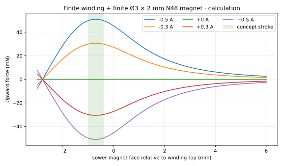

# Reversible actuator, electronics and complete-array accounting

## What reversing the field actually does

For a fixed permanent dipole `U=−m·B`, `F=grad(m·B)`, `tau=m×B`. In the selected coaxial geometry, magnetic moment points +z. Above the center of a finite coil, positive current produces +Bz that decreases upward, so Fz is negative (attraction). Negative current gives upward force. The guide prevents the magnet turning over; the ideal axial field cannot produce shaft-axis torque. A reversed magnet installed by mistake reverses the commands. A tilted magnet experiences a restoring or destabilizing tilt torque depending on polarity, so a free repelling magnet is not a stable unsupported linear actuator.

The coil spans z=−3.6…0 mm, and the 2-mm magnet's lower face coordinate is g. At **g=−2.8 mm** the centers coincide and axial force is zero; attraction toward the center is stable, reversed-current equilibrium is unstable. The proposed g=−1.0…−0.4-mm stroke stays on one side of that point. Reversing current does not create useful axial force at the symmetry center. Nor does reversing a soft-iron plunger necessarily repel it: its induced magnetization usually reverses too.

[Qualitative flux path](images/flux.svg) shows the air return and constrained magnet orientation.

## Finite geometry model and force curves

[Model](analysis/model.py) integrates exact circular-loop Biot–Savart fields over the two faces of a uniformly axially magnetized cylinder: `Fz=M∫A[Bz(g+t,r)−Bz(g,r)]dA`. The winding is 140 discrete turns, 20 axial turns ×7 radial layers, 0.18-mm center pitch, first wire center radius 2.49 mm. Copper diameter 0.15 mm; bobbin OD 4.8, winding OD 7.32, active length 3.6 mm. Assumed Br=1.395 T, midpoint of the cited N48 range. This includes finite magnet/coil dimensions, off-axis field within the magnet and all free-space leakage. It is not an infinite-solenoid field multiplied by permeability, and it is not calibrated to catalogue pull.

| Lower magnet face g | Upward F at −0.3 A | Upward F at −0.5 A |
|---:|---:|---:|
| −1.0 mm | 29.96 mN | 49.93 mN |
| −0.4 mm | 29.91 mN | 49.85 mN |
| +0.3 mm | 24.46 mN | 40.77 mN |
| +0.9 mm | 18.58 mN | 30.96 mN |
| +2.0 mm | 10.38 mN | 17.30 mN |
| +5.0 mm | 2.36 mN | 3.93 mN |

Opposite current changes the sign exactly in this fixed-magnet air model. At zero current the calculated actuator force is zero; real attraction to fixtures, nearby magnets or steel screws is not included in that statement. Numerical quadrature convergence, an independent virtual-work derivative and on-axis loop identity are checked. Magnet recoil permeability, nonuniform magnetization, winding irregularity, lead fields and mechanical errors remain model limitations. No uncertainty confidence interval or measured pass is assigned. [Size sweep](analysis/results/magnet-size.csv) varies 2/3/4/6-mm diameters and 1/2/3-mm thickness, expanding the coil bore where required; a larger magnet is never allowed to intersect the winding. [Force CSV](analysis/results/force-position.csv).

### Core and return-path alternatives

A straight Ø3 ×8-mm low-carbon-steel rod in this winding is an accessible comparison. It increases flux but the permanent magnet magnetizes it even at I=0. The [core surrogate](analysis/results/core-sensitivity-NOT-validated.csv) treats it as a uniformly magnetized finite cylinder, uses a shape demagnetizing factor 0.10–0.30, saturating polarization2 T, and self-consistently averages coil plus magnet field. It includes direct coil force and the induced-core force. **It is a sensitivity model, not a nonlinear finite-element solve or a rigorous force bound**: no measured B-H curve, hysteresis, pole-local saturation or actual machining state is available.

At g 0.3 mm, Nd0.15, this surrogate gives about **−0.685 N OFF, −0.544 N at −0.5 A, −0.824 N at +0.5 A**: all attraction. At g 2 mm the −0.5-A result approaches zero (~−4.8 mN). This is sufficient reason to test OFF and both polarities before designing a core clutch; it is not proof that repulsive steel-core actuators cannot work. A different return path, magnet location or larger ampere-turns can cross the sign threshold. The same bobbin accepts a removable core for g≥0.3-mm tests; do not put the core into the inserted-magnet stroke.

A cup/pot or U-shaped return can improve working-gap flux and reduce leakage. With a permanent magnet in the circuit, it also creates a magnetic latch and more position-dependent reluctance. `Bg≈(NI+Fpm)/(Rtotal Ag)`, limited by actual B-H and saturation, is a useful circuit starting point; `B²A/(2mu0)` is an attraction-pressure scale, not a repulsion proof. A single scalar series circuit cannot resolve opposite-facing pole repulsion and fringing. Ordinary washers, low-carbon screws and tubes can make a return path, but their clearances, joints, material state and assembly count must be included. A standard screw is not certified soft magnetic iron; a hardened dowel, austenitic stainless screw and mild steel rod are not interchangeable. No custom machined pot core is justified before the force test.

A commercially sold [Olimex reversible latching solenoid](https://www.olimex.com/Products/Components/Misc/PUSH-PULL-SOLENOID-5V/) is evidence that one-coil permanent-magnet reversal/latching is practical in a constrained geometry. Advertised8×10.3×16.3 mm,4-mm plunger,5-mm stroke, €2.50, pulse-only. Its listed6 Ω and 5 V/0.63 A are inconsistent (Ohm's law gives0.83 A), so measure the actual unit. It has its own armature and latch; it is not a drop-in rotating screw magnet, and its OFF state may remain latched. [SparkFun ROB-11015](https://www.sparkfun.com/solenoid-5v-small.html?___store=default) is another stocked actuator but much larger than pitch and needs its own moving/support parts. No stock ≤5.08-mm complete reversible rotating-passive actuator with suitable measured forces was verified.

A PCB spiral is easy to assemble but has little copper cross-section and few turns. Example: ten turns between radii1 and 2 mm, mean1.5 mm, trace/space50/50µm,35µm copper: conductor~94 mm, R~0.93 Ω,10 ampere-turns at 1 A,0.93 W in~1.5 mg copper. At0.1 A:1 ampere-turn,9.3 mW. Our wound coil supplies42 ampere-turns at 0.3 A/0.243 W with 0.42 g copper. Multilayer PCB coils add layers/vias/cost and thermal paths; no competitive equivalent established. A PCB return core still needs a real core. No second coil is required for the selected reversible-force test.

## Neighbors and pitch

A point-dipole screening estimate suggested interactions comparable to the actuator. A finite cylindrical surface-charge quadrature confirms the concern: two parallel Ø3×2-mm N48 magnets5.08 mm apart with 0.6-mm vertical offset have approximately **43.5 mN axial and 110 mN radial interaction**, and ~−11.6 mT Bz at the neighboring center. Doubling radial/azimuthal quadrature changes the axial result by <0.3%. At equal height axial force cancels by symmetry for the pair, but lateral force remains. In an ideal infinite equal-state lattice lateral forces cancel; boundaries, missing magnets, tolerances and mixed engagement heights break that balance. Four offset neighbors can add axial forces. [Finite-neighbor table](analysis/results/finite-neighbors.csv).

Unlike isolated air-coil force, this neighbor force remains with power off. Alternating polarities changes signs, introduces attraction/collision possibilities and changes command polarity; it is not a universal cancellation for arbitrary states. Shielding/returns add material, parasitic attraction and assembly. Coils also have fringe fields; the winding dipole moment is ~0.00123 A m² at 0.3 A versus the magnet's0.0157 A m². A far-field estimate at 5.08 mm is therefore of order1 mT per active coil; near-field error is not bounded, but permanent-magnet interaction is already large enough to reject assuming isolation. Neighbor-force/rotation measurements remain required for any dense design.

The magnet itself fits pitch, the selected clutch does not. OD 7.32 winding,8.4 flange,13 gear and 14 housing exceed5.08 mm. Checkerboard two-height spacing is 7.184 mm: even the bare winding overlaps at the same height. Four heights give10.16 mm: winding fits same-level spacing, but the gear/housing do not. More critically, a Ø10-mm cone on one axis hits a neighboring Ø3.2-mm through-shaft:5+1.6>5.08 mm. The bare winding also has3.66+1.6>5.08. Narrowing a lower shaft toØ2 resolves the latter but not the cone. More levels alone do not remove through-shaft collisions. Off-axis transmissions or sparse bank-mounted actuators are possible but add parts/routes; no pitch-compatible integrated drawing is claimed. DES-009 could keep such selectors on a shared bank, subject to owner decision, rather than repeat them6,400 times.

## Electrical quantities and heat

Calculated winding: **2.765 m including100 mm leads,2.698 Ω at 20°C,0.422 g active copper,0.1625 J/K copper heat capacity**. Ideal winding at 0.3/0.5 A needs0.809/1.349 V, dissipates0.243/0.674 W, and stores24.3/67.4 mJ heat per 100-ms pulse. At a40 K temperature rise copper resistance increases~15.7% (temperature coefficient0.00393/K); voltage drive loses force, current drive increases power. PLA and adhesive are the experiment's temperature limits, not the magnet's advertised80°C limit.

Initial copper-only adiabatic rise is **1.49 K/s at 0.3 A and 4.15 K/s at 0.5 A**. This ignores beneficial cooling but also local winding hot spots. Continuous thermal resistance is unmeasured, so no continuous duty rating is asserted. Begin with≤0.2-s pulses separated by≥4.8 s, record temperature, and stop at 45°C or a10°C rise. The bench protocol permits longer≤1-s readings only at≤0.3 A after thermal checks. A coil that passes a short pulse test has not established continuous holding capacity. This monostable friction concept needs current **throughout ON motion**; a brief pulse alone does not sustain pressure.

A Wheeler multilayer estimate gives~90 µH, L/R~33µs,11.2µJ stored magnetic energy at 0.5 A. This is a circuit-sizing estimate, not an inductance measurement. A current step settles electrically much faster than the mechanical stroke; a mass0.4 g moving0.6 mm under net40 mN has an ideal constant-force transit~3.5 ms, ignoring friction, impact and fluid damping. Measure actual delay. A core changes inductance and force substantially. Reverse only after a defined OFF interval and current decay; a conservative bench5-ms dead interval exceeds this air-coil estimate but is not a qualified core timing value.

## Addressing that supports the actual states

The reference circuit uses one full H-bridge per coil. For DRV8833, IN1/IN2=10 gives positive differential voltage;01 negative;00 coast/fast decay;11 brakes/slow decay. Coil current persists during decay. Startup means inputs00 and sleep held low until known zeros are latched. Two outputs from a3.3-V74HC595 per coil can encode all three commands; its outputs only drive logic. Use a hardware selector-power/shared-drive interlock. [TI DRV8833](https://www.ti.com/lit/ds/symlink/drv8833.pdf), [74HC595](https://www.ti.com/lit/ds/symlink/sn74hc595.pdf).

For6,400 coils: **3,200 dual-bridge ICs;1,600 eight-bit registers;6,400 sense resistors if using individual current limits;12,800 input pulldowns;9,600 local capacitors at three per driver;1,600 register bypass capacitors**. Shared-zone controllers, enable gates, connectors, bulk capacitors, fuses and PCB remain additional. Per64-cell tile:32 bridges,16 registers,64 sense resistors,128 pulldowns,112 local caps plus zone infrastructure. Latch128 command bits together; at 1MHz a tile word takes128µs. Command bandwidth is not the heating bottleneck. Lower integrated component counts or serial driver ICs can be evaluated later; no PCB layout is fabricated here.

A shared bipolar bus with per-coil switches can pulse one polarity group, then another, **if each unselected coil is genuinely isolated in both current directions**. A single low-side MOSFET/flyback diode does not do that under a reversed supply: its body diode/freewheel path conducts. Back-to-back FETs need correctly referenced gate drives and inductive commutation. For a monostable clutch, a global polarity flip also interrupts the holding force of already-selected cells unless separately isolated/maintained. These costs eliminate the claimed free shared-polarity simplification; local full bridges are the verified functional baseline.

A passive row/column matrix obeys `V11+V22=V12+V21`; requiring+V at both diagonal cells and 0 elsewhere violates it. The bipolar diagonal exception from E-303 gives opposite polarities on the two diagonal coils, **different mechanical states for fixed parallel magnets**. Local storage/latches/drivers or an actually characterized bistable threshold mechanism are necessary for arbitrary persistent states. Scanning80 rows is 1/80 duty; maintaining force linear in I with this fixed PM would ideally require80× current if the mechanics averaged it, which they generally will not. There is no power saving from an unverified passive matrix.

## Bench circuit

[Wiring drawing](../../../owner-print-tests/2026-10-25-reversible-magnet-force/images/wiring.svg). Use a real Pololu2130 carrier (or an identified equivalent with schematic), one bridge,3–5 V bench supply with **0.50-A current limit**, and a series **10 Ω,5-W resistor** for initial tests. The resistor alone bounds current below 0.5 A at 5 V even with a shorted coil, and the actual winding/bridge limit full-on current to roughly0.38 A. For the final0.4–0.5-A short-pulse readings, use the documented sense-limit modification (0.47 Ω,1%, ≥0.25W1206, nominal0.2/R≈0.426 A;0.43 Ω≈0.465 A) and remove the10 Ω only after verifying current limiting into a test load. Keep the bench supply at 0.50 A; the sense threshold tolerance does not permit assuming an exact0.5-A cap. Alternatively retain10 Ω and report the achieved lower current; **never label a voltage setting as measured coil current**. No high-current magnetizing setup is involved.

The carrier's current regulation is **disabled by default**, requiring the manufacturer's documented sense-trace cut and resistor fit. If that modification is undesirable, the resistor-limited test still answers polarity/OFF/force questions but may not reach the continuation threshold. Use onboard bridge recirculation/body diodes; **do not put a unidirectional diode across a bipolar coil**. Fit100 µF/10 V bulk and 100nF at the board supply, short leads, a0.75-A fuse and a supply switch. Inductive energy returns to the supply capacitor during fast decay; at 90 µH/0.5 A the isolated energy is only~11µJ, but cabling/core/load changes must be measured. Do not hot-unplug the coil. The controller and bridge share ground; no coil power from Pico GPIO/USB. [Pololu carrier and modification](https://www.pololu.com/product/2130/).

## Cost and array power

All costs are estimates unless tied to a source price; no quote, procurement or complete product cost. To avoid optimistic bulk assumptions, the reference uses the retail N48 tier and ordinary distributed electronics.

| Repeated item | €/cell planning low–high | 6,400 cells | Basis |
|---|---:|---:|---|
| Magnet |0.17–0.21|1,088–1,344|Published tiers; no assumed6,400 rebate |
| Copper/winding material |0.08–0.34|512–2,176|Bulk allowance low; retail2.765m×~€0.12/m high; winding labor excluded |
| Coil bobbin, carrier, input, support allocations incl. pin/screw |0.10–0.25|640–1,600|Filament/production allowance, no volume quote |
| Four low-friction thrust washers, retaining film, adhesives |0.12–0.35|768–2,240|Small-part allowance; material/fit not qualified |
| Half dual H-bridge |0.49–0.68|3,136–4,352|DRV8833C/PW indicative volume prices; board thermal/rating differences matter |
| Registers, sense/passives, PCB and connectors allocation |0.20–0.50|1,280–3,200|Planning allowance; dense routing and current capacity unresolved |
| **Repeated subtotal** |**1.16–2.33**|**7,424–14,912**|Excludes shared system, assembly, tax harmonization, delivery, reject rate |

[DONAU LD15-1 wire](https://www.reichelt.com/ie/en/shop/product/enameled_copper_wire_0_15mm_100m_black-398440):100m spool,0.15 mm copper, €12.20 incl.23% VAT listing. For100/1,000/6,400 coils the modeled wire demand is 277m/2.765km/17.70km before waste. Three/28/177 spools would be€36.60/341.60/2,159.40 at that listing. Industrial winding prices are **unquoted**, not silently substituted for retail copper cost.

[DRV8833PWR EU price reference](https://eu.mouser.com/en/ProductDetail/Texas-Instruments/DRV8833PWR?qs=biyDIajrTn6zZVfCUiXZ9g%3D%3D) lists€1.63 at 25, €1.36 at 500, €1.28 at 1,000 and€1.25 at 2,000 chips, with reel constraints. Thus50/500/3,200 chips for 100/1,000/6,400 cells are approximately€81.50/680/4,096 using applicable conservative tiers; not an exact optimized purchasing basket. TI lists PW at 500 mA RMS per bridge, unlike other packages. The [DRV8833C alternative](https://eu.mouser.com/en/ProductDetail/Texas-Instruments/DRV8833CPWPR?qs=asCBFxFfL1ROusTtfHMtHw%3D%3D) lists€0.98 at 1,000 but has much higher resistance (~1.735 Ω bridge path versus 0.36 Ω typical DRV8833). At0.5 A that is~0.434 W/channel versus 0.090 W, and dual-channel package thermal limits apply. The cheapest chip is not automatically the cheapest cooled tile. Confirm lifecycle, lead time, tax and production quantity before selection.

At0.3 A,1/16/80/800/6,400 active cells consume **0.243/3.88/19.4/194/1,554 W copper**. At0.5 A these become **0.674/10.8/54.0/540/4,317 W**. Add drivers, converters and rotary power. Aggregate winding current at 6,400×0.5 A is 3,200 A, not necessarily upstream5 V supply current under local PWM; the copper-only 5 V input lower bound is 863 A. Distributed power zones help routing, not energy. An80-active-cell tile bank at 0.5 A needs~54 W copper plus~7.2 W if using0.36 Ω bridge paths, about 68 W at 90% conversion efficiency; allow practical margin. A5 V/20 A bench-array allocation would cover this example, not a specification for the whole display.

Pulse actuation saves energy only if a real latch holds the required mechanical state. This chosen air-core friction clutch is not latched. Ten seconds of motion at 0.3 A costs2.43 J per selected cell; all6,400 is 15.5kJ. At a conservative5-min hand winding/termination per coil,6,400 means533 hours, before mounting; even30 seconds automated handling per cell is 53.3 hours. Add assembly access, polarity checking, repairs and destructive glue removal. Shared frame/motor/power hardware may add hundreds to thousands of euros; thermal design for an all-on kilowatt array is not included in the low subtotal. No complete €500 machine claim is credible from this result.
